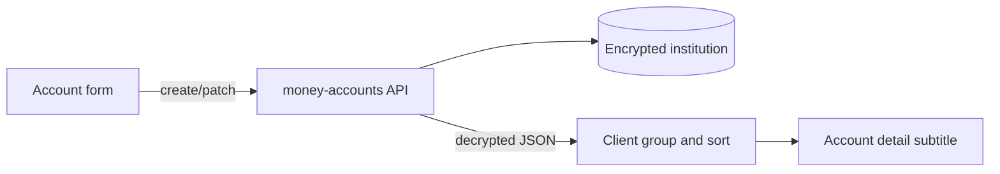

# Add optional institution to money accounts

## Impact verdict

**No — it will not break existing functionality** if institution is optional (`blank=True`, `null=True`).

| Area | Impact |
| --- | --- |
| Existing DB rows | Migration backfills null; no data migration required |
| Create/update API without `institution` | Still valid; field omitted or blank |
| Snapshots / upsert | Unchanged (keyed by account id + date) |
| Income streams / occurrences | Unrelated |
| Returns / demo overlay ([`mobile/utils/moneyReturns.ts`](mobile/utils/moneyReturns.ts)) | Still keyed by `account_type`; unaffected |
| Update balances wizard | Lists accounts by existing props; unaffected unless you re-sort |
| Balance reminder emails | Unchanged; still ordered by `account_type`, `id` |

Soft impacts only:
- API responses gain a new `institution` field (old clients ignore it).
- Once the mobile list groups by institution, existing blank accounts land under “Other” until edited.
- Backend `Meta.ordering` stays `['account_type', 'id']` — encrypted fields cannot be usefully ordered in SQL; grouping/sort happens in the client after decrypt (same constraint as encrypted `name`).

## Current state

[`Account`](backend/money/models.py) fields today: `family`, `name` (encrypted), `account_type`, `notes` (encrypted), `is_active`, timestamps. Default ordering: `['account_type', 'id']`.

UI create/edit in [`money.tsx`](mobile/app/(tabs)/money.tsx) only collects name + type (+ initial balance on create). List shows name, type label, as-of, balance — flat map, no grouping.

## Chosen approach

**Optional free-text encrypted `institution`**, matching `name` / `notes` privacy (not a FK lookup table).

Why:
- Matches examples like “BMO” / “Sun Life” and custom names.
- Institution identifies where money is held; encrypt like account name.
- Client-side group/sort after API decrypt — already the plan for UI grouping.
- Avoids maintaining a global institution catalog.

Schema:

```python
institution = EncryptedCharField(max_length=100, blank=True, null=True)
# Keep Meta.ordering = ['account_type', 'id']  # do not order_by encrypted institution
```

## Implementation

### Backend
- Add field + migration on [`backend/money/models.py`](backend/money/models.py) using `EncryptedCharField` (same import as `name`)
- Expose on [`AccountSerializer`](backend/money/serializers.py) `fields`
- Do **not** add institution to admin `list_filter` / searchable filters (ciphertext); optional detail form field only, like other encrypted account fields
- Leave reminder `.order_by('account_type', 'id')` unchanged

### Mobile
- Extend [`MoneyAccount` / create/update types](mobile/types/money.ts) (`institution: string | null`)
- Account form in [`money.tsx`](mobile/app/(tabs)/money.tsx): optional Institution text input; save/load with create/edit (send `null` or omit when blank)
- Accounts list: group by institution (empty/null → “Other”), sort groups A–Z, accounts within group by type then name
- Show institution in row subtitle and [`AccountDetailModal`](mobile/components/money/AccountDetailModal.tsx)
- Sort [`UpdateBalancesWizard`](mobile/components/money/UpdateBalancesWizard.tsx) the same way for consistency

[`moneyService.ts`](mobile/services/moneyService.ts) needs no logic change beyond types — it already posts/patches the payload object.



## What we will not change
- No new Institution model / FK
- No required validation (blank/null allowed)
- No DB-level `order_by('institution')`
- No changes to snapshot or income models
