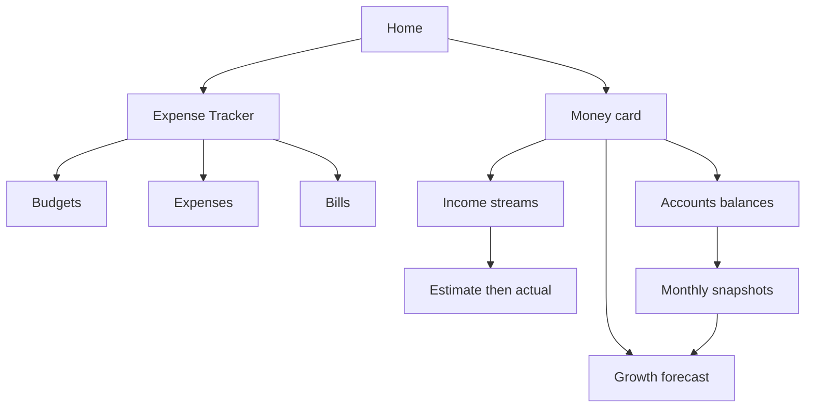

# Money — income, accounts, forecast (separate from Expense Tracker)

## Does this make sense?
**Yes.** You are describing three related jobs that are *not* expense budgeting:

1. **Income streams over time** — biweekly paychecks with varying estimates, then switch to pensions after retirement
2. **Account balances** — RRSP / TFSA / Non-reg / Cash with month-to-month actuals
3. **Forward looking** — growth scenarios (2.5% … 20%)

That is personal finance / retirement planning. Putting it inside Expense Tracker (budgets, bills, Update plan) would muddy spend limits and sync logic.

## Placement (chosen)
**New Home card: “Money”** — not Settings, not a tab inside Expense Tracker.

| Surface | Role |
|---------|------|
| **Expense Tracker** (existing) | Spend: Budgets, Expenses, Bills |
| **Money** (new) | Earn + save + project: Income, Accounts, Forecast |
| Settings | Connections only — not day-to-day money entry |

Later (optional): a small “Net this month” link between Money income and Expense Tracker spend. Not required for v1.

---

## Product model (matches your story)

### 1. Income streams
A stream is a named cash source with a schedule and a life span:

- **Work paycheck** — every 2 weeks; start now; **end ~ April 2027**
- **CPP / OAS** — monthly; **start ~ Dec 2027**
- **EPCOR pension** — monthly; **start ~ Dec 2027**

Each scheduled date gets an **occurrence**:

| Field | Use |
|-------|-----|
| `estimated_amount` | What you plan for (taxes/CPP vary by month — edit per occurrence or use a default estimate) |
| `actual_amount` | What hit the bank (nullable until deposited) |
| `status` | estimated / received / skipped |

Workflow: generate upcoming occurrences from the stream → adjust estimates → when paid, enter actual and mark received.

Biweekly + monthly frequencies cover your case. “Varies by month” = edit that occurrence’s estimate (or set a new default on the stream for future ones).

### 2. Accounts (investments / cash)
Accounts such as **RRSP, TFSA, Non-Reg, Cash (savings)**:

- Opening / first balance = first **snapshot**
- Each month (or whenever you update): new snapshot with **actual balance**
- History = month-to-month chart/list

No need for full brokerage transaction import in v1 — balance snapshots are enough for tracking and forecasting.

### 3. Forecast
From latest snapshot(s), project forward at selectable annual growth rates: **2.5%, 3%, 4%, … up to 20%** (step ~0.5% or preset chips). Show projected balance by month/year for one account or total portfolio. Purely calculative (no backend Monte Carlo in v1).

---

## Why not Settings / Expense Tracker
- **Settings** — wrong for weekly paycheck updates and forecasts
- **Inside Budgets/Bills** — budgets mean “spend vs limit”; paychecks/pensions/RRSP are different; Update plan must stay bill-driven

---

## Backend (new app or `backend/money/`)
Prefer a dedicated Django app `money` (keeps `expenses` clean):

**IncomeStream** — family, name, type (employment / pension / other), frequency (`biweekly` / `monthly`), `default_estimate`, `start_date`, `end_date` (nullable), `is_active`

**IncomeOccurrence** — stream FK, `due_date`, `estimated_amount`, `actual_amount` (nullable), `status`, notes

**Account** — family, name, type (rrsp / tfsa / non_reg / cash / other), currency, `is_active`

**AccountSnapshot** — account FK, `as_of_date`, `balance`, notes

APIs: CRUD + `generate_occurrences` (date range) + list snapshots by account + optional portfolio summary.

Encryption: same encrypted money fields pattern as expenses.

---

## Mobile UX
New route e.g. [`mobile/app/(tabs)/money.tsx`](mobile/app/(tabs)/money.tsx) (or `money-hub`), Home card next to Expense Tracker.

**Tabs inside Money:**
1. **Income** — streams list; open stream → timeline of occurrences; edit estimate / enter actual; add stream (paycheck or pension with start/end)
2. **Accounts** — account cards with latest balance; history; “Update balance”
3. **Forecast** — pick account(s), growth rate chips, projection table/chart

Reuse period helpers / forms patterns from expenses; do **not** import budget sync or Update plan.

---

## Delivery phases

**Phase 1 — Foundation**
- Home Money card + hub shell
- Income streams + occurrences (biweekly/monthly, start/end, estimate→actual)
- Seed your mental model: one paycheck stream ending Apr 2027

**Phase 2 — Accounts**
- Accounts + monthly snapshots
- Month-to-month history view

**Phase 3 — Forecast + pensions**
- Growth forecast 2.5%–20%
- Add pension streams with Dec 2027 start (same stream UI — no special retirement mode)

**Phase 4 (optional later)**
- Cross-link Money income vs Expense Tracker spend (net cashflow)
- Contribution/withdrawal lines on accounts
- Rename Expense Tracker → under a broader “Finances” umbrella

---

## Hard constraint: manual entry only
**No bank or brokerage sync** — ever in this plan’s scope. All paychecks, pensions, and account balances are entered by you (estimate → actual, monthly snapshots). No Plaid/Open Banking, no CSV import requirement, no broker APIs.

## Explicit non-goals (v1–3)
- Mixing income into expense budgets or Update plan
- Bank/brokerage sync (see hard constraint above)
- Tax filing / precise CPP deduction engine (you enter estimates manually)
- Monte Carlo / inflation-adjusted planning suite

---

## Success criteria (your scenarios)
- Enter biweekly paycheck estimates through Apr 2027; update each deposit with actuals
- After retirement date, paycheck stream ends; CPP/OAS + EPCOR streams start Dec 2027 with monthly estimates/actuals
- Record RRSP/TFSA/Non-reg/Cash balances and see history month to month
- Forecast those balances at 2.5%–20% growth
- Expense Tracker behavior unchanged

---

## Key files (when implementing)
- New: `backend/money/` (models, serializers, views, urls, migrations)
- New: `mobile/app/(tabs)/money.tsx` (+ components under `mobile/components/money/`)
- Update: [`mobile/app/(tabs)/index.tsx`](mobile/app/(tabs)/index.tsx) Home card, [`_layout.tsx`](mobile/app/(tabs)/_layout.tsx) route
- Leave: [`expenses-hub.tsx`](mobile/app/(tabs)/expenses-hub.tsx) and expense budget sync untouched
