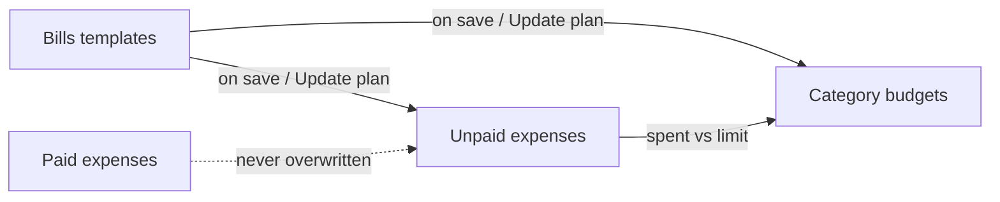

# Bills-first sync and simpler UI

## Recommendation (short)

Treat **bills (recurring templates) as the source of truth** for planned money. Expenses show what was generated/paid. Budgets are **category monthly limits derived from active bills**. Users should rarely need to touch Generate or Create Budget separately.

**Why not only a wizard?** A wizard helps once, but the pain (Sept budgets missing EPCOR/Telus, inactive flags, two dry-runs in different places) is **drift after edits**. Sync on change + one hub fixes that.

**Why not full redesign of Expenses?** Day-to-day add/pay/scan already works. Keep Expenses as the spending view; move planning (bills + limits) into one place.

---

## Product rules (lock these)

1. **Bills drive the plan** — amount, category, start/end, active on a bill update:
   - unpaid generated expenses (already via `sync_all_generated_from_template` in [`backend/expenses/views.py`](backend/expenses/views.py) `perform_update`)
   - the **category budget** amount and end date (new: auto-call budget sync logic from create_from_recurring)
2. **Budget start date** = earliest active bill start in that category (not “month Create was run”). Fixes Sept-only Food & Dining when EPCOR/Telus start in Sept.
3. **Paid expenses never change** from bill sync (already true).
4. **Manual budget edits** are allowed but marked “custom”; next bill sync can offer “reset from bills” or keep higher amount (current keep-higher behavior stays for amount).
5. **One Update plan action** = Generate missing unpaid expenses + sync budgets (preview → apply). Replaces separate mental models of Generate vs Create Budget for normal use.

---

## UI shape

### Keep
- **Expenses tab** — period view, paid vs budget, add/edit/pay, receipt scan. Soften inline budget edit to “Adjust limit” with note that bills may update it.

### Replace as primary path
- **Recurring tab** + **Settings → Budgets / Create Budgets** become one **Bills & Budgets** screen (new route under Expenses or Settings entry that opens the same hub).

### Bills & Budgets hub (simple)
- **Bills** list: one row per template (default flat; drop day/week/year explode as default—hide under “Calendar view” or remove later).
- **This month** summary: category totals from bills due this month vs budget limit vs spent (read-only bridge to Expenses).
- Primary CTA: **Update plan** → wizard steps below.
- Secondary: Add bill, Add/adjust budget (advanced).

### Update plan wizard (phases, reuse ReceiptScanWizard / dry-run pattern)
1. **Review bills** — active count, inactive callouts, Sept/Oct starts called out in plain language.
2. **Expenses preview** — creates / updates / skips (paid) from current Generate dry-run.
3. **Budgets preview** — creates / updates per category from create_from_recurring dry-run (with start = earliest bill).
4. **Apply** — run both for real; short success summary.

First-time empty state: same wizard as “Get started.”

---

## Backend changes (sync)

| Trigger | Behavior |
|---------|----------|
| Save / activate bill | Sync unpaid expenses (existing) + upsert category budget from active bills in that category (amount from recurring dues, start = min bill start, end = max bill end or open) |
| Deactivate / end bill | Recompute category budget; if no active bills left, leave budget but don’t inflate from that bill |
| Update plan wizard | `generate` + `create_from_recurring` in one API or sequential client calls with shared preview |

Concrete touchpoints:
- Extend bill `perform_update` / create in [`backend/expenses/views.py`](backend/expenses/views.py) to call shared “sync budget for category” helper (extract from `create_from_recurring`).
- Change `desired_start` in create_from_recurring from **current month** to **earliest active recurring start in category** (clamped not before that; do not invent Jan 1).
- Optional: `POST /expenses/sync-plan/` that returns combined dry-run then apply—keeps wizard simple.

---

## What we simplify / deprecate in UI

- Remove or bury Recurring **Group by** day/week/year (occurrence explosion) — main source of “Template vs Generated” confusion on the bills list.
- Stop requiring Settings → Budgets → Create for normal sync; Manage Budgets year grid becomes **optional detail** linked from the hub (“Year overview”).
- Collapse duplicate “How this works” walls into one short line on the hub + wizard copy.

---

## Implementation order

1. **Backend sync helper** — budget upsert from category bills; earliest-start rule; hook on bill save.
2. **Combined preview/apply** API or thin client orchestration of existing generate + create_from_recurring.
3. **Bills & Budgets hub** screen + Update plan wizard.
4. **Wire navigation** — Expenses Recurring tab → hub (or rename tab to Bills); Settings Budgets → same hub; keep manage-budgets as Year overview.
5. **Copy cleanup** — remove conflicting help that says Create Budget lives only in Settings.

---

## Out of scope (for later)

- Changing how spent is calculated on Expenses.
- Auto-paying or auto-matching bank feeds.
- Reports tab.
- Forcing budget start back to Jan for all historical months.
