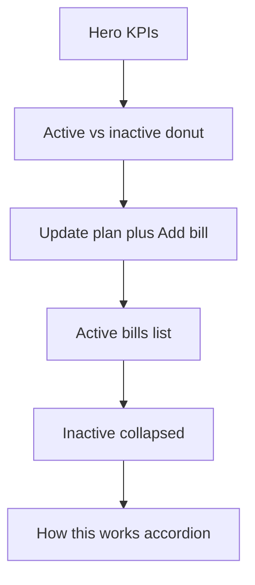

# Bills Board Tab

## Naming and placement
- Keep existing **Bills** tab (`BillsBudgetsHub` in [`expenses-hub.tsx`](mobile/app/(tabs)/expenses-hub.tsx)) unchanged
- Add **Bills board** (id `bills-board`) immediately **before** Bills
- New component: [`BillsDashboard.tsx`](mobile/components/expenses/BillsDashboard.tsx)

Tab order: Overview · Budgets · Expenses · **Bills board** · Bills · Categories

## Purpose (keep front-and-center)
Bills are recurring templates. They drive unpaid expenses and category budget limits. Paid expenses are never overwritten. Update plan = full refresh with preview (first setup / lots of changes). Saving a single bill already syncs that bill’s unpaid rows and category budget.

## Approach
Same pattern as Expense board: new dashboard owns its data/UI; old Bills stays as the comparison manage surface. Reuse form/wizard locally on the dashboard.

## Layout (match other boards)
1. **Hero card** — eyebrow “Bills drive the plan”; KPIs: Active bills · Category budgets · This month limits (reuse current sums from `getBudgets(familyId, true)`)
2. **Donut section** — Active vs inactive bill amounts (or counts if all amounts zero); reuse [`DonutChart`](mobile/components/expenses/charts/DonutChart.tsx)
3. **Action row** — primary **Update plan**, secondary **Add bill** (Expenses-style action row)
4. **Active bills** — section card; reuse [`RecurringExpenseRow`](mobile/components/expenses/RecurringExpenseRow.tsx) (tap edit, trash delete with confirm)
5. **Inactive** — collapsed accordion when any inactive bills exist
6. **How this works** — collapsible (Budget-style), not info modal:
   - Active bills keep unpaid expenses and category budgets in sync
   - Add/edit a bill syncs that bill; use Update plan for full refresh/preview or first setup
   - Paid expenses stay as-is; manual budget edits can be overwritten on next sync
7. Empty: “Add rent, utilities, and subscriptions, then run Update plan.”

## Functionality preserved
- Add / Edit bill via local `RecurringExpenseForm`
- Delete bill with confirm then `deleteRecurringExpense`
- Update plan via local `UpdatePlanWizard`; on apply reload and call `onPlanApplied`
- Self-load recurring + active budgets + categories; family clear/generation guards; optional `refreshKey`

## Hub wiring
- [`expenses-hub.tsx`](mobile/app/(tabs)/expenses-hub.tsx): add `bills-board` tab before `bills`; render `BillsDashboard` with `refreshKey={budgetsRefreshKey}` and `onPlanApplied`
- Leave [`BillsBudgetsHub.tsx`](mobile/components/expenses/BillsBudgetsHub.tsx) and standalone [`bills-budgets.tsx`](mobile/app/(tabs)/bills-budgets.tsx) untouched

## Out of scope
- Removing or changing the current Bills tab / BillsBudgetsHub
- Changing Update plan / sync API behavior
- Auto-sync redesign

## Deliverable
- Wire new tab + implement `BillsDashboard`
- Rebuild web `dist`
