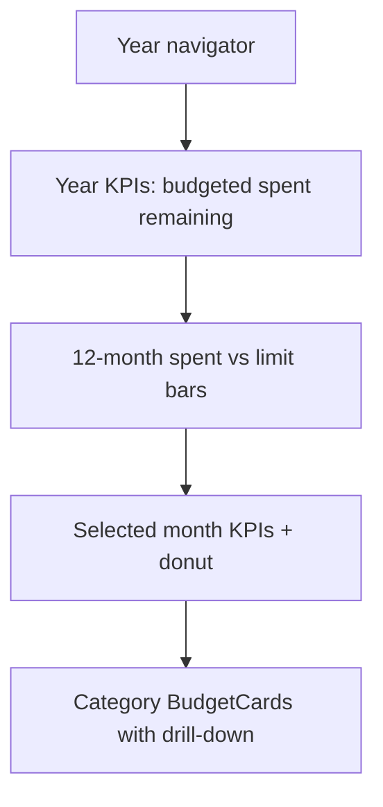

# Budget Board Tab

## Naming and placement
- Keep existing **Budgets** tab → [`MonthBudgetCards.tsx`](mobile/components/expenses/MonthBudgetCards.tsx) unchanged
- Add **Budget board** tab (id `budget-board`) immediately after Budgets so you can compare side by side
- New component: [`BudgetDashboard.tsx`](mobile/components/expenses/BudgetDashboard.tsx)

Tab order becomes: Dashboard · Budgets · **Budget board** · Expenses · Bills · Categories

## Layout (mirror Dashboard chrome)



1. **Year hero** — total budgeted, total spent (paid), remaining or over; short captions
2. **12-month bars** — spent vs limit per month (reuse/extend chart style from [`MonthCashflowBars`](mobile/components/expenses/charts/MonthCashflowBars.tsx) or a small `MonthBudgetBars` twin); tap selects month
3. **Selected month** — KPI strip (budgeted / spent / left / %) + donut (spent vs remaining, over-budget as error slice)
4. **Category drill-down** — same [`BudgetCard`](mobile/components/expenses/BudgetCard.tsx) list as today (edit, delete, expand items, paid toggle, receipt, expense press) so behavior stays identical

Default selected month: current month in current year; otherwise latest month with budgets (same idea as [`defaultDashboardMonthIndex`](mobile/utils/cashflow.ts)).

## Functionality preserved (via same hub callbacks + BudgetCard)
| Action | How |
|--------|-----|
| Edit budget | `onBudgetPress` → hub `BudgetForm` |
| Delete budget | confirm in board → `onBudgetDelete` |
| Edit expense | `onExpensePress` → hub expense editor |
| Paid toggle | local `updateExpense` + cache update (same as MonthBudgetCards) |
| Receipt preview | BudgetCard built-in |
| Help | compact “How this works” collapsible (same copy) |
| Family / refresh | generation + familyId guards; `refreshKey` + remount `key={familyKey}` |

## Data loading
Same APIs as MonthBudgetCards (self-contained, not hub period state):
- Load 12 months of active budgets: `getBudgets(familyId, true, { asOf: 'YYYY-MM-01' })`
- Lazy-load selected month expenses on first select/expand: `getExpenses` for that month range
- Spent = paid expenses once loaded; else `budget.spent_amount`

Small helper in a new util or beside the component, e.g. `buildMonthlyBudgetSeries(budgetsByMonth, expensesByMonth, year)` → per-month `{ budgeted, spent, remaining, pct, budgets[] }`.

## Hub wiring
In [`expenses-hub.tsx`](mobile/app/(tabs)/expenses-hub.tsx):
- Extend `HubTab` with `'budget-board'`
- Insert tab after Budgets
- Wire identical callbacks as Budgets:

```tsx
<BudgetDashboard
  key={familyKey}
  refreshKey={budgetsRefreshKey}
  onExpensePress={(exp) => void openExpenseEditor(exp)}
  onBudgetPress={(budget) => { setEditingBudget(budget); setShowBudgetForm(true); }}
  onBudgetDelete={handleDeleteBudget}
/>
```

## Charts
Reuse existing SVG stack under `mobile/components/expenses/charts/`:
- New `MonthBudgetBars.tsx` (spent + limit dual bars, selectable) — parallel to cashflow bars
- Reuse `DonutChart` for month spent vs remaining

## Deliverable
- Web `dist` rebuild after implementation
- Do **not** remove or change the Budgets tab until you say so
