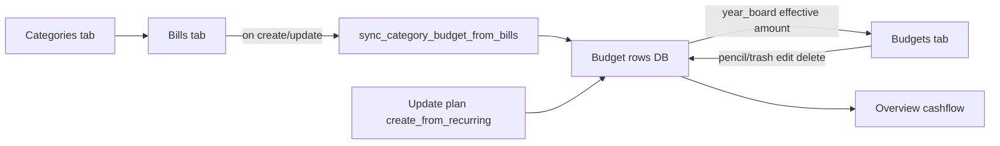

# Budget management clarity

## Current system (what the code actually does)

### Storage
- Model: [`backend/expenses/models.py`](backend/expenses/models.py) `Budget` — one row per family+category (typical), fields: `amount` (standing monthly Decimal), `period`, `start_date`, `end_date`, `alert_threshold`, `is_active`.
- **No month rows.** Month limits are computed in [`BudgetSerializer`](backend/expenses/serializers.py): API `amount` = **effective** (`max(standing, bill dues in window)`); `base_amount` = stored standing.
- No `source` / `manual` flag today.

### Create paths today
| Path | Behavior |
|------|----------|
| Bill create/update | Calls `sync_category_budget_from_bills` ([`views.py`](backend/expenses/views.py) ~1430, ~1608) — upserts standing from **non-seasonal monthly** bills; yearly/seasonal contribute 0 to standing |
| Bills **Update plan** | `create_from_recurring` — create/update/reactivate; can **deactivate** budgets with no recurring/expense source |
| Budgets UI | Pencil opens [`BudgetForm`](mobile/components/expenses/BudgetForm.tsx); hub can `createBudget` if `editingBudget` is null — but **nothing sets that** (only `onBudgetPress(existing)`). Help text: “This tab does not create budgets.” |

### Edit / delete today
- **Edit standing:** Budgets pencil → saves `amount` (form correctly loads `base_amount`).
- **Bill sync overwrite:** [`budget_sync.py`](backend/expenses/budget_sync.py) **always sets standing = bill target** when any active bill remains (docstring still says “keep higher” — stale/wrong).
- **Last bill removed:** sync returns `None` → **budget left as-is** (orphan standing, e.g. Food $500).
- **Delete:** Budgets trash → API delete. Bill delete does not prompt about budget.

### Display today
- Budget cards show **effective** `budget.amount` only ([`BudgetCard.tsx`](mobile/components/expenses/BudgetCard.tsx)) — no “Standing vs This month”.
- Overview uses year_board effective totals (correct for cashflow; confusing when standing ≠ effective).

---

## Problems and risks

Confirmed by codebase review ([budget backend map](7c9429c6-f91c-4b3f-9a28-696d23cad574)):

1. **Split brain ownership** — Bills create; Budgets claim they don’t; create API exists but UI hides it → Food-style envelopes are hard to discover.
2. **Silent overwrite** — Manual standing (or raised envelope) is reset on next bill save for that category (`sync_category_budget_from_bills` always follows bill target).
3. **Stale docstring / mental model** — Sync docs say “keep higher”; code overwrites. Help text says limits “come from bills” only.
4. **Orphan budgets** — Bill **delete does not call sync**; removing all bills leaves standing until Update plan. Update plan with `analyze_expenses=false` treats non-recurring budgets as stale and **deactivates** them (kills manuals/analysis).
5. **Category move on a bill** — Only the **new** category is synced; old category standing can stay inflated.
6. **No unique constraint** on `(family, category, period)` — multiple monthly rows possible; sync uses `.first()` / `-updated_at` (ambiguous).
7. **Standing vs effective confusion** — List shows effective only; form edits `base_amount`. Yearly/seasonal standing is 0 by design.
8. **Update plan opacity** — Preview mixes expense reconcile with budget create/update/deactivate; `sources==both` keep_higher only on full plan, not per-bill sync.
9. **Risk if we only add UI “Add budget” without origin** — Next bill sync still wipes Food $500 when a dining bill is added/edited.
10. **Ensure year ≠ Update plan** — Ensure-year modal only reconciles unpaid bill expenses; does not sync budgets. Easy to assume it “fixes” limits.
11. **Delete confirm / list use effective `amount`** — Can disagree with standing the user last edited; no Standing vs This-month labels on [`BudgetCategoryRow`](mobile/components/expenses/BudgetCategoryRow.tsx).
12. **Dead client path** — `createBudgetsFromRecurring` never called from UI (only via `syncPlan`); `BudgetCard` unused (list is `BudgetCategoryRow`).

---

## Scope

Full plan (user choice B): origin field, protect manuals, Add budget, Standing vs This month, pencil-edit takes ownership (`bills` → `manual`), and last-bill delete prompts before deactivating a `bills` budget.

## Existing data strategy (clean rebuild, not soft backfill)

Live check: 17 active bills, 317 expenses, 12 active budgets, 0 duplicates. All 9 bill-backed standings already match bill targets. Three active budgets have no active bills (orphans): Food & Dining $500, Transportation $144, Personal Care $26.99.

**Keep:** all bills, all expenses, Money data. Do not wipe those.

**Budgets:** rebuild with a management command after `origin` lands. No soft “guess origin on old rows” forever.

1. `python manage.py rebuild_budgets_from_bills`: deactivate or delete every Budget, recreate one monthly row per category with active bills (`origin=bills`), print orphan report (category + old amount).
2. Re-add intentional envelopes with **Add budget** (`origin=manual`). That is the clean Food $500 path.
3. Optional `--keep-orphans-as-manual` only if you want those three kept without retyping. Default is wipe them so the model stays simple.

## Target design (locked decisions)

**Budgets = home for envelopes. Bills = optional feeder.**

1. Add DB field `Budget.origin`: `bills` | `manual` | `analysis`. New bill-synced rows are `bills`. New Add-budget rows are `manual`. Existing rows are fixed by the rebuild command, not by a guessing migration.
2. **Add budget** on Budgets tab → `origin=manual`.
3. Bill save syncs that category only:
   - `origin=bills`: standing follows bill monthly target (current per-bill sync).
   - `origin=manual`: skip amount entirely.
   - Existing `origin=analysis` rows stay as saved. New envelopes without a bill come from Add budget (`manual`). The "analyze past spending" checkbox goes away with Update plan.
4. **No user-facing Update plan.** Saving, editing, or deleting a bill is the whole sync. Opening another year still shows the existing year prompt when unpaid bill rows are missing. That prompt only fills expenses.
5. UI always show **Standing** (`base_amount`) and **This month** (effective `amount`) + badge Manual / From bills / Analysis.
6. Bill delete: if category has a `bills` budget and no bills left, offer deactivate/delete budget; if `manual`, leave alone with message. This replaces Update plan's stale-budget cleanup.

### Future years and seasonal (unchanged math)

**Future years (e.g. 2027 while today is 2026)**
- Saving a bill only generates unpaid expenses through the later of the current calendar year and the bill start year (open-ended), or through the bill end date. It does not invent every future year up front.
- Opening Budgets, Expenses, or Overview for a later year runs the existing year prompt (`ensure_year`, capped at current year + 5). Accepting it creates missing unpaid schedule rows for that year and removes unpaid off-schedule rows. Paid expenses stay. Standing budgets are not rewritten; the same Budget row applies in every year via year_board / as_of.
- Overview and Budgets still show This month = effective amount for that viewed month, not a separate per-year stored limit.

**Seasonal monthly bills**
- Standing contribution from a seasonal bill is **0** (`budget_sync` / `_normalize_to_monthly`). A bills-origin category that is only seasonal keeps standing 0 unless the user pencil-edits (then Manual) or Add budget set a standing.
- This month / effective = `max(standing, dues in that month)`. In-season months use the bill due; off-season months show standing only (often $0 if standing is 0).
- Expense generation for seasonal bills only creates rows in months inside the season window, including when ensure_year fills a future year.
- Yearly bills work the same pattern: standing 0 from the bill, effective rises only in the due month.

**What this plan changes for those cases**
- Labels (Standing vs This month) so off-season $0 and due-month jumps are readable.
- Manual standing survives a later seasonal bill save.
- No Update plan needed to "activate" a future year; the year prompt covers unpaid expenses.

---

## Implementation phases

### Phase 1 — Data model + sync safety (backend first)
**Files:** `models.py`, new migration, `budget_sync.py`, `views.py` (`create_from_recurring`, bill create/update/delete), `serializers.py`, `types/expenses.ts`.

- Add `origin` CharField with choices; schema default `bills` for new sync-created rows. Do not soft-classify orphans in the migration.
- Ship `python manage.py rebuild_budgets_from_bills` (Phase 1 verify step): wipe budgets, recreate From bills only, print orphan report.
- `sync_category_budget_from_bills`: if existing `origin == manual`, return without changing amount.
- When sync **creates** a new row → `origin=bills`.
- BudgetForm/API create from Budgets UI → `origin=manual`.
- User pencil-edit of a `bills` budget: flip `origin` to `manual` so raised envelopes stick.
- On bill **category change**: re-sync **old and new** category (or sync old after move).
- On bill **delete**: call sync for that category; if no bills left and `origin=bills`, deactivate (or leave inactive for UI prompt in Phase 3).
- Add uniqueness: one active monthly budget per `(family, category)` (clean duplicates in migration if any).
- Fix sync docstring to match behavior.
- Use `backend/venv` + `makemigrations` / `migrate`.

### Phase 2 — Budgets UI: create + clarity
**Files:** [`expenses-hub.tsx`](mobile/app/(tabs)/expenses-hub.tsx), [`BudgetDashboard.tsx`](mobile/components/expenses/BudgetDashboard.tsx), [`BudgetForm.tsx`](mobile/components/expenses/BudgetForm.tsx), [`BudgetCategoryRow.tsx`](mobile/components/expenses/BudgetCategoryRow.tsx) (primary list; not unused `BudgetCard`), help copy in Bills/Expenses if it still says “tab does not create”.

- Add **Add budget** control → `setEditingBudget(null); setShowBudgetForm(true)` (create path already in hub `handleSaveBudget`).
- Form: label amount “Standing monthly limit”; show read-only “This month (from bills)” when editing if effective ≠ standing; create sends `origin=manual`.
- Rows: badge + `Standing $X · This month $Y`; delete confirm prefer standing or show both.
- Rewrite Budgets/Bills help: saving a bill updates that bill and its From-bills limit. Add budget for a limit with no bill. Remove every "run Update plan" instruction.
- Unique category guard: can’t add second active monthly budget for same category (API validation).

### Phase 3 — Remove Update plan from the app
**Why it exists today:** [`sync_plan`](backend/expenses/views.py) loops every bill (`generate_expenses`) and then [`create_from_recurring`](backend/expenses/views.py) (rewrite all budgets, optional spending analysis, deactivate leftovers). Bill create/update already generate that bill's expenses and call `sync_category_budget_from_bills`. The button is a second pass plus a cleanup the user cannot see.

**Files:** [`BillsDashboard.tsx`](mobile/components/expenses/BillsDashboard.tsx), [`BudgetDashboard.tsx`](mobile/components/expenses/BudgetDashboard.tsx), [`UpdatePlanWizard.tsx`](mobile/components/expenses/UpdatePlanWizard.tsx), [`EnsureYearModal.tsx`](mobile/components/expenses/EnsureYearModal.tsx), hub wiring in [`expenses-hub.tsx`](mobile/app/(tabs)/expenses-hub.tsx).

- Remove the Update plan button, wizard, and help lines that tell the user to run it.
- Leave `sync_plan` on the server unused by the app (repair hook). Do not add a new user control for it.
- After deleting the last bill in a category: confirm dialog for `bills`-origin budgets. Manual budgets stay.
- Keep the year prompt. Copy: it adds or removes unpaid bill rows for that year. Paid rows stay. Budgets are unchanged because standing already applies to later months.

### Phase 4 — Overview alignment (light)
**Files:** [`CashflowDashboard.tsx`](mobile/components/expenses/CashflowDashboard.tsx) only if needed.

- Keep using effective month totals for Budget vs Actual (cashflow truth).
- Optional tooltip/meta: “Includes bill dues this month” — no math change.

### Verify (ownership)
- Migrate + API: manual Food not overwritten when a Food bill is saved; bill-only Rent still tracks bill amount.
- Add budget UI creates manual row; trash deletes; Bills has no Update plan button; saving a bill still updates that category's From-bills standing.
- `npm run build` in `mobile/`.

### Phase 5 — Encrypt standing amounts (after Phases 1–4)
User choice: same server-side at-rest encryption bills and expenses already use (`EncryptedCharField`). The server still decrypts to sync bills, compute This month, and total Overview. The phone still receives numbers over the API. Existing budget amounts are converted in place; no re-entry.

**Files:** [`backend/expenses/models.py`](backend/expenses/models.py) `Budget.amount` (today `DecimalField`), new data migration, [`serializers.py`](backend/expenses/serializers.py) write path (mirror `RecurringExpenseSerializer` `amount` / `amount_input`), [`budget_sync.py`](backend/expenses/budget_sync.py) writes (`existing.amount = str(target)`).

- Read path already uses `Decimal(str(obj.amount))` in sync and `_base_amount`, which matches decrypted `EncryptedCharField`.
- Data migration: for each `Budget`, read the current decimal and save it through the encrypted field. App displays the same numbers afterward.
- Do this only after origin/sync behavior is migrated and checked, so two schema changes are not applied in one step.
- Skip SQL filters or ordering on `amount` (ciphertext is not comparable in the database). Current budget math is already in Python.

---

## Rollback / undo

**Easy to undo**
- All app and backend code: git revert or reset the branch. Bills, Expenses, Overview go back to the previous UI and sync rules.
- Schema `origin` field: reversible Django migration removes the column.

**Harder / data**
- `rebuild_budgets_from_bills` is the risky step. It removes current Budget rows (including the three orphans). Bills and expenses are not touched. Before running it: dump budgets only (`dumpdata expenses.Budget` or a SQL backup). If rebuild is wrong, restore that dump, then revert code if needed.
- Pencil-edit flipping `bills` → `manual` is per-row; restore From-bills by deleting the Manual row and saving the bill again (sync recreates `origin=bills`), or restore from the budget dump.

**Do Phase 5 encrypt only after Phases 1–4 feel right.** Encrypting `Budget.amount` is reversible with another data migration if the encryption key is intact, but it is a second schema touch. Keep it last so a bad ownership rollout is not mixed with ciphertext.

**Practical safety order:** implement and test Phases 1–4 on this DB → run rebuild only after a budget dump → use the app for a bit → encrypt last.

## Out of scope (this plan)
- Per-month stored overrides (12 rows/year).
- End-to-end encryption where the server cannot read amounts (that would block bill sync and Overview totals).
- Redesigning Overview Outside-budget drill further.

## Success criteria
- User can create a Food envelope with no bill and it survives bill sync elsewhere.
- User can see why October ≠ standing (dues).
- Bills has no Update plan button. Saving a bill keeps that category current. Manual envelopes are left alone.
- Help text matches that: add or edit a bill, add a budget, or accept the year prompt when unpaid rows are missing.