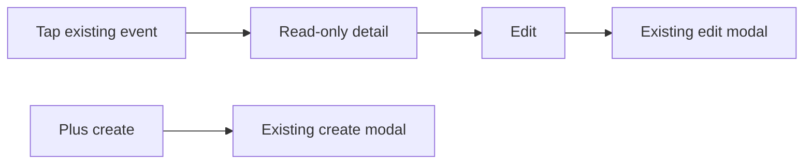

# Calendar: read-only event detail, then edit

## What the two-step UX feels like

**Step 1 – View (tap an event)**
A bottom sheet (or same modal shell you use today) that looks like a **summary**, not a form:

- **Title** as large plain text at the top (not `TextInput`).
- **When** as readable lines, e.g. “Starts …” / “Ends …” using `toLocaleString` or your preferred short format — no date/time pickers.
- **Location** as text if present; omit the row if empty.
- **Notes** in a **flexible, scrollable** area (`ScrollView` with `flex: 1` inside the modal body) using `**Text`** with `selectable` on native (optional on web) so long checklist bodies are easy to read; preserve line breaks (`\n` from checklist sync).
- Header actions: **Close** (X), optional **Delete** (if you want parity with the form).
- Primary action: **Edit** — transitions to step 2.

**Step 2 – Edit (unchanged behavior)**
**Edit** hydrates `formData` from `selectedEvent` and opens the **existing** modal content you already have in `[mobile/app/(tabs)/calendar.tsx](c:\dev\kewlkids\mobile\app\(tabs)`\calendar.tsx) (title field, start/end pickers, notes `TextInput`, color, Save, Delete, etc.). No need to duplicate save/delete logic.

**Create flow**
**+ Create** still sets `isEditing` false and opens the form directly — no detail step for new events.

## Implementation (single file first)

All logic today lives in `[calendar.tsx](c:\dev\kewlkids\mobile\app\(tabs)`\calendar.tsx): `handleSelectEvent` (lines 352–368) immediately sets form state and `setShowEventForm(true)`.

1. **State**
  - Add e.g. `showEventDetail` (boolean).
  - Keep `selectedEvent` as the source of truth for the detail view.
2. **Change `handleSelectEvent`**
  - Set `selectedEvent`, `setShowEventDetail(true)`, **do not** open `showEventForm` yet (or open a combined modal with `mode === 'detail'` first — see below).
3. **New handler `openEventEditForm`**
  - Copy the current `handleSelectEvent` body (populate `formData`, `setIsEditing(true)`, `setShowEventForm(true)`) and call it from the detail screen’s **Edit** button; then `setShowEventDetail(false)`.
4. **UI structure** (pick one)
  - **A. Two modals:** second `Modal` for detail (lighter markup), form modal unchanged. Close detail clears `selectedEvent` if needed.
  - **B. One modal, two panes:** `visible={showEventDetail || showEventForm}`; inside, if `showEventDetail` render detail layout; if `showEventForm` render existing `ScrollView` form. **Edit** sets `showEventDetail` false and `showEventForm` true. Slightly more branching but one overlay.
   Recommend **A** for clarity unless you strongly prefer one overlay.
5. **Detail layout notes**
  - Use `theme` colors like the form.
  - Notes: `ScrollView` + `Text` with `style={{ flexGrow: 0 }}` on inner content; give the notes region `minHeight` or `flex: 1` so it consumes space under the fixed header block on tall screens.
6. **Delete (optional)**
  - On detail, **Delete** can call `setShowDeleteModal(true)` — `AlertModal` already uses `selectedEvent` (lines 1609–1617). After delete, close detail and clear selection (mirror form close handlers).
7. **Voice / other callers**
  - Anything that calls `handleSelectEvent` will show detail first; if voice should jump straight to edit, add an optional parameter `skipDetail?: boolean` — only if you need it.
8. **Future polish (out of scope unless requested)**
  - If API exposes `list_section`, show a small “From checklist” badge on the detail screen.

## Files

- Primary: `[mobile/app/(tabs)/calendar.tsx](c:\dev\kewlkids\mobile\app\(tabs)`\calendar.tsx).
- Optional extract: `components/calendar/EventDetailModal.tsx` if the JSX grows large.

## Verification

- Tap event from month list / agenda / week / day: detail opens; notes scroll; no inputs focused.
- Edit: form opens with same data as today; save/cancel/delete behave as now.
- Plus: still create mode, no detail.
- Close detail without editing: calendar state unchanged aside from dismissal.

