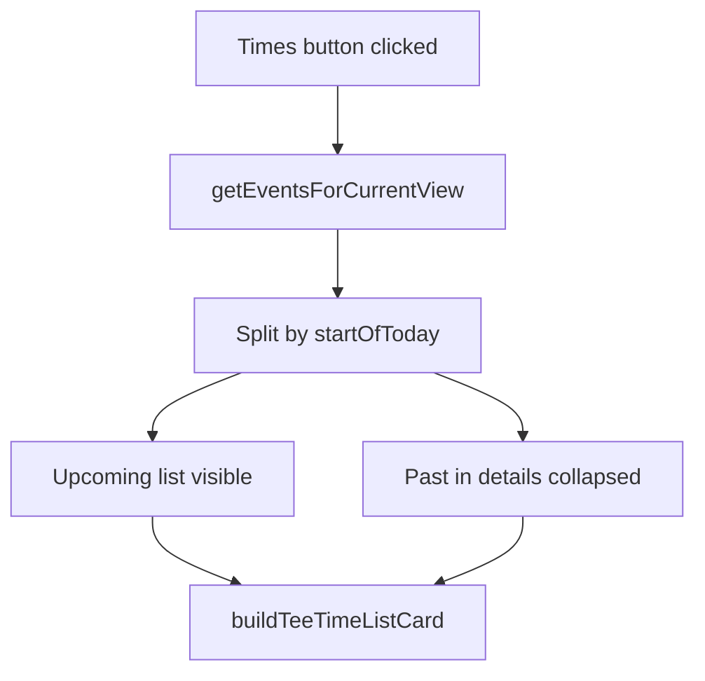

# Calendar Times: Upcoming First, Past in Dropdown

## Current behavior

The **Times** button on the calendar calls `showViewTeeTimesModal()` in [`templates/main/calendar.html`](templates/main/calendar.html). It:

1. Loads events via `getEventsForCurrentView()` (filtered to the current month/week/day range)
2. Sorts all events ascending by start time
3. Renders every event in a flat list — including times that already happened

Backend pages [`my_tee_times`](main/views.py) / [`all_tee_times`](main/views.py) already use `_upcoming_events_queryset()`, which treats **start of today** as the cutoff (`start_time >= start_of_today`).

## Desired behavior

Within the current calendar view period:

- **Upcoming section (visible):** tee times with `start >= start of today` (local timezone), sorted soonest first
- **Past section (collapsed):** tee times with `start < start of today`, in a `<details>` disclosure labeled e.g. **Past tee times (3)**, sorted most-recent-first inside the dropdown
- **Empty states:**
  - No events in period → keep existing “No tee times scheduled for this period.”
  - Only past events → show a short “No upcoming tee times” note above the collapsed past section
  - Only upcoming → no past section



## Implementation (client-side only)

No backend or migration changes — FullCalendar already has all events loaded.

### 1. Add partition helper in [`templates/main/calendar.html`](templates/main/calendar.html)

Add a helper near `getEventsForCurrentView()`:

```javascript
function getStartOfToday() {
    const now = new Date();
    return new Date(now.getFullYear(), now.getMonth(), now.getDate());
}

function partitionViewTeeTimes(events) {
    const startOfToday = getStartOfToday();
    const upcoming = [];
    const past = [];
    events.forEach(function(ev) {
        if (ev.start >= startOfToday) upcoming.push(ev);
        else past.push(ev);
    });
    upcoming.sort((a, b) => a.start - b.start);
    past.sort((a, b) => b.start - a.start); // newest past first
    return { upcoming, past };
}
```

### 2. Update `showViewTeeTimesModal()`

Replace the flat `events.forEach(...)` loop with:

1. Call `partitionViewTeeTimes(events)`
2. Render upcoming cards into `#viewTeeTimesList`
3. If `past.length > 0`, append a `<details class="view-tee-times-past">` with:
   - `<summary>Past tee times (N)</summary>`
   - Inner container with past cards (reuse `buildTeeTimeListCard`)
4. Adjust empty-state logic:
   - `events.length === 0` → show `#viewTeeTimesEmpty`
   - `upcoming.length === 0 && past.length > 0` → hide full empty message; show inline “No upcoming tee times” + past `<details>`

Existing card builder and edit/view click handlers stay unchanged.

### 3. Modal markup (optional tweak)

[`templates/components/view_tee_times_modal.html`](templates/components/view_tee_times_modal.html) can stay as-is — the past `<details>` block can be appended by JS into `#viewTeeTimesList`. Optionally add a placeholder comment for clarity.

### 4. Styles in [`static/css/style.css`](static/css/style.css)

Add styles under the existing “View times modal” section:

- `.view-tee-times-past` — top margin, border-top separator from upcoming list
- `.view-tee-times-past summary` — clickable row with chevron (via `list-style` / `::marker` or a small Font Awesome chevron), font-weight 600, muted color
- `.view-tee-times-past[open] summary` — optional active state
- `.view-tee-times-upcoming-empty` — subtle message when only past times exist
- Dark theme variants using existing CSS variables (`--text-muted`, etc.)

Use native `<details>/<summary>` for accessibility — no extra toggle JS.

### 5. Verify

- Month view spanning past + future dates: upcoming on top, past collapsed
- Week/day view on today: morning times before today’s midnight cutoff are past; all of today’s times are upcoming
- Past-only month (e.g. navigate to last month): “No upcoming tee times” + collapsed past list
- Future-only period: upcoming only, no past section
- Run `collectstatic` after CSS change if you deploy from `staticfiles/`

## Files touched

| File | Change |
|------|--------|
| [`templates/main/calendar.html`](templates/main/calendar.html) | Partition helper + updated modal render |
| [`static/css/style.css`](static/css/style.css) | Past disclosure + empty-state styles |

## Out of scope

- Changing My/All Tee Times pages (already upcoming-only)
- Filtering past events out of the calendar grid itself
- Server-side API changes
