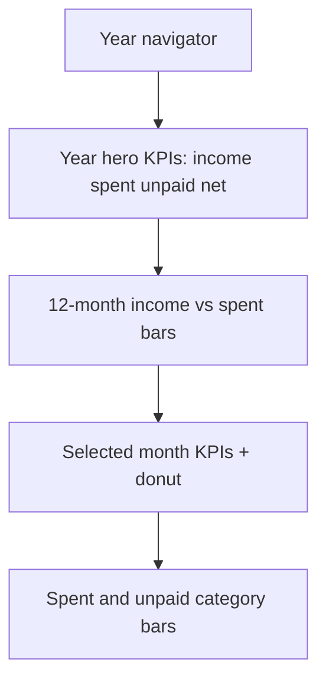

# Cashflow Dashboard Tab

## Naming
- Existing tab stays **Reports** → [`CashflowReport.tsx`](mobile/components/expenses/CashflowReport.tsx) (no behavioral changes)
- New tab **Dashboard** → new [`CashflowDashboard.tsx`](mobile/components/expenses/CashflowDashboard.tsx)

## Layout (A + B + C in one scroll)

1. **Year-first hero (C)** — year prev/next; three headline totals for the year (income, spent+unpaid, net) with short captions.
2. **Multi-month trend (B/C)** — 12 grouped bars (income vs spent) for Jan–Dec; tap a month to select it. Net line or net tint under bars as a secondary cue.
3. **This-month visual (A)** — for the selected month: KPI strip (in / spent / unpaid / net), donut of paid vs unpaid outflow (or income vs outflow), horizontal bars for spent-by-category and unpaid-by-category (top categories).
4. Reuse [`buildCashflowSummary`](mobile/utils/cashflow.ts) and [`useShowAmounts`](mobile/contexts/ShowAmountsContext.tsx) / `displayMoney` so amounts stay masked consistently.

Default selected month: current calendar month when viewing the current year; otherwise the latest month in that year that has activity (fallback: Dec).

## Charts (no new dependency)
Use existing `react-native-svg` (already in [`package.json`](mobile/package.json)) with small local primitives under `mobile/components/expenses/charts/`:
- `DonutChart.tsx` — arcs + center label
- `MonthCashflowBars.tsx` — 12 dual bars (income / spent), selectable
- `CategoryHBars.tsx` — horizontal proportional bars

Theme via `useTheme()` colors (success / error / primary / border) — match Expense Tracker, not a new purple/cream look.

## Data loading
Mirror family-isolation patterns from Reports ([`CashflowReport`](mobile/components/expenses/CashflowReport.tsx)): clear on family change, generation + `selectedFamilyIdRef` guards, `key={familyId}` remount from hub.

Per selected **year** (one fetch, then slice client-side):
- Ensure income schedule for that year (same `generateOccurrences` approach as Reports)
- `getOccurrences` + `getExpenses` for `YYYY-01-01` … `YYYY-12-31`
- Optional: budgets for selected month only (asOf) for a “vs budget” chip on the month strip — keep light; year chart stays income/spent focused

Add a small helper in [`cashflow.ts`](mobile/utils/cashflow.ts), e.g. `buildMonthlyCashflowSeries(occurrences, expenses, year)` → 12 `CashflowMonthSummary` entries.

## Hub wiring
In [`expenses-hub.tsx`](mobile/app/(tabs)/expenses-hub.tsx):
- Extend `HubTab` with `'dashboard'`
- Insert tab **Dashboard** (icon `dashboard` / `tachometer`) **before** Reports
- `case 'dashboard': return <CashflowDashboard key={familyKey} />`
- Leave Reports case as-is

## Deliverable
- Build web `dist` after implementation so organizer.kewlkids.ca picks it up on hard refresh
- Backend unchanged
