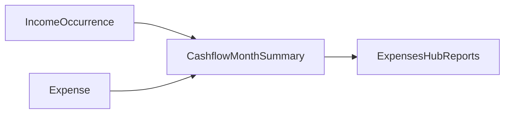

# Cashflow: Incoming vs Expenses

## What you already have

- **Money** already tracks incoming money: IncomeStream + IncomeOccurrence (estimate to actual, calendar totals).
- **Expenses** tracks outgoing: one-off expenses, bills that generate expenses, category budgets (spent = paid only).
- The two domains share only family — no join UI, no cashflow API, no account FKs.

So the gap is not add income. It is one place that puts income next to spending for the same period.

## Recommendation: build Cashflow first (not a ledger)

Skip bank sync and a full transaction ledger for now. Account snapshots cannot explain why balances moved. You already have the two event streams that matter:

- In: IncomeOccurrence (`due_date`)
- Out: Expense (`expense_date`)

Highest value, lowest cost: a **month Cashflow** view that answers how much came in, how much went out, and what is left.

### Where it lives

Replace the Reports stub in [mobile/app/(tabs)/expenses-hub.tsx](mobile/app/(tabs)/expenses-hub.tsx) (Reports coming soon). That tab is the natural home for comparative analytics; Money stays focused on income schedule plus portfolio YTD/target.

### What the Reports / Cashflow screen shows

For a selected month:

1. **Income** — sum of occurrences in range: received uses actual_amount; estimated uses estimated_amount; skipped excluded
2. **Spent** — sum of expenses with is_paid=True in range (matches budget spent rules)
3. **Planned / unpaid** — sum of unpaid expenses in range, shown separately so net is not misleading
4. **Net** — Income minus Spent (primary), with Planned as a secondary after-bills line if useful
5. **Simple breakdown** — income by stream, expenses by category

Visual: one composition — big Net, then Income vs Spent, then light breakdown lists.

### Implementation shape

- Client-first for v1: load occurrences via existing money APIs plus expenses for the month; aggregate in a small util such as `mobile/utils/cashflow.ts`
- Optional backend later: `/api/cashflow/summary/` if the client join gets heavy — not required for first ship
- Wire into the existing reports tab; reuse [mobile/utils/expensePeriods.ts](mobile/utils/expensePeriods.ts) and [mobile/types/money.ts](mobile/types/money.ts)

### Explicit non-goals for this step

- Linking expenses to money accounts / auto-updating snapshots
- Full transaction ledger or bank import
- Replacing budgets (budgets stay category limits; cashflow is period net)

## What to add after Cashflow lands

1. Year Cashflow — same rules, 12-month chart
2. Planned month — income estimates vs unpaid bill plan before the month starts
3. Account linkage only if you care where money sits — optional FK from expense/income to money.Account

## Why this order

Income and expenses already exist; joining them unlocks incoming vs expenses immediately. A ledger is a larger product change with little extra answer until you also track every transfer.
