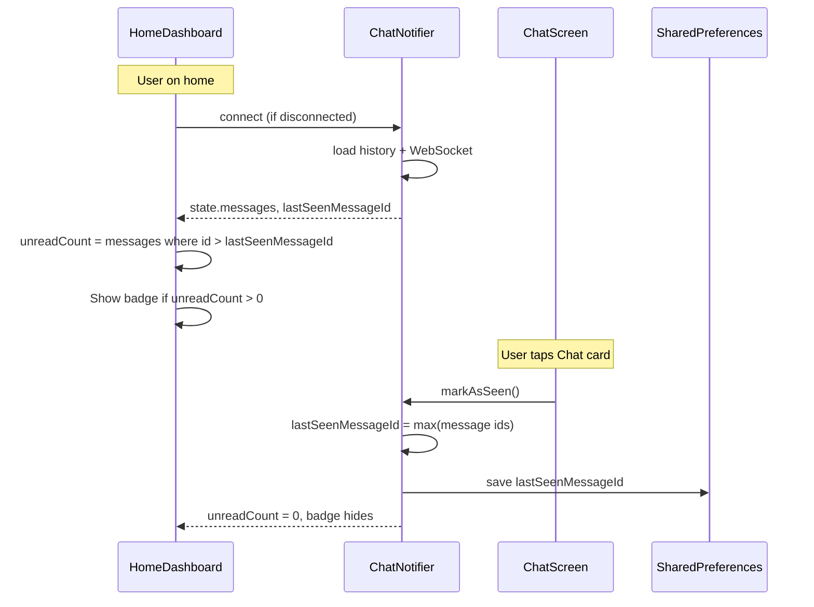

# Chat card unread badge

## Behavior

- **Badge**: Show on the Chat card on the home dashboard when there are messages with `id > lastSeenMessageId` (i.e. "new" since the user last opened chat).
- **Clear**: When the user navigates to the chat screen, call `markAsSeen()` so `lastSeenMessageId` is set to the current latest message id; badge disappears.
- **Persistence**: Store `lastSeenMessageId` in SharedPreferences so after app restart we don’t show old messages as unread.

## Data flow

## Implementation

### 1. Chat provider: last-seen and unread

**File:** [frontend/lib/providers/chat_provider.dart](frontend/lib/providers/chat_provider.dart)

- **State**: Add `lastSeenMessageId` (e.g. `int`) to `ChatState`, or keep it only inside `ChatNotifier` and expose `unreadCount` / `hasUnread` via state or a getter. Recommended: keep `lastSeenMessageId` in the notifier (not in `ChatState`) to avoid serialization; add to state a derived `unreadCount` (or add a separate `Provider<int>` that computes unread from `chatProvider` + lastSeenMessageId).
- **Persistence**: On notifier init, read `lastSeenMessageId` from SharedPreferences (key e.g. `chat_last_seen_message_id`). Use `shared_preferences` (already in the project if used elsewhere; otherwise add dependency). Async load: set initial lastSeenMessageId to 0, then in `connect()` or first use, load from prefs and set it (and update state so unreadCount recomputes).
- **markAsSeen()**: New method on `ChatNotifier`: set `lastSeenMessageId = state.messages.isEmpty ? 0 : state.messages.map((m) => m.id).reduce(max)` (or iterate to find max). Write to SharedPreferences. If unreadCount is in state, update state so UI refreshes.
- **unreadCount**: Either add to `ChatState` as `int unreadCount` (notifier updates it whenever messages or lastSeenMessageId change), or expose via a separate provider: `final chatUnreadCountProvider = Provider<int>((ref) { final state = ref.watch(chatProvider); ... });` that computes `state.messages.where((m) => m.id > lastSeenMessageId).length`. The notifier must expose `lastSeenMessageId` (e.g. on state or a small wrapper) for the provider to read. Simplest: add `lastSeenMessageId` and `unreadCount` to `ChatState`; notifier updates both when messages change and when `markAsSeen()` is called.
- **Connect from home**: So the badge can show without the user opening chat, ensure chat is connected when home is visible. In [frontend/lib/screens/home/home_dashboard_screen.dart](frontend/lib/screens/home/home_dashboard_screen.dart), in `initState` or first build, call `ref.read(chatProvider.notifier).connect()` if `connectionStatus == disconnected`. That way messages (and unread count) are available on the dashboard. The provider is already kept alive by home watching it for the badge.

### 2. Chat screen: mark as seen when opened

**File:** [frontend/lib/screens/chat/chat_screen.dart](frontend/lib/screens/chat/chat_screen.dart)

- When the chat screen is shown and we have messages, call `markAsSeen()`. Do this in a post-frame callback after `connect()` (or when `chatState.messages` becomes non-empty), e.g. in `build`: when `messageCount > 0`, schedule a one-time callback that calls `ref.read(chatProvider.notifier).markAsSeen()`. Use a small guard (e.g. a bool `_hasMarkedSeenThisVisit`) so we only call once per navigation to chat, not on every rebuild.

### 3. Home dashboard: badge on Chat card

**File:** [frontend/lib/screens/home/home_dashboard_screen.dart](frontend/lib/screens/home/home_dashboard_screen.dart)

- **Watch chat**: Ensure the widget watches `chatProvider` (e.g. `ref.watch(chatProvider)`) so that when messages or lastSeenMessageId change, the chat card rebuilds.
- **Connect on home**: When building home, if chat is disconnected, call `ref.read(chatProvider.notifier).connect()` (e.g. in `initState` or at the start of `build` with a one-time check) so messages load for badge logic.
- **_buildDashboardCard**: Add an optional parameter, e.g. `int? badgeCount` (or `bool showBadge`). When `badgeCount != null && badgeCount > 0`, show a badge on the card (e.g. top-right corner): a small red circle with the count, or just a red dot if you prefer. Use `Stack` + `Positioned` around the card content so the badge sits on top of the icon/title area.
- **Chat card**: Pass `badgeCount: ref.watch(chatProvider).unreadCount` (or the derived provider value) into `_buildDashboardCard` for the Chat card only.

### 4. SharedPreferences

- If the project does not already use `shared_preferences`, add it to `pubspec.yaml`. Use a single key, e.g. `chat_last_seen_message_id`, to store the int. Read on notifier init (or first use); write in `markAsSeen()`.

## Edge cases

- **No messages**: `unreadCount = 0`; no badge.
- **First app launch**: `lastSeenMessageId` not set → treat as 0; all messages are "new" until user opens chat and `markAsSeen()` runs.
- **Provider disposal**: Keep current behavior; if home is watching chat for the badge, provider stays alive and connection remains until logout or disposal.

## Files to touch

| File                                                                                                         | Changes                                                                                                                                        |
| ------------------------------------------------------------------------------------------------------------ | ---------------------------------------------------------------------------------------------------------------------------------------------- |
| [frontend/lib/providers/chat_provider.dart](frontend/lib/providers/chat_provider.dart)                       | Add lastSeenMessageId (in state or notifier), load/save via SharedPreferences; add markAsSeen(); add unreadCount to state or derived provider. |
| [frontend/lib/screens/chat/chat_screen.dart](frontend/lib/screens/chat/chat_screen.dart)                     | Call markAsSeen() when chat is visible and messages are loaded (once per visit).                                                               |
| [frontend/lib/screens/home/home_dashboard_screen.dart](frontend/lib/screens/home/home_dashboard_screen.dart) | Connect chat when home is shown; add optional badge to _buildDashboardCard; pass unreadCount to Chat card.                                     |
| [frontend/pubspec.yaml](frontend/pubspec.yaml)                                                               | Add shared_preferences if not present.                                                                                                         |

