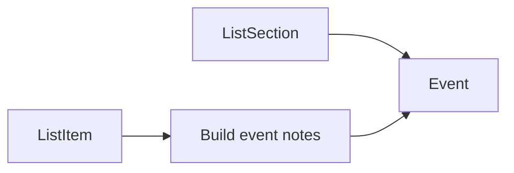

# Checklist sections → family calendar integration

## Existing pieces

- **Events:** `[Event](c:\dev\kewlkids\backend\events\models.py)` (`title`, `notes`, `starts_at`, `ends_at`, `family`, `created_by`, …). API: `[EventViewSet](c:\dev\kewlkids\backend\api\views.py)` + `[EventSerializer](c:\dev\kewlkids\backend\api\serializers.py)`. Mobile: `[calendarService.ts](c:\dev\kewlkids\mobile\services\calendarService.ts)`, `[calendar.tsx](c:\dev\kewlkids\mobile\app\(tabs)`\calendar.tsx) already loads events and shows **notes** on open — suitable for “items + list name” without a new calendar UI if `notes` are formatted clearly.
- **Checklists:** `[ListSection](c:\dev\kewlkids\backend\lists\models.py)` has `section_date`, `title`, `order`, FK to `[List](c:\dev\kewlkids\backend\lists\models.py)` → `family`. Items: `[ListItem](c:\dev\kewlkids\backend\lists\models.py)` with `section` FK.

## Data model

- Add on `**Event**` (new migration under `events`):
  - `**list_section**` = `OneToOneField('lists.ListSection', null=True, blank=True, on_delete=models.CASCADE, related_name='calendar_event')`
    - At most one calendar row per section; deleting a section removes its event.
  - Optional: `**source_type**` or rely on `list_section is not None` to identify checklist-backed events (for reslot queries and to avoid touching manual events).
- **No change** to `ListSection` required if the link lives on `Event` (avoids circular migration weirdness; `events` already depends on app graph — confirm `lists` is installed; FK from `Event` → `ListSection` is valid).
- Expose `**list_section`** on serializer as **read-only** (optional) for debugging/admin; calendar UI does not need it if title/notes are enough.

## Sync behavior (backend)

Central module e.g. `[backend/lists/checklist_calendar_sync.py](c:\dev\kewlkids\backend\lists\checklist_calendar_sync.py)` (or `events/` if you prefer) with:

1. `**build_event_notes(section)`**
  - Plain-text (or light markdown) body: line **“List: {list.name}”**, then each item in that section (respect `order`; include nested/indented lines if you want parity with checklist UI).
  - Refresh whenever **items** under that section change.
2. `**ensure_checklist_event(section, member)`**
  - `get_or_create` `Event` with `list_section=section`, `family=list.family`, `created_by=member` (on first create).
  - Set `title = section.title`, `notes = build_event_notes(section)`, `is_all_day=False`, `color` optional (list color or fixed preset).
  - **Do not** set final `starts_at`/`ends_at` here — delegate to reslot.
3. `**reslot_checklist_events_for_date(family, d: date)`**
  - Consider all `Event` rows for that `family` with `list_section_id` set and `list_section.section_date == d` (join/filter in DB).
  - **Sort** for stable stacking (recommend: `**list.name`**, then `**section.order`**, then `**section.id**`).
  - Assign consecutive **1-hour** blocks starting **08:00** on date `d` in **one chosen timezone** (phase 1: Django `[TIME_ZONE](c:\dev\kewlkids\backend\config\settings.py)` as “local”; document follow-up for per-user/family TZ).
  - Nth section → `starts_at = d 08:00 + n hours`, `ends_at = starts_at + 1 hour`.
  - **Edge case:** many sections in one day → slots extend past 11:00 (16 sections → 8:00–23:00). If you hit **24+**, cap or merge (call out in implementation; simplest is allow hours past midnight into next calendar day or stop at 23:00 and widen last blocks — product choice).
4. **When `section_date` changes**
  - After save: run `**reslot_checklist_events_for_date(family, old_date)`** and `**reslot_checklist_events_for_date(family, new_date)`** (if old known).
  - Ensures the event **disappears** from the previous day’s slot stack and **appears** on the new day.
5. **Triggers (call sites)**
  - `**[ListSectionViewSet](c:\dev\kewlkids\backend\lists\views.py)`** (`perform_create` / `perform_update` / `perform_destroy`): after successful save/delete, invoke ensure + reslot for affected dates (create/update: new date; update: old+new if date changed; destroy: reslot old date only — event CASCADE removes row).
  - `**[ListItemViewSet](c:\dev\kewlkids\backend\lists\views.py)`** (`perform_create` / `perform_update` / `perform_destroy`): if the item belongs to a checklist `section`, `**build_event_notes` + save** that section’s event (no reslot unless section field changed). If `section` FK changes, refresh **both** old and new section events and reslot **both** dates if needed.
6. **Copy checklist** (`[copy` action](c:\dev\kewlkids\backend\lists\views.py)): new sections are created via normal `ListSection` creation path — if sync is hooked in `perform_create`, **new in-app events appear automatically**.
7. **External calendar (Outlook, etc.) — on demand only**
  - **Do not** automatically push checklist-backed `Event` rows to Microsoft/Google when sections save. In-app calendar and external calendar are decoupled: **internal** events update immediately; **external** mirrors only when the user asks.
  - **Backend:** Add an authenticated endpoint (e.g. `POST /api/calendar/outlook/push-checklist-events/` or scoped under `events`) that:
    - Requires an active `CalendarSync` (Outlook) for the user/family (same checks as existing `[Outlook connection](c:\dev\kewlkids\backend\api\views.py)` flow).
    - Accepts optional `**list_id`** (sync only events for sections belonging to that checklist) or defaults to **all checklist-linked events** for the family the user is allowed to see.
    - For each target `Event` with `list_section` set: create or update the remote event via Graph (using existing token helpers), and persist `external_calendar_id` / `external_calendar_type` / `etag` on `Event` like manual sync does today.
    - Returns counts: created, updated, failed (and optional error messages).
  - **Mobile:** On **checklist list detail** [`[id].tsx](c:\dev\kewlkids\mobile\app\(tabs)\lists\[id].tsx)` — add a secondary control **“Sync to external calendar”** (or **“Push to Outlook”** if only Outlook exists today), placed near History / actions bar:
    - **Disabled** or hidden when Outlook (or chosen provider) is **not connected** for the selected family (reuse connection status from `[outlook-sync](c:\dev\kewlkids\mobile\app\(tabs)\outlook-sync.tsx)` / existing API if available).
    - **On press:** call the new endpoint with `list.id`; show loading; then success/error alert (“External calendar updated” / failures).
  - If Google sync is added later, the same button can become a menu or call a provider-specific endpoint; v1 can be Outlook-only to match current `CalendarSync` + Graph code paths.

## API contract for “calendar updated” (mobile)

- Extend `**ListSectionSerializer`** response (or parent list detail) with optional read-only flag, e.g. `**calendar_synced: true`**, set in `to_representation` after a mutating operation — awkward on GET.
- **Cleaner:** return on **POST/PATCH** only: e.g. `{"...section fields...", "calendar_updated": true}` from `ListSectionViewSet` by overriding `finalize_response` / custom response — or `**200` body** already returns full section; add `**calendar_updated`** in `ListSectionSerializer` **context** from view when create/update succeeds.
- Mobile `[submitAddSection](c:\dev\kewlkids\mobile\app\(tabs)`\listsid].tsx) / `[submitEditSection](c:\dev\kewlkids\mobile\app\(tabs)`\listsid].tsx) / `[SectionFormModal](c:\dev\kewlkids\mobile\components\lists\SectionFormModal.tsx)` save handlers: if response includes `calendar_updated`, show a **short non-blocking message** (e.g. `Alert.alert('Calendar updated')` once, or a 2–3s banner — match existing patterns in the app).
- **Copy checklist** success: optional same message when copy completes (many sections → one toast “Calendar events added” is enough).

## Mobile calendar UX (minimal)

- **No change required** for basic behavior: tapping an event already shows **title + notes**. Ensure **notes** are readable (bullets/newlines). Optional polish: if `list_section` is exposed, show a small “Checklist section” badge — not required for v1.

## Ordering clarification (default in this plan)

- **Same calendar day, same family:** all checklist-backed sections (any list) share one **8:00–9:00, 9:00–10:00, …** sequence, sorted by **list name** then **section order**.
- If you prefer stacking **per list** only, the reslot query filters by `list_id` and runs once per list per date — easy variant; state explicitly when implementing.

## Testing / ops

- Migration for `Event.list_section`.
- Unit test: three sections same date → three events, hours 8–9, 9–10, 10–11; date change moves slot; item edit updates notes.
- Manual: calendar month/week/day views show new events; edit section title updates event title.

