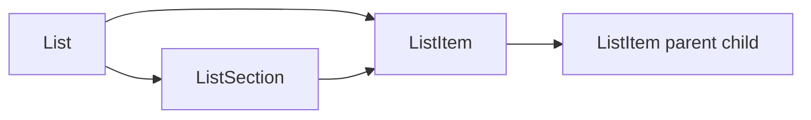

# Copy checklist list (sections + items)

## How items relate to sections

- `[ListSection](backend/lists/models.py)`: `list` FK to `List`, `order`, `section_date`, `title`, `bullet_style`.
- `[ListItem](backend/lists/models.py)`: `list` FK to `List`, `**section` FK to `ListSection` (nullable)**, optional `**parent` self-FK** for nested checklist rows, plus `indent_level`, `order`, `name`, `notes`, `quantity`, `completed`, etc.

So each checklist item points at a **section id** that only makes sense within that list. A copy must create **new** sections and **new** items, and rewrite both `section` and `parent` using id maps.

## Feasibility

Yes. There is **no** existing duplicate/copy API today (`[ListViewSet](backend/lists/views.py)` only has standard CRUD plus unrelated actions). Implementing `**POST /lists/{id}/copy/`** (or `duplicate/`) keeps the operation **atomic** (one transaction), correct for `parent` ordering, and avoids dozens of client round-trips via `[listService](mobile/services/listService.ts)`.

## Source list stays intact

Yes — **nothing is removed or altered on the original checklist.** The server **creates** a new `List` plus **new** `ListSection` and **new** `ListItem` rows (with new primary keys). The source list’s sections and items are only **read** to build the clone. After copying you have **two separate lists**: the original keeps all titles, items, nesting, completion flags, and section dates as they were; the new list is a duplicate with fresh section dates (today), items reset **uncompleted**, and the name you chose. Edits to either list do not affect the other.

## Backend (recommended)

**Add** `@action(detail=True, methods=['post'], url_path='copy')` on `[ListViewSet](backend/lists/views.py)`:

1. **Load** source `List`; ensure `list_type == 'checklist'` and user has access (same family membership as `get_queryset`).
2. `**transaction.atomic()`**:
  - Create new `List`: same `family`, `list_type`, `color`, `description`; `**name` from request body** (required for the mobile flow). If omitted, default `"Copy of {original}"` for backwards-compatible API use.
  - Set `created_by` to current member (same pattern as `perform_create`).
  - Query sections: `source.sections.all().order_by('section_date', 'order')`.
  - For each section: `ListSection.objects.create(list=new_list, order=..., title=..., bullet_style=..., **section_date=date.today**)`; build `old_section_id → new_section`.
  - Query items: `ListItem.objects.filter(list=source)` (include `section` null if any exist).
  - **Clone items** with `completed=False`, `completed_at/by=None`, same `name`, `notes`, `quantity`, `indent_level`, `order`, `due_date` (copy as-is or null—default copy as-is unless you prefer null for todos).
  - **Parent mapping**: repeatedly create items whose `parent_id` is null or already mapped (same pattern as `[_item_depth](backend/lists/views.py)`); if a cycle leaves stragglers, skip or log—shouldn’t happen for normal data.
  - Assign `list=new_list`, `section=new_section_map[old_section_id]` when old section existed, else `section=None`.
3. **Return** `201` + serialized new list (reuse `[ListSerializer](backend/lists/serializers.py)`), optionally include `id` only if the client only needs navigation.

**Tests**: one integration test (or API test): checklist with 2 sections, nested items, assert new list has today’s `section_date` on all sections and preserved structure.

## Naming UX (your choice: **c**)

- Tapping **Copy list** does **not** copy immediately. It opens a **name step** (same spirit as edit flows: small **Modal** or **AlertModal**-style sheet) with:
  - **Text input** pre-filled with `Copy of {current list name}` so the user can **edit** or **accept as-is**.
  - **Cancel** closes without calling the API.
  - **Copy** / **Create** (or primary action) validates non-empty trimmed name, then calls `POST .../copy/` with `{ "name": "<chosen>" }`.
- Backend uses that `name` for the new `List` (reject empty / too-long per same rules as normal list create if applicable).

## Mobile

- `[mobile/app/(tabs)/lists/[id].tsx](mobile/app/(tabs)/lists/[id].tsx)`: In the checklist actions row, add **Copy list** to the **left** of **Add Section** (only `isChecklistList`, only when `!showAddItem && !showAddSection && !editingItem` like the other primary buttons). Wire the button to open the **name modal** above, then `copyList` on confirm.
- `[mobile/services/listService.ts](mobile/services/listService.ts)`: `copyList(listId: number, body: { name: string }): Promise<List>` (name required from UI after prompt).
- On success: `router.push(\`/(tabs)/lists/${newList.id})` so the user lands on the new checklist to adjust section dates.
- While the request runs: disable primary button / show loading; on error use existing `alert` pattern. Optional one-line helper text in the modal: section dates will be set to today on the copy.

## Product defaults (matches your ask)

- All **new** sections: `**section_date = today`** (local date on server via `date.today()` is acceptable; if you need strict client-tz, pass ISO date in body—optional follow-up).
- **Item text and structure** preserved; **completed** cleared on the copy.
- User edits dates on the **new** list using existing section date / edit-section flows.

## Alternative (not recommended)

Client-only: sequential `createList` + many `createListSection` + many `createListItem` calls with parent ordering logic duplicated in TS—slower, easier to break on partial failure.