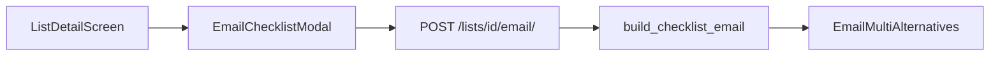

# Checklist email export

## Decision locked

**Recipient:** editable To field, prefilled with the signed-in user’s email (option 2).

## Approach

Add **Email** on checklist detail. Tap opens a modal (To editable, default = account email). Backend builds a professional HTML email (+ plain-text fallback) of the entire checklist — all sections, nested items, completed and incomplete — and sends via SMTP with `EmailMultiAlternatives` (same pattern as [family invite emails](backend/families/views.py)).

## HTML email design

Match KewlKids invite styling (table-friendly HTML, inline CSS):

- Header: **KewlKids Organizer** brand bar
- Title: checklist name; optional description
- Summary strip: e.g. `12 of 40 complete`
- Per section: section title + date, then nested checklist rows
  - Completed: green check / muted completed style
  - Incomplete: open box / normal weight
- Footer: sent-by / timestamp note
- Always attach plain-text alternative

Reuse nesting walk from [`build_event_notes`](backend/lists/checklist_calendar_sync.py), but for **all** sections and rendered as HTML.

## Backend

- New [`backend/lists/checklist_email.py`](backend/lists/checklist_email.py): `build_checklist_email(list) -> (subject, text, html)`.
- New `@action` on [`ListViewSet`](backend/lists/views.py): `POST .../email/` with `{ "email": "..." }` (required after trim/validate; may fall back to `request.user.email` if omitted).
  - Checklist-only; auth + family membership.
  - Send with `EmailMultiAlternatives` + `DEFAULT_FROM_EMAIL`.
  - Fail clearly if SMTP errors.

## Mobile

- [`ListService.emailChecklist(listId, email)`](mobile/services/listService.ts)
- [`EmailChecklistModal`](mobile/components/lists/) — mirror [`CopyChecklistModal`](mobile/components/lists/CopyChecklistModal.tsx): editable To prefilled from current user; Send / Cancel; loading/error states
- Checklist detail [`[id].tsx`](mobile/app/(tabs)/lists/[id].tsx): **Email** action beside History / Outlook

## Out of scope

- PDF attachment, shopping/grocery lists, Outlook/calendar changes, completed-history-only export
