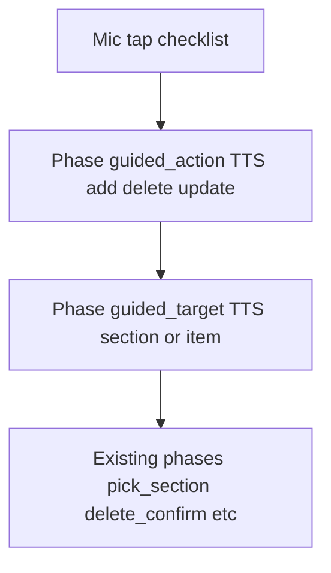

# Checklist mic: guided Add / Delete / Update then Section / Item

## Current behavior

- `[handleVoiceClick](mobile/app/(tabs)`/lists/[id].tsx) resets checklist voice state to `idle`, then speaks a long checklist opener and calls `start({ ignoreTranscriptsForMs: 2000 })`.
- While `checklistVoicePhase === 'idle'`, the same file’s voice `useEffect` runs the large “one-shot” parser block (~1616–1919): `parseAddSectionCommand`, `parseAddItem`, `parseDeleteSectionCommand`, bare delete/update intents, etc., which jump straight into phases like `add_section_or_item`, `delete_section_pick`, `delete_choose_kind`, etc.

## Target behavior

1. **Mic tap (checklist only):** Speak something like: *“What would you like to do: add, delete, or update?”* and enter a **non-idle** phase so the user is guided before any one-shot parsing runs.
2. **Step 1:** User answers add / delete / update (with synonyms where helpful, e.g. remove → delete).
3. **Step 2:** Speak *“Would you like to work with a section or an item?”* (or equivalent short copy).
4. **Step 3:** Map **(action, target)** to the **same** next phase + TTS strings already used today when those flows start from idle (no duplicate business logic beyond routing):

| Action | Target  | Next phase               | Reuse existing prompt from                                                                   |
| ------ | ------- | ------------------------ | -------------------------------------------------------------------------------------------- |
| add    | section | `section_title`          | `[parseAddSectionCommand` without title path](mobile/app/(tabs)/lists/[id].tsx) (~1642–1647) |
| add    | item    | `add_section_or_item`    | bare add item intent path (~1665–1671)                                                       |
| delete | section | `delete_section_pick`    | `parseDeleteSectionCommand` without query (~1769–1774)                                       |
| delete | item    | `delete_section_or_item` | `parseChecklistDeleteItemBareIntent` path (~1811–1816)                                       |
| update | section | `update_section_pick`    | `parseUpdateSectionCommand` without query (~1870–1875)                                       |
| update | item    | `update_section_or_item` | `parseChecklistUpdateItemBareIntent` path (~1912–1917)                                       |

1. **Guards:** When transitioning from step 2, apply the **same** “no sections yet” / empty-list checks already used in the idle block (speak the same error lines and `clearChecklistVoice()` + reset transcript as today) so behavior stays consistent.
2. **Cancel:** Existing rule `checklistVoicePhase !== 'idle' && isCancelCommand` already covers guided phases; extend `[clearChecklistVoice](mobile/app/(tabs)`/lists/[id].tsx) (and mic **stop** reset in `handleVoiceClick`) to clear any new ref used to remember the chosen action between steps.

## Implementation outline

### 1. New phases and stored action

- Extend the `checklistVoicePhase` union in `[[id].tsx](mobile/app/(tabs)`/lists/[id].tsx) with two values, e.g. `guided_action` and `guided_target`.
- Add a `useRef` such as `checklistPendingGuidedActionRef: 'add' | 'delete' | 'update' | null` (avoids extra `useEffect` dependencies; cleared whenever checklist voice is reset).

### 2. Parsers in `[mobile/utils/voiceCommands.ts](mobile/utils/voiceCommands.ts)`

- `parseGuidedVoiceAction(text): 'add' | 'delete' | 'update' | null` — normalize like existing helpers; match **add**, **delete** / **remove**, **update** / **change** (keep list small and documented).
- `parseGuidedVoiceTarget(text): 'section' | 'item' | null` — match **section** vs **item** (and obvious variants if you already use them elsewhere, e.g. “task” → item only if you want parity with spoken language).

### 3. Voice handler branches in `[[id].tsx](mobile/app/(tabs)`/lists/[id].tsx)

- Insert **early** blocks (after cancel / number selection / delete-update confirms, before `delete_choose_kind`):
  - `**guided_action`:** `stop()`, parse action; on success set ref + `setChecklistVoicePhase('guided_target')`, `lastProcessedTranscriptRef` / `reset()`, speak step-2 prompt, `start({ ignoreTranscriptsForMs: … })`. On failure, short reprompt: *“Say add, delete, or update.”*
  - `**guided_target`:** `stop()`, read ref; parse section/item; apply guards; set the appropriate phase + speak the **existing** third-line prompt from the table above (copy the same strings as the idle paths). Clear ref when leaving the guided flow. On failure, reprompt: *“Say section or item.”*
- Mirror patterns already used in neighboring phases: `lastProcessedTranscriptRef.current = ''`, `reset()`, `start` delays/ignore windows consistent with similar short prompts (e.g. comparable to `[delete_choose_kind](mobile/app/(tabs)`/lists/[id].tsx) reprompts).

### 4. Mic button entry

- In `handleVoiceClick`, for `isChecklistList` only: after reset, `setChecklistVoicePhase('guided_action')` instead of leaving `idle`, then speak the **new** short opener (replace the current long checklist sentence at ~2172–2173).
- Non-checklist lists: keep current behavior.

### 5. Help copy

- Update the checklist section of the `[AlertModal` “Voice commands”](mobile/app/(tabs)/lists/[id].tsx) `details` (~4336–4376) to describe: tap mic → add/delete/update → section/item → then the same follow-up prompts as today. Optionally add a line that **full phrases** (e.g. “delete section kitchen”) still work when the flow is in `**idle`** (e.g. if the user did not use the guided mic entry or finished a flow).

### 6. No change to idle one-shot parsing (by default)

- The existing `if (isChecklistList) { … }` idle block stays as-is for users who speak full commands without going through the guided entry, or after a flow returns to `idle`.

## Flow (mermaid)

## Files to touch

- `[mobile/app/(tabs)/lists/[id].tsx](mobile/app/(tabs)`/lists/[id].tsx) — phases, ref, `handleVoiceClick`, two new handler blocks, `clearChecklistVoice` + mic stop cleanup, help modal text.
- `[mobile/utils/voiceCommands.ts](mobile/utils/voiceCommands.ts)` — two small parser exports (and unit-style sanity: optional quick grep/test if the project has voice command tests).

## Testing (manual)

- Checklist: mic → hear short opener → “add” → “section” → section title flow; repeat for add/item, delete/section, delete/item, update/section, update/item.
- With **zero sections**, delete/item/update paths should match existing error TTS.
- Cancel during step 1 and step 2.
- After completing an action, confirm **idle** one-shot commands still work if the user speaks a full phrase.

