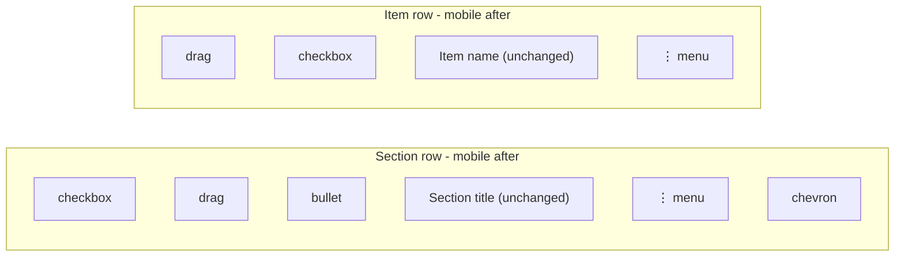

# Checklist mobile overflow menu

## Visibility of names (unchanged)

- **Section name:** Rendered in [SectionRow.tsx](mobile/components/lists/SectionRow.tsx) in the `titleContainer` (lines 157–173) as `section.title` or a `TextInput` when editing. It uses `flex: 1` and `numberOfLines={2}`. Only the **four action buttons** (pencil, trash, outdent, indent) are being replaced; the bullet + title block stays as-is. **Section name remains fully visible on mobile.**
- **Item name:** Rendered in [ListItemComponent.tsx](mobile/components/lists/ListItemComponent.tsx) in `itemNameRow` (lines 359–392) as `item.name`. The mobile-only action strip is in `itemActionsInline` (lines 395–458), which sits to the **right** of the name. Replacing that strip with a single ⋮ button keeps the name in the same place with the same flex/truncation. **Item name remains fully visible on mobile.**

---

## Scope

- **Platform:** Apply overflow menu only when `Platform.OS !== 'web'` (i.e. native iOS/Android). Web keeps current buttons.
- **Context:** Checklist section headers (SectionRow) and checklist item rows (ListItemComponent when indent/outdent are used). No change to grocery, todo, or other list types.

---

## 1. Section header – SectionRow

**File:** [mobile/components/lists/SectionRow.tsx](mobile/components/lists/SectionRow.tsx)

- **Current (mobile):** Four separate `TouchableOpacity` buttons after the title: pencil (174–182), trash (183–192), outdent (193–202), indent (203–212), then chevron (213–226).
- **Change:** When `Platform.OS !== 'web'`, render a single overflow button (e.g. `FontAwesome name="ellipsis-v"`) that opens an action menu. Keep checkbox, drag handle, bullet, **section title** (and chevron) unchanged.
- **Menu content:** "Rename section" → `setEditing(true)` / `onRenameSection` flow, "Delete section" → `onDeleteSection`, "Indent all" → `onIndentAll`, "Outdent all" → `onOutdentAll`. Only show options when the corresponding prop exists.
- **Menu API:** Use React Native’s `Alert.alert` with a list of buttons (cross-platform). Alternatively use `ActionSheetIOS.showActionSheetWithOptions` on iOS and `Alert.alert` on Android for a native feel; both are built-in.
- **Web:** Keep existing four buttons; no overflow menu.

---

## 2. Item row – ListItemComponent

**File:** [mobile/components/lists/ListItemComponent.tsx](mobile/components/lists/ListItemComponent.tsx)

- **Current (mobile):** When `Platform.OS !== 'web'`, `itemActionsInline` (396–458) shows up to five buttons: edit, move, delete, outdent, indent. For checklist items, all of these (or a subset) appear.
- **Change:** When `Platform.OS !== 'web'` **and** the item has checklist-style actions (e.g. `onIndent != null` or an explicit prop like `useChecklistActionsMenu`), hide the inline action buttons and render a single ⋮ button that opens an action menu. **Item name** stays in the same row with the same layout (e.g. `itemNameRow` + name + new ⋮ button).
- **Menu content:** "Edit" → `onEdit`, "Delete" → `onDelete`, "Move to list" → `onMove` (if provided), "Indent" → `onIndent` (if provided), "Outdent" → `onOutdent` (if provided). Disable Indent/Outdent when `canIndent`/`canOutdent` is false (or hide them). Only include options whose handlers are passed.
- **Menu API:** Same as section (e.g. `Alert.alert` with buttons, or `ActionSheetIOS` on iOS).
- **Web and non-checklist:** Keep existing inline buttons; no overflow menu.

---

## 3. Implementation details

- **SectionRow:** Add a helper (e.g. `showSectionOverflowMenu`) that is true when `Platform.OS !== 'web'`. When true, render one `TouchableOpacity` with ellipsis-v icon; on press, call `Alert.alert('Section', null, [ { text: 'Rename', onPress: () => setEditing(true) }, { text: 'Delete', onPress: onDeleteSection }, ... ])` (or ActionSheet on iOS). When true, do not render the four individual action buttons.
- **ListItemComponent:** Add a condition such as `const useChecklistOverflowMenu = Platform.OS !== 'web' && (onIndent != null || onOutdent != null)` (or a prop from the parent). When true, render one ⋮ button instead of the existing `itemActionsInline` block; on press, show an alert/action sheet with Edit, Delete, Move (if any), Indent, Outdent. When false, keep current `itemActionsInline` behavior.
- **Accessibility:** Give the overflow button an `accessibilityLabel` (e.g. "Section actions" / "Item actions") and `accessibilityHint` (e.g. "Opens menu with rename, delete, and indent options").

---

## 4. Files to touch

| File                                                                                           | Changes                                                                                                                              |
| ---------------------------------------------------------------------------------------------- | ------------------------------------------------------------------------------------------------------------------------------------ |
| [mobile/components/lists/SectionRow.tsx](mobile/components/lists/SectionRow.tsx)               | On mobile: one overflow button + Alert/ActionSheet; hide pencil, trash, outdent, indent. Section title and rest of layout unchanged. |
| [mobile/components/lists/ListItemComponent.tsx](mobile/components/lists/ListItemComponent.tsx) | On mobile when checklist: one overflow button + Alert/ActionSheet; hide `itemActionsInline`. Item name and rest of layout unchanged. |

No changes to [mobile/app/(tabs)/lists/[id].tsx](mobile/app/(tabs)/lists/[id].tsx) for this feature unless a new prop (e.g. `useChecklistActionsMenu`) is preferred for toggling item overflow menu instead of inferring from `onIndent`/`onOutdent`.

---

## Summary

- **Section name:** Still shown in the same place (bullet + title); only the four icon buttons become one ⋮ menu on mobile.
- **Item name:** Still shown in the same place (next to checkbox); only the inline action icons become one ⋮ menu on mobile when the item is a checklist item.
- **Web:** No change; all current buttons remain.

