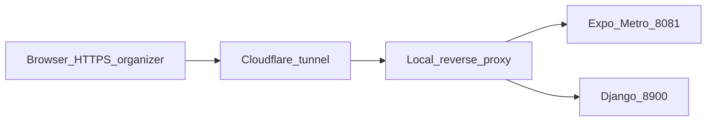

# Cloudflare + Expo web: localhost / mixed-content fixes

**Stack:** Expo (app in `[mobile/](mobile/)`) + Django (API in `[backend/](backend/)`).

## Local dev (localhost / 127.0.0.1) stays supported

Nothing in this plan requires removing localhost behavior.

- `**REACT_NATIVE_PACKAGER_HOSTNAME`:** Only set it when you intentionally access the app through a **public hostname** (Cloudflare tunnel, etc.). **Omit it** for normal local work: open `http://localhost:8081` or `http://127.0.0.1:8081` and Metro keeps embedding `**http://localhost:8081`** (or your LAN IP) — **same scheme and host as the page**, so fonts/icons keep loading as they do today.
- **Optional `__webpack_public_path__` = `window.location.origin`:** On local dev, `window.location.origin` is already `http://localhost:8081` (or `127.0.0.1:8081`), so this is a no-op for correctness and does not break local dev.
- `**WEB_APP_URL`:** Set `**https://organizer.kewlkids.ca`** on the **tunnel / production** API environment. For Django running only on `**localhost:8900`** with the browser on `**localhost:8081`**, you can leave it unset; existing logic still falls back to `**http://localhost:8081**` when the request host is localhost.
- **CORS:** Add public HTTPS origins **in addition to** existing localhost entries — do not remove localhost from allowed origins for dev.

## Why ngrok worked but Cloudflare does not (icons / nav)

Same underlying issue: **the URL in the address bar must match the origin Metro/webpack uses for chunk and font URLs** (or those URLs must be relative / same-origin).

- **Typical ngrok flow:** You open the app at an `**https://…ngrok…`** URL. Metro is often started with a packager hostname aligned to that tunnel (or you use Expo’s tunnel), so the **page origin and asset URLs are both HTTPS and the same host** — no mixed content, icons load.
- **Typical Cloudflare flow:** You open `**https://organizer.kewlkids.ca`**, but the bundle still says “load fonts/chunks from `**http://localhost:8081`**.” The browser treats that as **mixed content** (HTTPS page → HTTP localhost) and **blocks** those requests → **missing tab icons**; links that resolve to the packager origin can also jump you to localhost.

So Cloudflare is not “worse”; it just exposes the **hostname/scheme mismatch** ngrok avoided when everything was aligned to one public HTTPS origin.

## Does this plan fix icons?

**Yes, for this failure mode:** when icons fail because font requests are blocked (wrong or `http://localhost` from an `**https://organizer…`** page). Aligning the **public packager hostname** and/or `**window.location.origin`** for the public path addresses that directly.

If icons failed for a **different** reason (e.g. proxy not forwarding `/_expo` or static font paths), that would be a **proxy routing** fix on top — Network tab would show **404** on same-origin URLs rather than **blocked mixed content**.

## What we found

### 1. Icon/tab bar fonts (likely mixed content)

Tabs use `@expo/vector-icons` / FontAwesome (`[mobile/app/(tabs)/_layout.tsx](mobile/app/(tabs)`/_layout.tsx)). On web, those fonts load via `@font-face` URLs baked into the bundle. With `**npx expo start --web`** (or dev client web) accessed as `**https://organizer.kewlkids.ca`**, Metro often still advertises the **dev server** as `**http://localhost:8081`**. The page is **HTTPS** but font/chunk URLs become **HTTP + localhost** → browsers block them → **icons missing**; same pattern can affect **navigation** if links or the router resolve against the wrong origin.

Your built output under `mobile/dist/` already uses **relative** `/assets/...` paths (good for static hosting); the problem matches **dev + tunnel**, not necessarily production static export.

### 2. API base URL logic (mostly OK for `*.kewlkids.ca`)

`[mobile/utils/webApiBaseUrl.ts](mobile/utils/webApiBaseUrl.ts)` maps `organizer.kewlkids.ca` → `https://organizer-api.kewlkids.ca/api` (or `EXPO_PUBLIC_API_HOST`). `[mobile/services/api.ts](mobile/services/api.ts)` gives **public custom-domain hosts priority** over `EXPO_PUBLIC_API_URL`, which is the right order for your case.

**Watch:** `isPublicCustomDomainWebHost()` only matches `EXPO_PUBLIC_CUSTOM_DOMAIN` (default `**kewlkids.ca`**) as apex or `*.kewlkids.ca`. If `.env` sets `EXPO_PUBLIC_CUSTOM_DOMAIN` to a wrong value (e.g. a single subdomain that isn’t the page hostname), the app falls through to `**EXPO_PUBLIC_API_URL`**, which often points at **localhost/LAN** and breaks web.

### 3. Backend redirects still hard-default to `http://localhost:8081`

Several flows default the web app URL to `**http://localhost:8081`** when referer parsing fails or isn’t applicable:

- OAuth “return to app” HTML in `[backend/api/views.py](backend/api/views.py)` (~lines 2205, 3009, 3802).
- `_get_web_app_url` in `[backend/api/views.py](backend/api/views.py)` and `[backend/families/views.py](backend/families/views.py)`: for non-localhost, non-ngrok hosts it uses `**{scheme}://{request.get_host()}`**. If the browser hits the API as `**organizer-api.kewlkids.ca`**, that produces `**https://organizer-api.kewlkids.ca/...**`, not the Expo web app on `**organizer.kewlkids.ca**` — wrong place for deep links like `/(tabs)/...`.

`WEB_APP_URL` is already checked **first** in `_get_web_app_url`; the gap is **unset env in tunnel setups** and **OAuth fallback** skipping `WEB_APP_URL`.

### 4. Minor mobile issues

- `[mobile/services/websocketService.ts](mobile/services/websocketService.ts)`: impossible branch sets `http://localhost:8900/api` when `Platform.OS === 'web'` but `window` is undefined — should just use `getResolvedApiBaseUrl()` for all cases.
- `[mobile/services/api.ts](mobile/services/api.ts)`: JWT refresh uses the **module-load** constant `API_BASE_URL` while requests use `getApiBaseUrl()` per call — refresh should use `**getResolvedApiBaseUrl()`** so it never disagrees with the interceptor.

---

## Recommended changes (after approval)

### A. Expo / Metro: make the “public origin” match the browser (primary fix for icons + wrong host links)

**Operational (no code or minimal code):**

- When starting Metro for web behind Cloudflare, set the packager hostname to the **public host** (no `localhost` in generated URLs). Common pattern: set `**REACT_NATIVE_PACKAGER_HOSTNAME=organizer.kewlkids.ca`** (and ensure the tunnel/reverse proxy forwards **Host** correctly and supports **websockets** for HMR). If you must include a non-443 port in the public URL, use the form Metro expects for your setup (sometimes `host:port`).

**Optional code (only if env alone is insufficient):**

- Add a **tiny web-only bootstrap** (imported first from `[mobile/app/_layout.tsx](mobile/app/_layout.tsx)` or `index` entry) that sets webpack’s public path to `**${window.location.origin}/`** when `typeof __webpack_public_path__ !== 'undefined'`, so font and chunk URLs stay **same-origin** with the page. Guard with `typeof window !== 'undefined'` and `Platform.OS === 'web'`.

**Docs:** Add a short subsection to `[Docs/STARTUP_PROCEDURE.md](Docs/STARTUP_PROCEDURE.md)` (or your runbook): Cloudflare tunnel + `REACT_NATIVE_PACKAGER_HOSTNAME`, required proxy headers (`Host`, `X-Forwarded-Proto`, websocket upgrade), and `**WEB_APP_URL`**.

### B. Django: one canonical public web origin

1. **Set** `WEB_APP_URL=https://organizer.kewlkids.ca` in the environment for the tunnel / production API (matches your real public web host).
2. **Centralize** web-app base resolution in a small helper (e.g. `backend/config/web_app_url.py` or `backend/common/web_app_url.py`) used by:
  - `EmailVerificationView._get_web_app_url`
  - `AcceptInvitationView._get_web_app_url`
  - OAuth return builders in `[backend/api/views.py](backend/api/views.py)`
   **Order of precedence (suggested):**
  - `WEB_APP_URL` (strip trailing slash)
  - `_web_app_base_from_referer(referer)` (already respects `PUBLIC_WEB_APP_DOMAIN` for `*.kewlkids.ca`)
  - ngrok / localhost heuristics (current behavior)
  - `**WEB_APP_URL` again** is redundant; instead **last resort** before localhost: derive from `PUBLIC_WEB_APP_DOMAIN` + optional `**PUBLIC_WEB_APP_HOST`** (e.g. `organizer.kewlkids.ca`) if you want a non-magic default — *or* keep it simple and **require `WEB_APP_URL` whenever API and web are different hosts**.
3. **OAuth HTML fallbacks:** replace bare `web_app_url = 'http://localhost:8081'` with: `**os.getenv('WEB_APP_URL')` → referer base → localhost** so missing `Referer` (common through proxies) does not send users to localhost.

### C. Mobile polish (small, safe)

- `[mobile/services/websocketService.ts](mobile/services/websocketService.ts)`: always use `getResolvedApiBaseUrl()` for web + native.
- `[mobile/services/api.ts](mobile/services/api.ts)`: refresh POST uses `getResolvedApiBaseUrl()`.
- Optional: add `**EXPO_PUBLIC_WEB_APP_ORIGIN*`* (or document **do not** set `EXPO_PUBLIC_CUSTOM_DOMAIN` to anything other than apex `**kewlkids.ca`** unless you know the matching rules) to avoid misconfiguration.

### D. CORS / Django settings

`[backend/config/settings.py](backend/config/settings.py)` already lists `http://localhost:8081` and related origins. For HTTPS public web, ensure `**https://organizer.kewlkids.ca`** (and if needed `**https://organizer-api.kewlkids.ca`**) appear in `**CORS_ALLOWED_ORIGINS**` / CSRF trusted origins as your deployment uses them — adjust via env if those lists are env-driven.

---

## Verification (what you asked for)

1. Open `**https://organizer.kewlkids.ca**` (through the tunnel).
2. **DevTools → Network:** filter `localhost` / `127.0.0.1` / `http://`. Expect **no** font (`*.ttf`), script, or fetch URLs to `**http://localhost:8081`** or `**http://localhost:8900`** from the **HTTPS** page.
3. **Console:** no mixed-content errors; tab icons (Home / Lists / Profile) render.
4. Click **Home** and other nav: address bar stays on `**organizer.kewlkids.ca`** (no jump to localhost).
5. Trigger a flow that used to redirect wrong (e.g. email verification link, OAuth return): final URL should be under `**https://organizer.kewlkids.ca/...`**, not API host or localhost.

**Files likely touched:** `[mobile/app/_layout.tsx](mobile/app/_layout.tsx)` (optional bootstrap import), `[mobile/services/api.ts](mobile/services/api.ts)`, `[mobile/services/websocketService.ts](mobile/services/websocketService.ts)`, new small `backend/.../web_app_url.py`, `[backend/api/views.py](backend/api/views.py)`, `[backend/families/views.py](backend/families/views.py)`, `[backend/config/settings.py](backend/config/settings.py)` or env template, `[Docs/STARTUP_PROCEDURE.md](Docs/STARTUP_PROCEDURE.md)`.