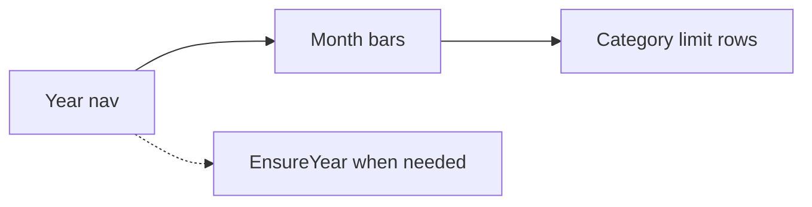

# Compact Budgets (limits only)

## Confirmation: monthly + going forward

**Yes — that stays.** Budgets already supports:
- **Year ↔** and **This year** in [`BudgetDashboard.tsx`](mobile/components/expenses/BudgetDashboard.tsx)
- **Month pick** via `MonthBudgetBars` (`selectedMonthIndex`)
- **Future years**: opening another year still runs `EnsureYearModal` for missing unpaid bill rows (budgets themselves are not rewritten by that prompt)

This plan does **not** remove year/month navigation or ensure-year. You keep viewing Standing / This month **per month**, including months and years ahead.

## What changes

**Budgets job:** edit category limits. **Overview** keeps cashflow + expense drills (paid/unpaid/over/under).

### 1. Flat limit rows — no expense accordion
In [`BudgetCategoryRow.tsx`](mobile/components/expenses/BudgetCategoryRow.tsx):
- Drop expand/collapse, expense lines, paid toggle, and receipt modal from this surface.
- One compact row: category name, origin chip (Manual / From bills), Standing, This month (highlight when dues raise the limit), thin spent-vs-limit bar, Over/Near chip, pencil + trash.
- Spent uses `budget.spent_amount` from the year board (paid-only), so Budgets no longer needs to load month expense lists for the UI.

### 2. Slim [`BudgetDashboard.tsx`](mobile/components/expenses/BudgetDashboard.tsx)
- **Keep:** year nav, Add budget, month bars, selected-month KPI strip (`Budget · Spent · Left/Over`), category list, delete confirm, ensure-year, help (shortened to one collapsed blurb).
- **Remove from primary UI:** year hero card (redundant with Overview), donut + donut filter, long Standing/This month hint paragraph under Categories, expense fetch / `onExpensePress` / paid-toggle wiring used only for the accordion.
- Wide layout: left = month bars + help; right = KPIs + limit list (or single column on narrow).

### 3. Hub wiring
In [`expenses-hub.tsx`](mobile/app/(tabs)/expenses-hub.tsx): stop passing `onExpensePress` into `BudgetDashboard` (budget edit/delete/add unchanged).

### 4. Verify
- Switch months in current year: limits and Standing / This month update.
- Open a future year: ensure prompt still appears when needed; Cancel / Apply behavior unchanged; month bars still selectable.
- Edit Manual Standing, delete budget, Add budget still work.
- `npm run build` in `mobile`.

## Out of scope
- Overview / Cashflow drill layout (already adjusted).
- Bills sync / origin rules / encryption.
- New “jump to Overview filtered by category” deep link (not required for this slim-down).
