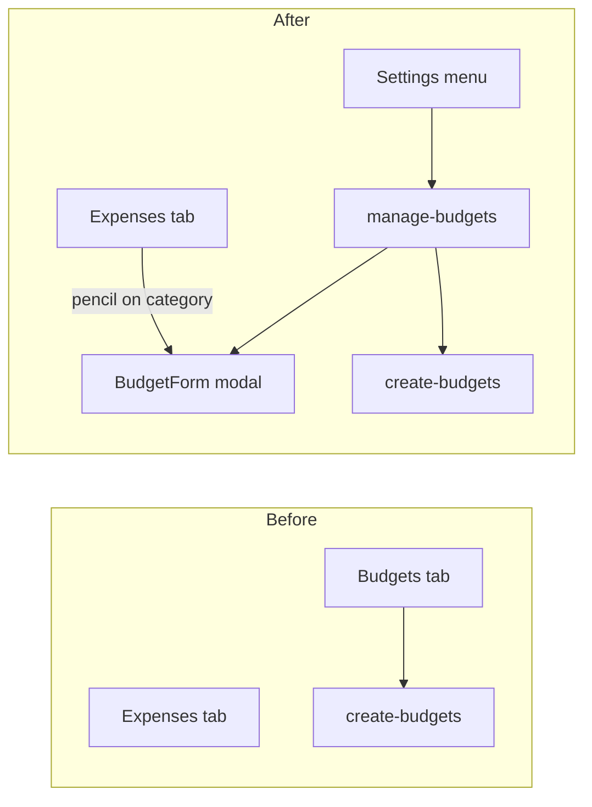

# Consolidate Budgets into Settings

## Goal

Expenses stays the single daily surface (category cards with paid/budget). Budget **setup** (create from recurring, add/edit/delete limits) moves under Settings. Remove the Budgets peer tab.

## 1. Add Manage Budgets screen

Create [`mobile/app/(tabs)/manage-budgets.tsx`](mobile/app/(tabs)/manage-budgets.tsx) by lifting the management pieces from `renderBudgetsTab` in [`mobile/app/(tabs)/expenses.tsx`](mobile/app/(tabs)/expenses.tsx):

- Header + back (same pattern as [`create-budgets.tsx`](mobile/app/(tabs)/create-budgets.tsx))
- **Create budget** button → `router.push('/(tabs)/create-budgets')`
- Month prev/current/next + Today (reuse existing period helpers / styles conceptually)
- Category budget card grid (reuse [`BudgetCard`](mobile/components/expenses/BudgetCard.tsx)) with edit/delete only — **no** paid toggles / item delete on this screen
- FAB or + to open [`BudgetForm`](mobile/components/expenses/BudgetForm.tsx) for add/edit
- Fetch budgets (+ expenses for expandable items if useful) scoped to selected family and `asOf` month

Keep [`create-budgets.tsx`](mobile/app/(tabs)/create-budgets.tsx) as the dry-run / regenerate wizard; only change its entry point (Settings → Manage → Create).

## 2. Wire Settings

In [`mobile/components/SettingsMenu.tsx`](mobile/components/SettingsMenu.tsx), add a menu item:

- Label: **Budgets**
- Icon: `credit-card`
- Route: `/(tabs)/manage-budgets`

Place it near other family/data items (e.g. after Grocery Categories).

## 3. Slim down Expenses screen

In [`mobile/app/(tabs)/expenses.tsx`](mobile/app/(tabs)/expenses.tsx):

- Remove `'budgets'` from `ActiveTab` and from the tab bar array
- Remove `renderBudgetsTab` and budgets-only state (`budgetViewDate`, `budgetDetailsExpanded`, budgets FAB branch)
- Keep loading `budgets` whenever the expenses tab needs them (month/year totals + category cards)
- Keep category-card pencil → `BudgetForm` for quick limit edits from Expenses
- Keep `BudgetForm` modal + create/update/delete handlers (shared with manage screen locally, or duplicate thinly on manage-budgets)

Default landing tab stays **Expenses** (already first meaningful view after removing Budgets from the bar; reorder tabs to `Expenses → Recurring → Reports → Categories`).

## 4. Clean fetch / deps

- Drop `budgetViewDate` / `activeTab === 'budgets'` branches in `fetchData`
- Expenses continue to pass `asOf` / `budget_period` from expenses `viewDate` / `groupBy`
- After create-budgets apply, user returns via back; Manage Budgets and Expenses soft-refresh on focus

## 5. Build

Run `npm run build` in `mobile` after changes.

## Out of scope

- Deleting the create-budgets route
- Changing backend budget APIs
- Moving Categories/Recurring/Reports
