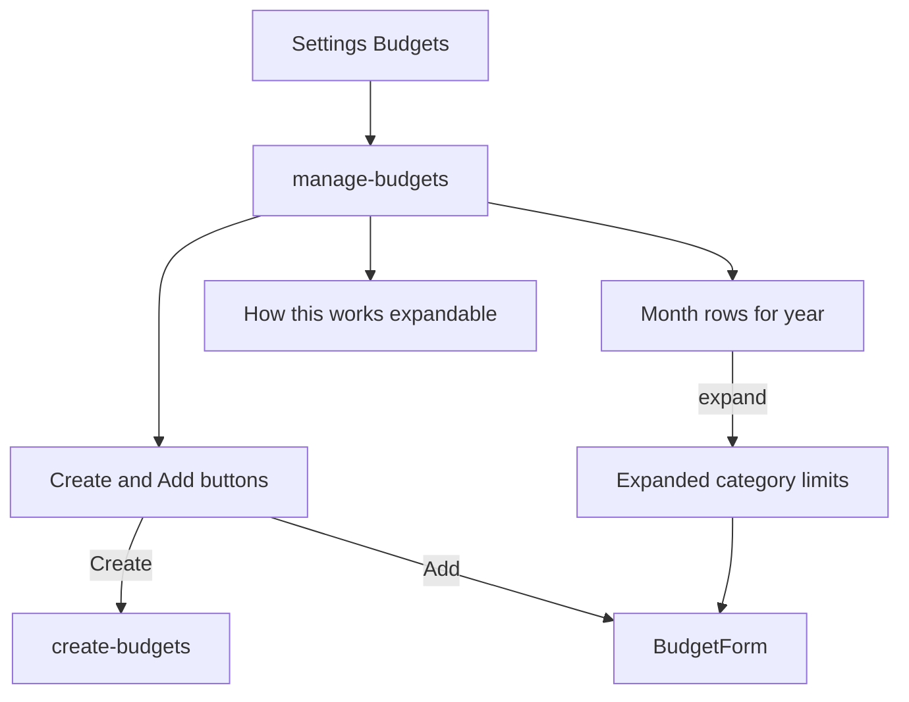

# Consolidate Budgets into Settings

## Product split

| Surface | Job |
|--------|-----|
| **Expenses** | Daily: categories, paid toggles, receipts, expense items, paid vs budget |
| **Settings → Budgets** | Setup: create/regenerate limits, browse months, edit/delete category budgets |
| **Recurring** | Stays on Expenses tabs (not merged into Budgets) |

Manage Budgets is a **clean limits UI** — not a copy of Expenses/Budgets expense actions.

## Manage Budgets screen (`/(tabs)/manage-budgets`)

### Top action row (compact, side by side)

Two smaller buttons in one row (not a full-width Create + separate FAB):

| Button | Action |
|--------|--------|
| **Create** | → existing [create-budgets.tsx](mobile/app/(tabs)/create-budgets.tsx) wizard (from recurring / regenerate) |
| **Add** | Opens [BudgetForm](mobile/components/expenses/BudgetForm.tsx) to add one category budget manually |

Equal flex / compact height so both fit comfortably on mobile. No floating FAB required if **Add** is in this row (keep Add visible; do not drop it).

### Main content: months → categories

1. **Year control** — prev/next year (or equivalent)
2. **Month rows** (Jan–Dec) — label + total budget limit for that month
3. **Expand a month** → category list: name, limit (optional read-only spent); edit + delete per row
4. Default: current month expanded

No paid toggles, expense lists, receipts, or expense delete on this screen.

### Bottom: expandable help (“How this works”)

Collapsed by default; tap to expand. Copy covers:

- Budgets are **monthly category limits** used on the Expenses tab (paid vs budget)
- **Create** builds/updates limits from **active Recurring** templates (and optional expense analysis in the wizard)
- Yearly/recurring dues only count in their **due months** (month totals can differ)
- **Add** creates a single manual category budget without running the full wizard
- Day-to-day paid toggles and expense detail live on **Expenses**, not here
- After changing Recurring, re-run **Create** to resync category limits

## Expenses tab after change

- Remove **Budgets** from tab bar → **Expenses → Recurring → Reports → Categories**
- Remove `renderBudgetsTab` and budgets-only state/FAB
- Keep fetching budgets for month/year cards and accordion
- Keep pencil on category card → `BudgetForm` when a budget exists

## Settings

Add **Budgets** to [SettingsMenu.tsx](mobile/components/SettingsMenu.tsx) → `/(tabs)/manage-budgets`.

## Implementation notes

- Lazy-load `getBudgets(..., { asOf })` per expanded month
- Month-aware limits so yearly dues only inflate due months
- No backend API changes required

## Out of scope

- Merging Recurring into Settings
- Redesigning create-budgets wizard internals
- Backend changes
