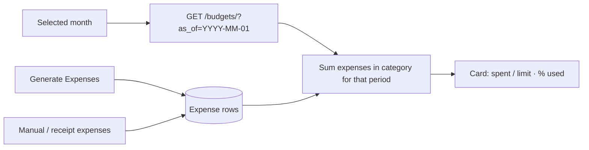
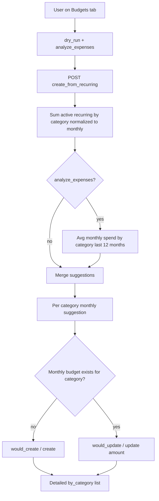

# Create Budgets from Recurring (+ Expense Analysis + Month Nav)

## Decisions (locked)
- **Auto-create always uses `monthly`** — normalize recurring to a monthly budget limit
- Daily / weekly / yearly budgets stay available via manual form and **show** in the list with a period label
- **Existing monthly budget** for same family + category → **update amount**
- Dry run **on by default**; detailed results; **Run for real** from preview
- Optional **Analyze expenses** toggle for missing/higher category budgets
- **Month-to-month navigation** on Budgets tab so you can see spent vs limit for any month

## How month view works
- Budget **limit** = the budget amount (seeded from recurring / analysis; same across months unless updated)
- Budget **spent** for the selected month = sum of **expenses** in that category whose `expense_date` falls in that month (includes generated recurring expenses + one-off expenses)
- Prev/next month control (same idea as Expenses period tabs) sets `viewMonth`
- API list accepts `as_of=YYYY-MM-DD` (first of selected month); spent/remaining/% use that date’s period window instead of `today`

## Create-from-recurring behavior

**Recurring → monthly:** daily×30.44, weekly×4.33, monthly×1, yearly÷12

**Expense analysis:** last 12 months; avg monthly; merge with max(recurring, expense_avg); skip ~$0

**Match existing:** active `family` + `category` + `period='monthly'`

## Backend
1. [`backend/expenses/views.py`](backend/expenses/views.py) `BudgetViewSet.create_from_recurring`
   Body: `{ family, dry_run, analyze_expenses }` — period fixed monthly
   Response: counts + `by_category[]` actions (`would_create` / `created` / `would_update` / `updated` / `skipped`)

2. Budget list + serializer spent calc: accept `as_of` query param; use it as the reference date for daily/weekly/monthly/yearly windows in [`BudgetSerializer.get_spent_amount`](backend/expenses/serializers.py) (via serializer context)

## Frontend
[`mobile/app/(tabs)/expenses.tsx`](mobile/app/(tabs)/expenses.tsx) Budgets tab:
- Month prev/next + label (e.g. October 2026); refetch budgets with `as_of` when month changes
- Dry run + Analyze expenses toggles + Create budgets button + results modal
- FAB + form unchanged for manual any-period budgets

[`mobile/components/expenses/BudgetCard.tsx`](mobile/components/expenses/BudgetCard.tsx): period label (`Rent · Monthly`)

[`mobile/services/expenseService.ts`](mobile/services/expenseService.ts) + types: create-from-recurring + `getBudgets(familyId, { isActive, asOf })`

## Out of scope
- Yearly generation window label for Cursor AI (deferred)
- Auto-creating daily/weekly/yearly budgets from this button
- Per-month *different* budget limits (limit stays one amount; only spent changes by month)
