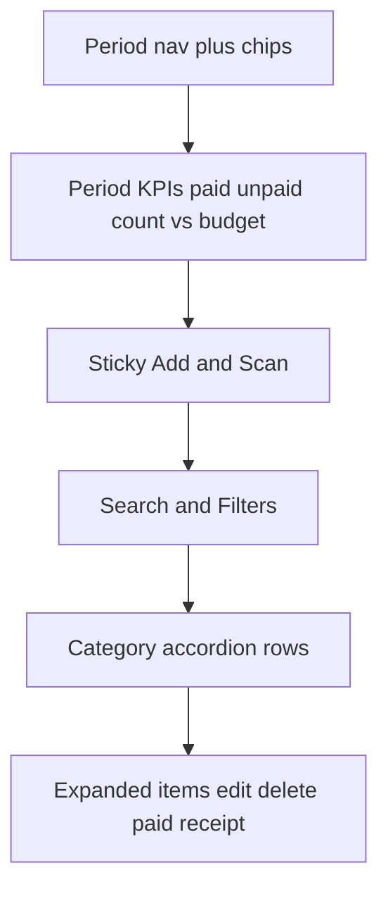

# Expense Board Tab

## Naming and placement
- Keep existing **Expenses** tab (`renderExpensesTab` in [`expenses-hub.tsx`](mobile/app/(tabs)/expenses-hub.tsx)) unchanged
- Add **Expense board** (id `expense-board`) immediately **before** Expenses
- New component: [`ExpenseDashboard.tsx`](mobile/components/expenses/ExpenseDashboard.tsx)

Tab order: Overview · Budgets · **Expense board** · Expenses · Bills · Categories

## Design (match Overview/Budgets chrome; keep Expenses as the manage surface)

Expenses stays period-flexible (day / week / month / year / all) — not year-only like Budgets — because this is where people add and update spend.

1. **Period chrome** — same Day/Week/Month/Year/All + ◀ ▶ + Today as today, in a compact card/header (not a dense toolbar-first layout)
2. **Hero KPIs** — Paid spent · Unpaid · Expense count · Budgeted (omit budget cell when period is All)
3. **Donut** — Paid vs unpaid for the filtered period (reuse [`DonutChart`](mobile/components/expenses/charts/DonutChart.tsx))
4. **Primary actions** — prominent **Add** + **Scan receipt** (camera) — these stay first-class, not buried
5. **Search + Filters** — same capabilities as today (category, payment, tag, recurring/one-time, paid status, sort, upcoming bills toggle, clear); filter panel collapsed by default
6. **Categories** — list of expandable rows (reuse/adapt [`BudgetCategoryRow`](mobile/components/expenses/BudgetCategoryRow.tsx) or a thin `ExpenseCategoryRow` twin): category name, paid/budget progress when a budget exists, item count; expand → compact one-line items with paid switch, receipt icon, tap to edit, trash to delete
7. **Upcoming bills** — optional collapsed section when “Upcoming bills” is on (same `RecurringExpenseRow` data as today)
8. **Empty budget-only categories** — when no search/filters, still show budgeted categories with $0 spent (parity with current Expenses)

## Functionality preserved (hub callbacks)

| Action | Wiring |
|--------|--------|
| Add expense | Opens hub `ExpenseForm` create |
| Scan receipt | Opens hub `ReceiptScanWizard` |
| Edit expense | Item press → `openExpenseEditor` |
| Delete expense | Confirm → `handleDeleteExpense` |
| Paid toggle | `updateExpense({ is_paid })` + local list update |
| Edit budget (if present) | Pencil → hub `BudgetForm` |
| Search / filters / sort / period | Same state logic as `renderExpensesTab` (extract shared helpers or pass props from hub) |

Data: reuse hub-loaded `expenses`, `budgets`, `categories`, `tags`, `recurringExpenses`, `viewDate`, `periodMode`, and existing `filteredExpenses` / filter state — either lift UI into `ExpenseDashboard` with props from hub, or move filter+period state into the new component and keep forms on the hub. **Chosen approach:** `ExpenseDashboard` owns period/filter/search UI state locally (like `BudgetDashboard` owns year) and loads its own expenses/budgets for the selected range with family guards; opens forms via the same callback props pattern as BudgetDashboard (`onAdd`, `onScan`, `onExpensePress`, `onExpenseDelete`, `onTogglePaid`, `onBudgetPress`). Hub still mounts `ExpenseForm` / `ReceiptScanWizard` / `BudgetForm` and bumps `refreshKey` after saves.

## Visual language
- Section cards, hero KPIs, donut, accordion rows — same as Budgets/Overview
- Theme colors via `useTheme` / `displayMoney`
- No new chart libraries

## Out of scope
- Removing or changing the current Expenses tab
- Auto-sync / Bills Update plan work

## Deliverable
- Wire tab + implement `ExpenseDashboard` (+ row component if needed)
- Rebuild web `dist`
