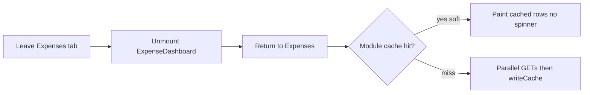

# Expenses board soft cache

## Problem
[`ExpenseDashboard.tsx`](mobile/components/expenses/ExpenseDashboard.tsx) already soft-loads while mounted, but the hub unmounts it on tab switch (`switch (activeTab)` in [`expenses-hub.tsx`](mobile/app/(tabs)/expenses-hub.tsx)). Return visits cold-fetch expenses + budgets + recurring (+ cats/tags if hub catalog not ready). Paid toggles go through hub `bumpExpenseBoards()`, which bumps `refreshKey` and can race local UI updates.

Budgets/Cashflow already use module `Map` caches with soft early-return; Expenses does not.

## Approach (mirror Budgets)

### 1. Module cache in ExpenseDashboard
- `expenseBoardCache = Map<string, ExpenseBoardCache>`
- Key: `familyId:periodMode:rangeKey` where `rangeKey` is `start_date|end_date` from `periodDateRange`, or `all` for period mode `all`
- Value: `{ expenses, budgets, categories, tags, recurringExpenses, periodMode, viewDateISO }`
- Export `invalidateExpenseBoardCache(familyId?)` (same prefix-clear pattern as `invalidateBudgetYearCache`)

### 2. Soft hydrate + early return
- Init state from cache when `selectedFamily` matches (like BudgetDashboard `initialCache`)
- In `load({ soft })`: if cache hit → apply to state, `setLoading(false)`, **return when soft** (skip network). Mutations clear cache so next soft/hard load refetches.
- On successful fetch → `writeCache(...)`
- Keep existing family-switch `clearState` behavior; do not paint another family’s rows

### 3. Paid toggle sticks
- In `ExpenseDashboard.handleTogglePaid`: after success, update local `expenses` **and** `writeCache` (same lesson as Budgets paid toggle)
- Change hub [`handleTogglePaid`](mobile/app/(tabs)/expenses-hub.tsx) to **API-only** (no `bumpExpenseBoards`). From the dashboard, after writeCache, call `invalidateBudgetYearCache` + `invalidateCashflowYearCache` so Overview/Budgets stay consistent with paid/spent without remounting Expenses into a refetch race
- Creates/edits/deletes keep `bumpExpenseBoards()` as today

### 4. Wire invalidation
- In hub `bumpExpenseBoards` / `clearExpenseState`: also call `invalidateExpenseBoardCache(familyId)` (or clear-all on full family clear)

### 5. Bills (same remount gap, small pass)
- Add a lighter module cache in [`BillsDashboard.tsx`](mobile/components/expenses/BillsDashboard.tsx) keyed by `familyId` for `{ bills, budgets, categories }`
- Export `invalidateBillsBoardCache`; call it from the same hub bump/clear paths
- Soft+cache early return on remount; write on load + after local bill save/delete

### 6. Verify
- Rebuild mobile `dist`
- Manual: open Expenses → leave to Budgets/Overview → return (instant, no spinner); flip paid → leave/return (toggle sticks); edit expense (boards refresh); family switch (no cross-family paint)

## Out of scope
- New backend batch endpoints for expenses
- Keep-mounted tabs / router changes
- Changing cold first-open network shape (still one parallel Promise.all)