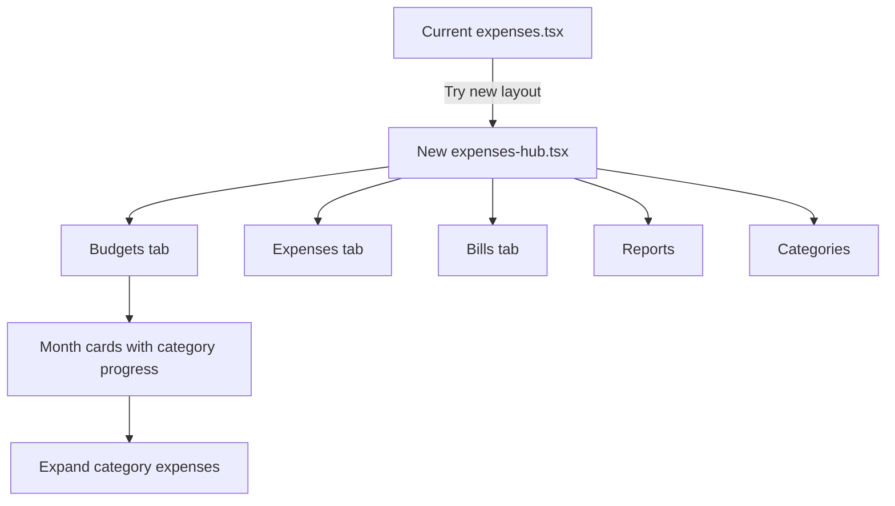

# New Expense Tracker landing with top-level Budgets

## Why this makes sense

Yes. **Bills** are recurring templates (schedule). **Budgets** are category limits and spending against those limits. Nesting Year Budget under Bills mixes two jobs. Putting **Budgets** as its own top tab matches how people think: plan limits vs track bills vs log spend.

## Approach

Keep [`mobile/app/(tabs)/expenses.tsx`](mobile/app/(tabs)/expenses.tsx) as-is (Expenses | Bills | Reports | Categories, with Year Budget still under Bills).

Add a **new screen** that is the new landing, plus a small entry button on the current page.

## Navigation

- New route: [`mobile/app/(tabs)/expenses-hub.tsx`](mobile/app/(tabs)/expenses-hub.tsx) (hidden from bottom tab bar in [`_layout.tsx`](_layout.tsx)).
- On current Expenses landing: a compact control (e.g. header chip or link) **“New layout”** → `router.push('/(tabs)/expenses-hub')`.
- On new hub: **“Classic layout”** → back to `/(tabs)/expenses`.
- Settings can keep pointing at classic or Bills & Budgets; no Settings change required for this pass.

## New hub tabs

| Tab | Content |
|-----|---------|
| **Budgets** | New year overview of month cards (default tab) |
| **Expenses** | Reuse existing expenses period UI (extract shared content or embed the same render path) |
| **Bills** | Bills list + Update plan only — **no** Year Budget sub-tab |
| **Reports** | Same placeholder as today |
| **Categories** | Same categories/tags UI as today |

**Bills cleanup on new hub only:** pass a prop into [`BillsBudgetsHub`](mobile/components/expenses/BillsBudgetsHub.tsx) such as `yearTabEnabled={false}` so classic Bills keeps Year Budget; new hub Bills is recurring-only.

## Budgets tab UI (new component)

New component: [`mobile/components/expenses/MonthBudgetCards.tsx`](mobile/components/expenses/MonthBudgetCards.tsx) (used only by the new hub’s Budgets tab).

**Layout**

- Year prev/next (same pattern as [`YearBudgetOverview`](mobile/components/expenses/YearBudgetOverview.tsx)).
- One **card per month** that has any budget or spent:
  - Header: month name + **total budget** and **total spent** for the month.
  - Body: each category as a row with **limit vs spent** and a **color-coded progress bar** matching Expenses / [`BudgetCard`](mobile/components/expenses/BudgetCard.tsx):
    - over 100% → red
    - at 100% → green
    - near `alert_threshold` → amber
    - else → primary
  - Categories sorted by name; show spent even when under limit.
- **Drill-down:** tap a category row (or chevron) to expand a collapsible list of that month’s expenses in that category (date, amount, paid, same affordances as BudgetCard expand — open edit / paid toggle where already supported).
- Empty months: collapsed one-line “No budgets” or hide months with zero limit and zero spent to reduce noise (hide empty).

**Data**

- Load 12 months of budgets: `getBudgets(familyId, true, { asOf: 'YYYY-MM-01' })` (existing YearBudgetOverview pattern).
- On expand of a month (or when a month card mounts if expanded by default for current month): `getExpenses(familyId, { start_date, end_date })` for that month; group by `category` for spent + line items.
- Default expand **current month** only; other months collapsed until opened (lazy-load expenses on first expand).

**Reuse**

- Progress math/colors: mirror `BudgetCard` (extract a tiny shared helper if needed to avoid duplication).
- Expense row actions: reuse patterns from BudgetCard expand list; tap expense opens existing `ExpenseForm` via hub-owned state (same as expenses.tsx).

## Expenses / Categories / Reports on new hub

Avoid forking the entire [`expenses.tsx`](mobile/app/(tabs)/expenses.tsx) (it’s large). Concrete approach:

1. Extract the **Expenses tab body** (period chips, nav, summary, BudgetCard grid) into `ExpensesPeriodView.tsx` used by classic `expenses.tsx` and new hub — **only if** a thin extract is quick; otherwise the new hub’s Expenses tab can **router.replace** or deep-link is worse UX.
2. Preferred ship path: new hub file owns tab chrome; for **Expenses** and **Categories**, import shared pieces already used by expenses.tsx (`ExpenseForm`, `BudgetCard`, `CategoryForm`, services) and copy the minimal tab render logic into the hub **or** extract `renderExpensesTab` / `renderCategoriesTab` into shared components in the same PR.

Minimum viable extract (to keep classic page untouched behaviorally):

- Leave `expenses.tsx` untouched except the **New layout** button.
- New hub **reimplements** Expenses/Categories/Reports by composing existing components + the same service calls (acceptable duplication for a parallel landing; refine extract later).

## Out of scope

- Removing Year Budget from classic Bills.
- Backend API changes (existing budgets + expenses endpoints are enough).
- Reports implementation.

## Implementation order

1. Register `expenses-hub` route; add New layout / Classic layout buttons.
2. Hub shell with five tabs; Bills with `yearTabEnabled={false}`.
3. Build `MonthBudgetCards` (year load, month cards, category progress, expense drill-down).
4. Wire Expenses + Categories + Reports on hub using existing components/services.
5. `npm run build` for web deploy.
