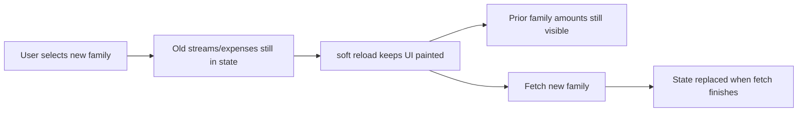

# Family switch: hide prior Expense/Money data

## Assessment

**Backend isolation is fine for non-members** — expense/money querysets are scoped to `family__members__user=user`. The leak you are seeing is **client-side**: when switching from e.g. Steve Ross Family to another family, screens keep previous arrays in React state and often use “soft” loading that still paints the old cards/totals.

Main culprits:

| Area | Problem |
|------|---------|
| [money.tsx](mobile/app/(tabs)/money.tsx) | Does not clear `streams` / `occurrences` / `accounts` / `snapshots`; spinner only if arrays empty |
| [expenses-hub.tsx](mobile/app/(tabs)/expenses-hub.tsx) | Soft reload when data already present; Budgets/Bills tab does not clear expenses; filters/editors kept |
| [CashflowReport.tsx](mobile/components/expenses/CashflowReport.tsx) | Same soft-stale pattern for income + expenses |
| [MonthBudgetCards.tsx](mobile/components/expenses/MonthBudgetCards.tsx) / [BillsBudgetsHub.tsx](mobile/components/expenses/BillsBudgetsHub.tsx) / [YearBudgetOverview.tsx](mobile/components/expenses/YearBudgetOverview.tsx) | Month/bill caches not cleared; weak race guards |

Show-amounts masking does **not** fix this — category names, bill descriptions, and structure from the prior family can still show.

## Approach

On every `selectedFamily?.id` change (including `null`):

1. **Immediately clear** all expense/money domain state for that screen.
2. **Force a hard loading state** (no soft paint of previous family’s data).
3. **Close editors/modals** and reset filters/selection IDs.
4. **Ignore stale responses** with an existing or new generation counter.
5. **Remount** heavy children with `key={selectedFamily.id}` so internal caches die with the family.

Default: no shared global “finance cache” — each screen clears itself. Remount via `key` is the safety net.

## Concrete changes

### Money — [mobile/app/(tabs)/money.tsx](mobile/app/(tabs)/money.tsx)

- `useEffect` on `selectedFamily?.id`:
  - Clear `streams`, `occurrences`, `accounts`, `snapshots`
  - Reset `selectedStreamId`, `selectedAccountId`, expanded IDs
  - Close stream/occurrence/account forms and Update Balances wizard
  - Reset `ensuredYearRef`, `error`, set `loading=true`
- Show spinner whenever `loading` (remove “only if empty arrays” gate), or only render lists when `dataFamilyId === selectedFamily.id`
- Keep/strengthen fetch generation so a late response from family A cannot overwrite family B
- Only run `ensureYearSchedule` after streams for the **current** family have loaded
- Reset selection from the new list (`setSelectedStreamId(s[0]?.id ?? null)`), do not keep `prev`

### Backend harden (small) — [backend/money/serializers.py](backend/money/serializers.py)

- Make `family` **read-only** on income stream / account serializers so an update after a family switch cannot reassign an entity to the newly selected family

### Expenses hub — [mobile/app/(tabs)/expenses-hub.tsx](mobile/app/(tabs)/expenses-hub.tsx)

- On family change: clear `expenses`, `budgets`, `categories`, `tags`, `recurringExpenses`; clear filters (`filterCategory`, `filterTag`, `filterPaid`, etc.); close forms; null editors; `setLoading(true)`
- On family change, always `load({ soft: false })` regardless of active tab (so Budgets/Bills also refresh parent expense/recurring data)
- Remount children:
  - `<MonthBudgetCards key={selectedFamily.id} ... />`
  - `<BillsBudgetsHub key={selectedFamily.id} ... />`
  - `<CashflowReport key={selectedFamily.id} />`

### Expense children

- [CashflowReport.tsx](mobile/components/expenses/CashflowReport.tsx): clear `occurrences` / `expenses` / `budgets` on family change; show spinner while `loading` (not only when arrays empty)
- [MonthBudgetCards.tsx](mobile/components/expenses/MonthBudgetCards.tsx): clear `budgetsByMonth` + `expensesByMonth` on family change; add fetch generation (match hub pattern)
- [BillsBudgetsHub.tsx](mobile/components/expenses/BillsBudgetsHub.tsx): clear `bills` / `budgets` / `categories`; close bill form; generation guard; spinner while loading after switch
- [YearBudgetOverview.tsx](mobile/components/expenses/YearBudgetOverview.tsx): clear `budgetsByMonth` on family change; honour cancel/generation in `loadYear`

### Out of scope

- Changing ShowAmounts (global mask only)
- Bank sync / new APIs
- Demo portfolio (per-user display boost; not cross-family storage)

## Verification

1. Open Money + Expenses on Steve Ross Family until data is visible
2. Switch to another family **without leaving the tab**
3. Confirm: immediate blank/spinner — no prior income streams, accounts, expenses, bills, cashflow, or budget cards
4. Confirm new family’s data loads after fetch
5. Switch back and confirm Steve Ross data returns only after its fetch
6. With an edit modal open on family A, switch to B — modal closes and no A entity remains editable
