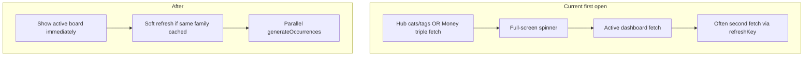

# Faster Money & Expenses first loads

## What’s slow today

Two patterns dominate wall time:

1. **Blocking parents before the active dashboard**
   - Expenses: [`expenses-hub.tsx`](mobile/app/(tabs)/expenses-hub.tsx) waits on `getCategories` + `getTags` before mounting Overview/Budgets/etc. (`familyDataReady`).
   - Money: [`money.tsx`](mobile/app/(tabs)/money.tsx) always `setLoading(true)` and fetches streams + accounts + snapshots, then bumps every board `refreshKey`, which makes YTD fetch accounts/snapshots **again**.

2. **Hard reloads on focus for the heaviest boards**
   - [`CashflowDashboard.tsx`](mobile/components/expenses/CashflowDashboard.tsx): sequential `generateOccurrences` per stream, then year expenses/occurrences; no soft-load.
   - [`BudgetDashboard.tsx`](mobile/components/expenses/BudgetDashboard.tsx): 12× `getBudgets` every focus; no soft-load.
   - [`IncomeDashboard.tsx`](mobile/components/money/IncomeDashboard.tsx): same sequential generate pattern.

## Approach (frontend only — safest)

Reuse the soft-load pattern already on Expenses/Bills/YTD: keep prior UI for the same family; full spinner only on first load or family switch. No new caching library; no backend changes.

### 1. Money parent: soft-load + stop double-fetch

In [`money.tsx`](mobile/app/(tabs)/money.tsx):
- Add `load({ soft })` like expenses-hub: soft when `dataFamilyId === selectedFamily.id` and accounts/streams already present.
- Gate UI with hard spinner only when `dataFamilyId !== selectedFamily.id` (not every refocus).
- **Do not** bump YTD/Income/Accounts/Target `refreshKey` after routine focus `load()`. Keep bumps only after mutations that need board refresh (create/update/delete handlers that already refresh).
- Pass parent `accounts` / `snapshots` into [`YtdDashboard`](mobile/components/money/YtdDashboard.tsx) and [`AccountsDashboard`](mobile/components/money/AccountsDashboard.tsx) as optional initial props so first paint can use parent data and skip the immediate duplicate GET (still soft-refresh on mutation `refreshKey`).

### 2. Expenses hub: don’t block boards on cats/tags

In [`expenses-hub.tsx`](mobile/app/(tabs)/expenses-hub.tsx):
- Mount the active dashboard as soon as a family is selected; load categories/tags in parallel for forms/modals.
- Keep hard gate only for the Categories tab (or when opening forms that need cats/tags).
- Soft-load hub cats/tags on tab switch remains; remove `activeTab` from forcing a hard feel if soft already works.

### 3. Soft-load Cashflow + Budgets

Mirror Expenses/Bills:
- [`CashflowDashboard.tsx`](mobile/components/expenses/CashflowDashboard.tsx): `load({ soft })`; spinner only when no data for current family.
- [`BudgetDashboard.tsx`](mobile/components/expenses/BudgetDashboard.tsx): same for `loadYear`; do **not** clear `expensesByMonth` / force hard year reload on every focus when same family+year already loaded; soft-refresh in background.

### 4. Parallelize `generateOccurrences`

In Cashflow + Income (and Money parent if it still loops):
- Change sequential `for … await generateOccurrences` to `Promise.all` over active streams.
- Keep existing generation/family guards so stale responses are ignored.

### 5. Trim redundant child fetches on Expenses tabs

- [`ExpenseDashboard.tsx`](mobile/components/expenses/ExpenseDashboard.tsx) / [`BillsDashboard.tsx`](mobile/components/expenses/BillsDashboard.tsx): accept hub `categories`/`tags` (and recurring if already loaded) as props when available; skip re-fetching those on mount if props are present for the same family.

## Out of scope (on purpose)

- New Budgets year API (12 month calls stay; soft-load + less refetch is the win).
- React Query / persistent cache.
- Changing pagination page size or backend serializers.

## Verification

- Cold open Money → YTD: one accounts+snapshots path (not two), soft revisit keeps UI.
- Cold open Expenses → Overview: board starts without waiting on cats/tags; soft revisit.
- Budgets / Income / Cashflow: first load still correct numbers; revisit no full blank spinner.
- Create/edit expense, budget, stream, account: boards still refresh.
- Family switch: no flash of previous family’s data.
- Rebuild `mobile/dist` after changes.
