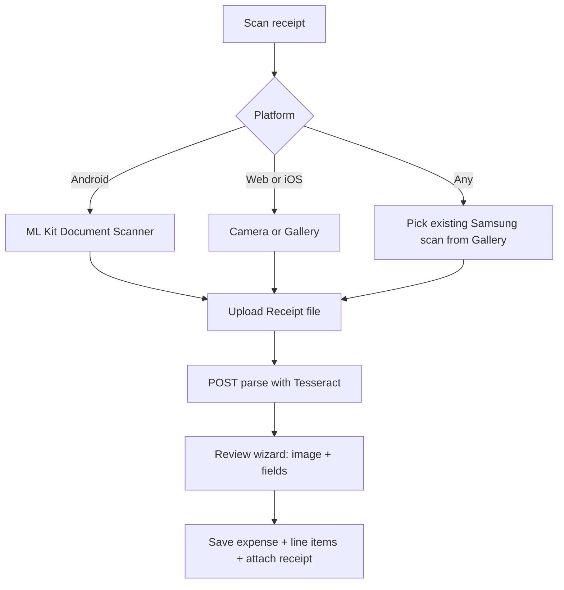

# Free receipt OCR + review wizard

## Decisions locked

- **OCR:** free / self-hosted — **Tesseract** on Django (`pytesseract` + Pillow). Upload image → server OCR (web + native). No paid APIs.
- **Scope:** auto-extract **total, merchant, date** when possible; **line items manual** in a review wizard that always shows the receipt image.
- **Capture (updated):**
  - **Android (incl. Samsung):** prefer **Google ML Kit Document Scanner** in-app — edge crop, deskew, contrast (same class of quality as Samsung Camera’s document mode; free Play Services API).
  - **Also supported:** pick from **Gallery** if you already scanned with Samsung Camera and saved the image/PDF page.
  - **Web / iOS fallback:** camera photo or gallery via existing `expo-image-picker` (no ML Kit scanner on web).

## User flow

1. User taps **Scan receipt**.
2. On Android → document scanner UI; or choose Gallery if the scan is already on the phone.
3. Upload to [`Receipt`](backend/expenses/models.py) (`expense` may be null until confirm).
4. Backend OCR → suggested merchant / date / total + confidence.
5. Wizard: image + editable fields + manual line items → Save expense, lines, attach receipt.

Low OCR confidence: wizard still opens; user fills amount/merchant manually with the image visible.

## Backend

- `pytesseract` in [`requirements.txt`](backend/requirements.txt); host needs **Tesseract** on PATH.
- [`backend/expenses/receipt_ocr.py`](backend/expenses/receipt_ocr.py): preprocess, OCR, heuristics for TOTAL / date / merchant.
- **`ExpenseLineItem`** model + migration (encrypted name/qty/prices).
- `POST /receipts/{id}/parse/` on [`ReceiptViewSet`](backend/expenses/views.py).
- Nested or sibling line-item save on expense create/update.
- Fix upload to always send `family`.

## Mobile

- **Android document scan:** Expo-compatible ML Kit Document Scanner module (config plugin / native build — not available in plain web `dist` alone; Android APK/dev client required for in-app scan). Capture button label: **Scan receipt**.
- Gallery + camera remain for web and as fallback.
- Finish receipt UI in [`ExpenseForm.tsx`](mobile/components/expenses/ExpenseForm.tsx).
- **`ReceiptScanWizard`:** capture → upload/parse spinner → image + fields + line items → save.
- [`expenseService.ts`](mobile/services/expenseService.ts): `parseReceipt`, line items, `family` on upload.
- Entry point: **Scan receipt** on expenses tab / form.

## Note on Samsung Camera

Scanning in **Samsung Camera → Document** then **Gallery → Pick** in KewlKids works without extra APIs. In-app ML Kit scanner gives a similar result without leaving the app. Both feed the same OCR + wizard.

## Out of scope

- Paid receipt APIs, auto line-item OCR, Reports tab, Samsung-only proprietary camera Intent (use ML Kit instead for portability).

## Ops note

Server: install Tesseract. Android: rebuild native app (Expo prebuild / EAS) after adding the document-scanner module; static web `dist` keeps gallery/camera only.
