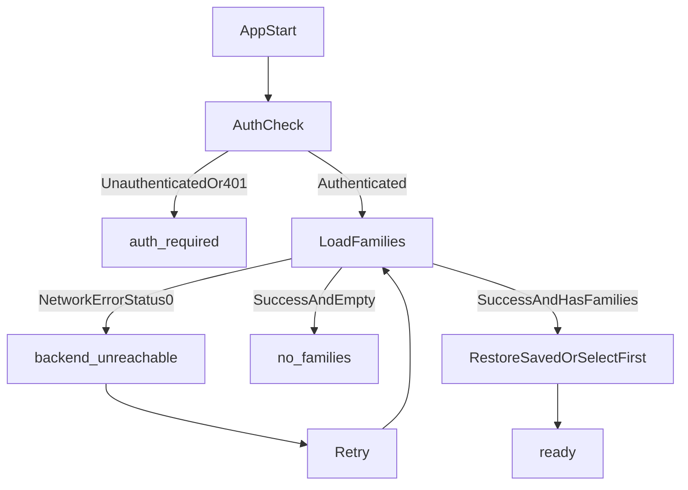

# Fix Null Family State Handling (No Regressions)

## Goal

Ensure `selectedFamily === null` has one clear meaning at a time:

- `loading`: app is still bootstrapping.
- `auth_required`: user must login again.
- `backend_unreachable`: backend/app is down or unreachable.
- `no_families`: authenticated user has zero families.
- `ready`: authenticated and a family is selected.

This prevents the current ambiguity where backend/network failures can look like a normal no-family state.

## Current behavior to preserve

- Existing 401 refresh/login redirect flow in `[mobile/services/api.ts](mobile/services/api.ts)`.
- Saved-family restore + auto-select-first-family behavior in `[mobile/contexts/FamilyContext.tsx](mobile/contexts/FamilyContext.tsx)`.
- Existing family CRUD and tab data loading APIs.

## Implementation plan

### 1) Add explicit null-family state model

Extend family bootstrap state in `[mobile/contexts/FamilyContext.tsx](mobile/contexts/FamilyContext.tsx)` with a small enum/union:

- `bootstrap_loading`
- `ready`
- `no_families`
- `auth_required`
- `backend_unreachable`
- `error_other` (optional fallback)

Expose this state through `useFamily()` so screens can decide intent, not just `selectedFamily === null`.

### 2) Classify failure source non-invasively

In `[mobile/services/api.ts](mobile/services/api.ts)`:

- Keep interceptor and retry semantics unchanged.
- Add a helper for UI classification only, based on existing `APIError`:
  - `status === 401` -> `auth`
  - `status === 0` / no-response message -> `network`
  - otherwise -> `other`

In `[mobile/contexts/FamilyContext.tsx](mobile/contexts/FamilyContext.tsx)`:

- Map classification to context state:
  - auth -> `auth_required`
  - network -> `backend_unreachable`
  - success + zero families -> `no_families`
  - success + families present -> `ready` and auto-select saved/first family

### 3) Add global gate where tabs are rendered

In `[mobile/app/(tabs)/_layout.tsx](mobile/app/(tabs)`/_layout.tsx):

- If state is `backend_unreachable`, render blocking fallback:
  - “Cannot reach server. App may not be running.”
  - `Retry` button -> `refreshFamilies()`
- If state is `auth_required`, keep existing login redirect path (do not add competing behavior).
- If `bootstrap_loading`, show spinner (existing pattern retained).

This makes all tabs consistent without rewriting each screen.

### 4) Keep families screen behavior, but only for true empty-account case

In `[mobile/app/(tabs)/families.tsx](mobile/app/(tabs)`/families.tsx):

- Only show “No families yet” empty state when context state is `no_families`.
- If context indicates backend unreachable, show explicit server-down copy and retry.
- Keep existing alert/banner wiring and refresh button.

### 5) Minimal touch policy to avoid regressions

- No endpoint changes.
- No payload/response shape changes.
- No auth storage changes.
- No navigation service behavior changes in `[mobile/services/navigationService.ts](mobile/services/navigationService.ts)`.

## Scenario outcomes after implementation

- **Auth expired/invalid** -> refresh attempt -> login redirect if refresh fails.
- **Backend down/unreachable** -> global unavailable screen with Retry (not “No families yet”).
- **Backend recovers** -> Retry reloads families; saved/first family is selected.
- **Authenticated with zero families** -> intentional empty state with Create Family CTA.
- **Authenticated with families + null selection** -> auto-select saved/first family, app becomes ready.

## Target flow

## Primary files

- `[mobile/contexts/FamilyContext.tsx](mobile/contexts/FamilyContext.tsx)`
- `[mobile/services/api.ts](mobile/services/api.ts)`
- `[mobile/app/(tabs)/_layout.tsx](mobile/app/(tabs)`/_layout.tsx)
- `[mobile/app/(tabs)/families.tsx](mobile/app/(tabs)`/families.tsx)
- `[mobile/services/navigationService.ts](mobile/services/navigationService.ts)`

