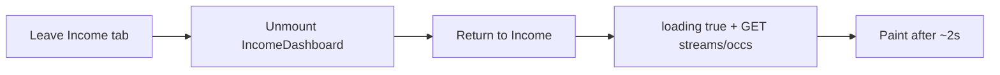

# Income tab soft cache

## Why it’s ~2s every time
Yes — this one was missed for remount survival.

[`money.tsx`](mobile/app/(tabs)/money.tsx) unmounts Income when you leave the tab (`tab === 'income' ? <IncomeDashboard /> : …`). [`IncomeDashboard.tsx`](mobile/components/money/IncomeDashboard.tsx) then remounts with `loading: true` and empty state, and `load()` always hits:

1. `getStreams` + `getOccurrences` (network — the ~2s)
2. `ensureStreamSchedules` (already skipped on remount via `ensuredIncomeScheduleKeys`)

Soft-load only helps while mounted (`sameFamily`); remount resets `dataFamilyId`, so every return is a hard path.

## Fix (same pattern as Cashflow/Budgets)

### 1. Module cache in IncomeDashboard
- `incomeBoardCache = Map<string, { streams, occurrences, demoPortfolio, year, boardTab, selectedMonthIndex }>`
- Key: `familyId` (optionally include year if year-scoped data matters; default store last viewed year + prefs like Expenses `lastKey`)
- Export `invalidateIncomeBoardCache(familyId?)`
- Init state from cache on mount; `loading: !initialCache`
- In `load({ soft })`: on cache hit → paint + **early return when soft**; mutations clear cache so next load refetches
- `writeCache` after successful fetch

### 2. Wire invalidation from Money hub
In [`money.tsx`](mobile/app/(tabs)/money.tsx), wherever streams/occurrences are created/updated/deleted (and header refresh), call `invalidateIncomeBoardCache(familyId)` before or with `setIncomeBoardRefreshKey`.

Header refresh already bumps `incomeBoardRefreshKey`; keep `load({ soft: false })` on refreshKey **after** invalidate so force-refresh still works.

### 3. Docs
Short note in [`Docs/MONEY_EXPENSES_PERF.md`](Docs/MONEY_EXPENSES_PERF.md) that Income now has the remount cache.

### 4. Rebuild `dist`

## Expected result
- First open Income: still ~2s cold (unchanged)
- Leave to YTD/Accounts/Forecast → back to Income: instant paint, no spinner, no streams/occs GETs
- Edit stream / payment / header refresh: invalidate → refetch

## Out of scope
YTD/Accounts/Forecast (parent-seeded; user report is Income-specific).