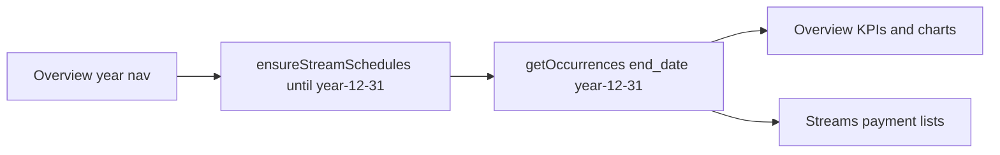

# Open-ended income follows selected year

## Why it feels wrong today
[`IncomeDashboard.tsx`](mobile/components/money/IncomeDashboard.tsx) hard-codes open-ended streams to **calendar year + 1** (`openEndedPayHorizonEnd` / `openEndedPayHorizonYear`). That caps fetch, list truncation, and help copy at **2027** in 2026 — even though streams have no end date and Overview can navigate to 2028+.

`ensureStreamSchedules` already takes the Overview year but still uses `Math.max(y, currentYear + 1)`, and Streams UI ignores the selected year entirely.

## Target behavior
- Selected Overview **year** is the horizon for open-ended streams: generate and show pays through `{year}-12-31`.
- Streams with an `end_date` still stop at that date (unchanged).
- Advancing to 2028 (or any later year) ensures missing occurrences for that year, refetches, then Overview/Streams show them.
- Copy updates to match (no “1 year forward”).

## Implementation (single file)
In [`mobile/components/money/IncomeDashboard.tsx`](mobile/components/money/IncomeDashboard.tsx):

1. **Horizon helpers** — replace current+1 helpers with year-based ones, e.g. `openEndedHorizonEnd(year)` → `` `${year}-12-31` ``.
2. **`ensureStreamSchedules`** — for open-ended streams use `until = ${y}-12-31` (drop `currentYear + 1`). Keep the ensure-key set so repeats are cheap.
3. **`load` / year-change effect** — fetch occurrences with `end_date` = horizon for the active Overview year (`yearRef` / `year`), not fixed current+1.
4. **`paymentsForStream`** — take the selected `year` and truncate open-ended lists to that year’s Dec 31; set `truncatedOpenEnded` when the stream has no end date.
5. **Copy** — Streams hint and per-stream note: e.g. “Open-ended streams show through {year}. Change the year above to generate further.”

## Out of scope
- Backend default (~5y when `until` omitted) stays as-is; the app always passes an explicit `until`.
- No change to Accounts/YTD unless they share the same helpers (they don’t today).
