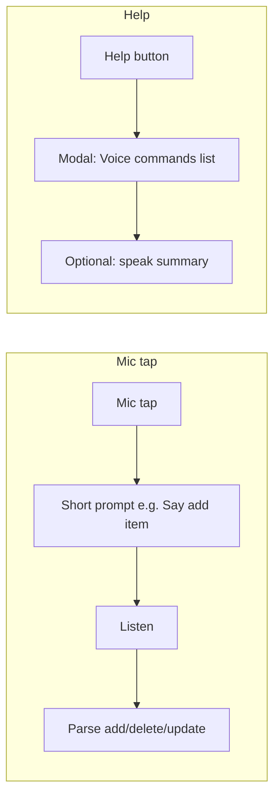

# List Detail: Short Voice Prompt + Voice Commands Help Button

## Current behavior

**File:** [mobile/app/(tabs)/lists/[id].tsx](mobile/app/(tabs)/lists/[id].tsx)

- When the user taps the mic, the app speaks a long sentence (lines 394–396):
  - *"Please say add followed by your item to add an item, delete followed by the item name to delete, or update followed by the item name and new name to update"*
- When no command matches, it speaks (line 357):
  - *"Please use one of these commands: add item name, delete item name, or update item name to new name"*
- There is no dedicated help control; the only way to discover commands is this spoken prompt or the "no match" message.

Supported voice commands (from [mobile/utils/voiceCommands.ts](mobile/utils/voiceCommands.ts)):

- **Add:** `add [item name]` (e.g. "add milk")
- **Delete:** `delete [item name]` (e.g. "delete milk")
- **Update:** `update [old name] to [new name]` (e.g. "update milk to oat milk")

## Goals

1. **Shorten the mic prompt** so that on mic tap the app says something brief (e.g. "Say add item") and then starts listening, instead of the long sentence.
2. **Add a help button** next to the mic that, when pressed, shows (and optionally speaks) all voice commands accepted on this screen.

## Implementation

### 1. Shorten the mic prompt

**File:** [mobile/app/(tabs)/lists/[id].tsx](mobile/app/(tabs)/lists/[id].tsx)

- In `handleVoiceClick`, replace the long `speak(...)` string (lines 394–396) with a short phrase, for example:
  - **Option A:** *"Say add item"* (minimal; user can say "add milk" etc. and discover delete/update from help).
  - **Option B:** *"Say add, delete, or update"* (slightly longer but hints at all actions).
- Keep the same flow: start recognition briefly, stop, speak the short prompt, then in the callback `setTimeout` and `start()` again so the user can speak right after.

### 2. Optional: shorten the "no command matched" message

- Line 357: the fallback message can stay as-is (it lists full command forms) or be shortened to something like *"Say add, delete, or update. Tap the help button for details."* so it stays brief and points to help. Either approach is fine; the plan assumes we only shorten the initial mic prompt unless you want this changed too.

### 3. Add a voice-commands help button

**Placement:** In the same actions row as the mic and "Add Item" button (around line 1029), inside `View style={styles.actionButtons}`. Show the help button only when voice is supported and the add-item form is not open (same visibility as `VoiceButton`): `isSupported && !showAddItem && !editingItem`.

**Button design:**

- Use a small icon button (e.g. `FontAwesome` `question-circle` or `info-circle`) so it reads as "help" and doesn’t clutter the bar.
- Style it to match the existing bar (e.g. same size as `VoiceButton` or slightly smaller, using `colors.textSecondary` or a neutral surface color so it’s clearly secondary to the mic and Add Item).

**On press:**

- **Show a modal** with the list of voice commands so users can read them. Reuse [mobile/components/AlertModal.tsx](mobile/components/AlertModal.tsx):
  - `visible` / `onClose` controlled by local state (e.g. `showVoiceHelpModal`).
  - `title`: e.g. "Voice commands"
  - `message`: e.g. "Use these phrases when the mic is listening:"
  - `details`: array of `{ label, items }` describing each command, for example:
    - `{ label: "Add item", items: ["add [item name]"] }`
    - `{ label: "Delete item", items: ["delete [item name]"] }`
    - `{ label: "Update item", items: ["update [old name] to [new name]"] }`
  - Single "OK" (or "Close") to dismiss; no need for cancel.
- **Optional:** When opening the help modal, call `speak()` once with a short summary (e.g. "Voice commands: add item, delete item, update item name to new name") so voice-only users get the same info. If you prefer help to be visual-only, skip this.

### 4. State and wiring

- Add `const [showVoiceHelpModal, setShowVoiceHelpModal] = useState(false)`.
- Help button: `onPress={() => setShowVoiceHelpModal(true)}`.
- Render `AlertModal` for voice help (e.g. near other modals in the same file), with `visible={showVoiceHelpModal}`, `onClose={() => setShowVoiceHelpModal(false)}`, and the title/message/details above.

### 5. Styles

- Add a style for the help button so it fits the actions bar (e.g. same 36x36 or 32x32 circle as the mic, or a compact icon-only pill). Reuse `actionButtons` gap so spacing between mic, help, and Add Item stays consistent.

## Summary of changes

| File                                                                 | Change                                                                                                                                                                                                                             |
| -------------------------------------------------------------------- | ---------------------------------------------------------------------------------------------------------------------------------------------------------------------------------------------------------------------------------- |
| [mobile/app/(tabs)/lists/[id].tsx](mobile/app/(tabs)/lists/[id].tsx) | Shorten mic prompt in `handleVoiceClick`; add help button next to `VoiceButton`; add `showVoiceHelpModal` state and `AlertModal` for voice commands; optional shorten "no match" message and optional `speak()` when opening help. |

No changes to [mobile/utils/voiceCommands.ts](mobile/utils/voiceCommands.ts) or to the parsing logic; only UX and copy on the list detail screen.

## Flow (after change)

