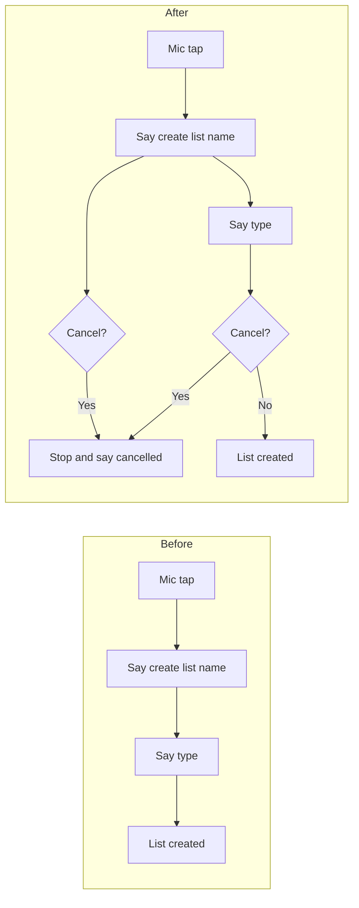

# Add "Cancel" Voice Command on Lists Page

## Current behavior

On the lists screen ([mobile/app/(tabs)/lists.tsx](mobile/app/(tabs)/lists.tsx)), the voice flow is:

1. User taps mic → app says: *"Please say create list followed by the list name"* and starts listening.
2. User says e.g. *"create list groceries"* → app sets `pendingListName`, `awaitingListType = true`, says *"What type of list? Say: to do, grocery, shopping, ideas, or other"* and keeps listening.
3. User says a type (e.g. *"grocery"*) → app creates the list and exits the flow.

There is no way to exit this flow by voice; the user can only tap the mic again to stop.

## Approach

- **Detect cancel** in the same `useEffect` that processes voice commands, and handle it before any other command (so "cancel" always wins).
- When cancel is detected: stop listening, clear `pendingListName` and `awaitingListType`, and give brief spoken feedback so the user knows the flow was cancelled.

## Implementation

### 1. Add cancel-command helper in voice utils

**File:** [mobile/utils/voiceCommands.ts](mobile/utils/voiceCommands.ts)

- Add a small helper, e.g. `isCancelCommand(text: string): boolean`, that returns `true` for normalized phrases such as:
  - "cancel"
  - "never mind" / "nevermind"
  - "stop"
  - "abort"
  - "forget it"
- Use the existing `normalizeText()` so matching is consistent (lowercase, no punctuation, single spaces).

### 2. Handle cancel at the start of the voice handler (lists screen)

**File:** [mobile/app/(tabs)/lists.tsx](mobile/app/(tabs)/lists.tsx)

- Import `isCancelCommand` from `../../utils/voiceCommands`.
- At the **very beginning** of the `handleVoiceCommand` logic inside the `useEffect` (before the `if (awaitingListType)` block):
  - If `isCancelCommand(text)`:
    - Call `stop()` and `reset()`.
    - Call `setAwaitingListType(false)` and `setPendingListName(null)`.
    - Call `speak('List creation cancelled.')` (or `'Cancelled.'` when not in the type step).
    - `return` so no other command runs.

This way "cancel" works in both phases: right after the first prompt (user says "cancel" instead of "create list X") and after the second prompt (user says "cancel" instead of a list type).

### 3. Optional: mention cancel in the spoken prompts

You can optionally update the first prompt to: *"Please say create list followed by the list name, or say cancel to stop."* and the second to: *"What type of list? Say: to do, grocery, shopping, ideas, or other. Say cancel to stop."* so users know the command exists. This can be a follow-up or part of the same change.

## Flow (after change)

## Files to touch

| File                                                           | Change                                                                                                                                                                                |
| -------------------------------------------------------------- | ------------------------------------------------------------------------------------------------------------------------------------------------------------------------------------- |
| [mobile/utils/voiceCommands.ts](mobile/utils/voiceCommands.ts) | Add `isCancelCommand(text: string): boolean`.                                                                                                                                         |
| [mobile/app/(tabs)/lists.tsx](mobile/app/(tabs)/lists.tsx)     | At start of voice handler: if `isCancelCommand(text)`, clear state, stop, speak "List creation cancelled.", return. Optionally update prompt strings to mention "say cancel to stop." |

No backend or API changes; this is UI/voice-only on the lists tab.