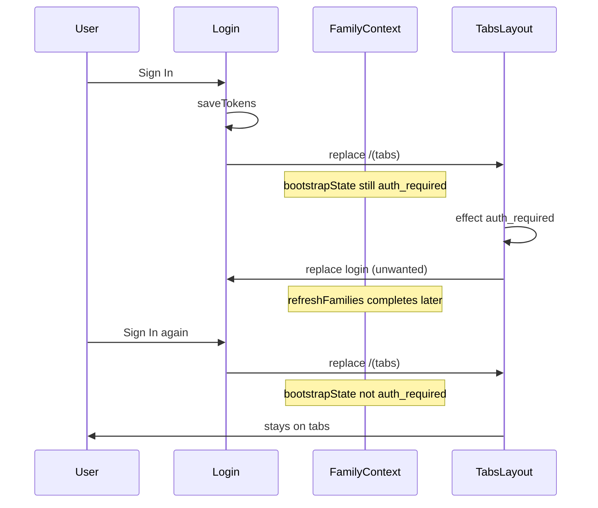

# Why login feels like it takes two attempts

## Root cause (race)

1. On app load, [`FamilyProvider`](mobile/contexts/FamilyContext.tsx) runs `checkAuthAndLoad` while the user is **not** logged in. It sets `bootstrapState` to **`auth_required`** (lines 140–151).

2. On successful login, [`login.tsx`](mobile/app/(auth)/login.tsx) saves tokens and calls `router.replace('/(tabs)')`.

3. When [`(tabs)/_layout.tsx`](mobile/app/(tabs)/_layout.tsx) mounts, **`bootstrapState` is still `auth_required`** until `checkAuthentication` finishes and `await refreshFamilies()` updates the context.

4. This effect runs **immediately** on that stale value (lines 19–23):

```19:23:mobile/app/(tabs)/_layout.tsx
  useEffect(() => {
    if (bootstrapState === 'auth_required') {
      router.replace('/(auth)/login');
    }
  }, [bootstrapState, router]);
```

So the app **sends you back to the login screen even though login just succeeded**. The first attempt “did nothing” visually because you were bounced out before the tabs UI settled.

5. After that, `refreshFamilies()` may complete in the background and move `bootstrapState` off `auth_required`, or timing differs. The **second** Sign In often lands on tabs when `bootstrapState` is no longer `auth_required` at mount time, so the redirect effect does not fire.



## Fix (recommended)

**Option A (minimal, in tabs layout):** When `bootstrapState === 'auth_required'`, **await `AuthService.isAuthenticated()`** and only call `router.replace('/(auth)/login')` if there is **no** access token. If tokens exist, call `refreshFamilies()` (or no-op and let the existing `checkAuthentication` path run) instead of redirecting.

**Option B (clear stale state on login):** After `AuthService.login` in [`login.tsx`](mobile/app/(auth)/login.tsx), invoke a small `FamilyContext` method like `resetBootstrapAfterLogin()` that sets `bootstrapState` to `bootstrap_loading` (or triggers `refreshFamilies`) **before** `router.replace('/(tabs)')`, so tabs never mount with `auth_required` from the pre-login era.

**Option C:** Remove the `bootstrapState === 'auth_required'` redirect from tabs entirely and rely on `checkAuthentication` + 401 handling only if you are sure no other screen leaves users stuck without a redirect (usually not recommended without auditing).

Recommendation: **Option A** — one localized change in [`(tabs)/_layout.tsx`](mobile/app/(tabs)/_layout.tsx), no new context API.

## Verification

- Log in once from a cold start with cleared storage: should land on home/tabs without a second submit.
- Confirm Network: `POST /auth/login/` once, then families fetch with `Authorization` header.
- Optional: add a short `console.log` in the redirect effect during dev to confirm it no longer fires right after a successful login.
