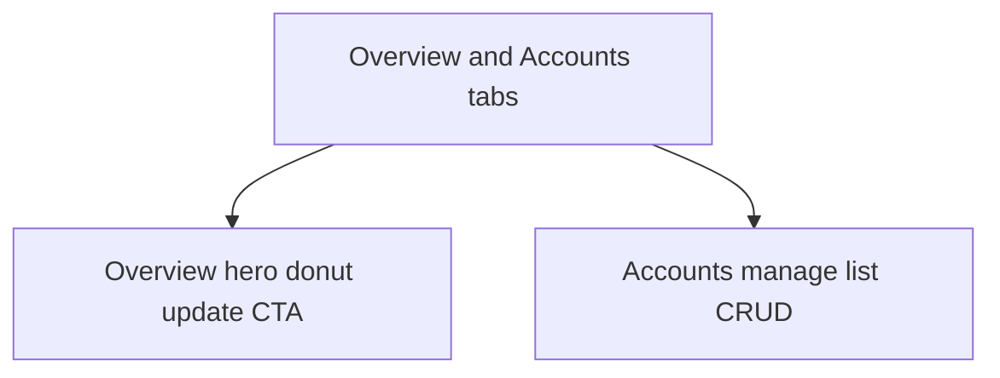

# Money Accounts Board

## Naming and placement
- Keep existing **Accounts** tab (`renderAccounts` in [`money.tsx`](mobile/app/(tabs)/money.tsx)) unchanged
- Add **Accounts board** (`accounts-board`) immediately **before** Accounts
- New file: [`mobile/components/money/AccountsDashboard.tsx`](mobile/components/money/AccountsDashboard.tsx)

Tab order: YTD · Income · **Accounts board** · Accounts · Target

Deep links: `?tab=accounts` / `updateBalances=1` stay on old Accounts until later cutover; accept `accounts-board` as well.

## Demo overlay (required)
Accounts use **`withDemoBalance`** (not `withDemoIncome`). Same Profile **Demo portfolio** switch:

- Load pref atomically with account/snapshot data (`readDemoPortfolioPref` → set with data)
- Apply `withDemoBalance` to hero totals, donut slices, account/history rows
- Never write boosted amounts to create/update APIs; forms continue to edit raw balances

## Layout (Income-style two tabs)

**Overview**
1. Primary **Update balances** CTA (when accounts exist) + last-updated subtitle (reuse `lastBalancesUpdatedLabel` logic)
2. Hero — Portfolio total · Investments · Cash (boosted latest balances)
3. Donut — by institution (reuse [`DonutChart`](mobile/components/expenses/charts/DonutChart.tsx) + [`groupAccountsByInstitution`](mobile/utils/moneyAccounts.ts)); full-width legend (no truncation)
4. Institution summary rows (optional compact list under donut)

**Accounts** (manage — current list UX)
1. Header: count + total + **Add account**
2. Institution groups; expand account → snapshot history
3. Edit/delete account; edit/delete snapshot
4. Empty: “Add RRSP, TFSA…”

## Functionality preserved (callbacks into money.tsx)
Parent keeps modals + wizard. Board props:

- `onUpdateBalances` / `onAddAccount` / `onEditAccount` / `onDeleteAccount`
- `onAddSnapshot(account)` / `onEditSnapshot(account, snap)` / `onDeleteSnapshot`
- `refreshKey` after parent `load()` success

Board self-loads `getAccounts` + `getSnapshots` with family guards, focus soft-reload, generation refs (copy YTD/Income).

Preserve: create with initial balance → snapshot today; edit account without re-entering balance; snapshot date lock on history edit; delete confirms; show-amounts toggle.

## Hub wiring
- Extend `MoneyTab` with `accounts-board`
- Bump `accountsBoardRefreshKey` beside YTD/Income keys in parent `load()`
- Render `<AccountsDashboard … />` when `tab === 'accounts-board'`
- Leave `renderAccounts` as-is

## Out of scope
- Removing old Accounts (later, after you validate)
- Changing demo boost amounts or Profile toggle
- Redesigning Target
- Changing YTD return math

## Deliverable
Accounts board tab live beside old Accounts; demo balances on Overview/Manage; CRUD + wizard still work; rebuild web `dist`.