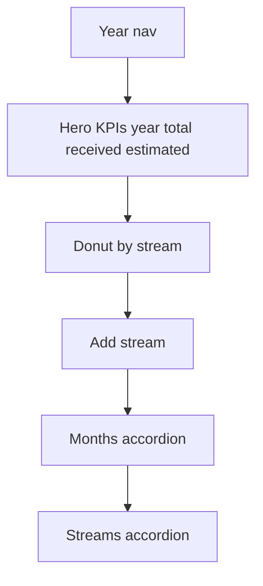

# Money Income Board Tab

## Naming and placement
- Keep existing **Income** tab (Year + Streams sub-tabs in [`money.tsx`](mobile/app/(tabs)/money.tsx)) unchanged
- Add **Income board** (id `income-board`) immediately **before** Income
- New component: [`mobile/components/money/IncomeDashboard.tsx`](mobile/components/money/IncomeDashboard.tsx)

Tab order: YTD · **Income board** · Income · Accounts · Target

Deep links `?tab=income` / `calendar` continue to land on existing Income until you later switch default.

## Purpose
Year income overview: total received/estimated, mix by stream, month breakdown, plus quick path to add/edit streams and payments — same data and generate rules as today’s Year view.

## Demo income (required — same as old Income)
Profile **Demo portfolio** (allowlisted emails) also boosts employment income display via `withDemoIncome` (+$15k per pay). Income board must:

- Load the same pref (`STORAGE_KEYS.MONEY_DEMO_PORTFOLIO` + `canUseMoneyDemoPortfolio`)
- Apply `withDemoIncome` to hero totals, donut slices, month totals, and payment row amounts — mirror `displayIncomeMoney` in [`money.tsx`](mobile/app/(tabs)/money.tsx)
- Not invent a separate toggle; Profile remains the switch

Note: **YTD board** already applies demo **balances** (`withDemoBalance` / `ytdPortfolioTotals`). Demo **income** only belongs on Income views.

## Layout (match YTD / Expense boards)

1. **Year chrome** — ◀ ▶ year + This year (same as current Year sub-tab)
2. **Hero card** — eyebrow “Income”; KPIs: Year total · Received · Estimated (from occurrence `status` / actual vs estimate)
3. **Donut** — amount by stream for the year (reuse [`DonutChart`](mobile/components/expenses/charts/DonutChart.tsx) + existing `STREAM_COLORS` / `streamColor`); tight legend
4. **Action row** — primary **Add stream**
5. **Months** — collapsed-by-default accordion per month (count + total); expand → compact payment rows (stream color, name, date, est/act, edit/delete)
6. **Streams** — collapsed accordion; expand → stream rows (type · freq · count); tap edit / trash; optional expand payments like today
7. Empty: “Add an income stream first…” when no streams

Preserve auto-generate: when year/streams load, run the same `ensureYearSchedule` logic (generate through year-end / stream end, reload if created).

## Functionality preserved (callbacks into money.tsx)
Parent already owns stream/occurrence modals and delete confirms. Board opens them via props:

- `onAddStream` / `onEditStream(stream)`
- `onEditOccurrence(occ)` / `onDeleteOccurrence(occ)` / `onDeleteStream(stream)`
- `refreshKey` after parent saves/deletes/generates

Board self-loads `getStreams` + `getOccurrences` (family guards) and runs year ensure locally; bump `refreshKey` from parent `load()` success so board stays in sync after Accounts/Income CRUD on the old tab.

## Hub wiring
- Extend `MoneyTab` with `income-board`
- Render `<IncomeDashboard …callbacks refreshKey={…} />`
- Leave `renderIncome` / Year / Streams as-is

## Out of scope
- Removing old Income
- Changing generate/occurrence math or the demo boost amounts
- Redesigning Accounts / Target
- Moving the demo toggle out of Profile

## Deliverable
- Implement `IncomeDashboard`, wire tab before Income, rebuild web `dist`
