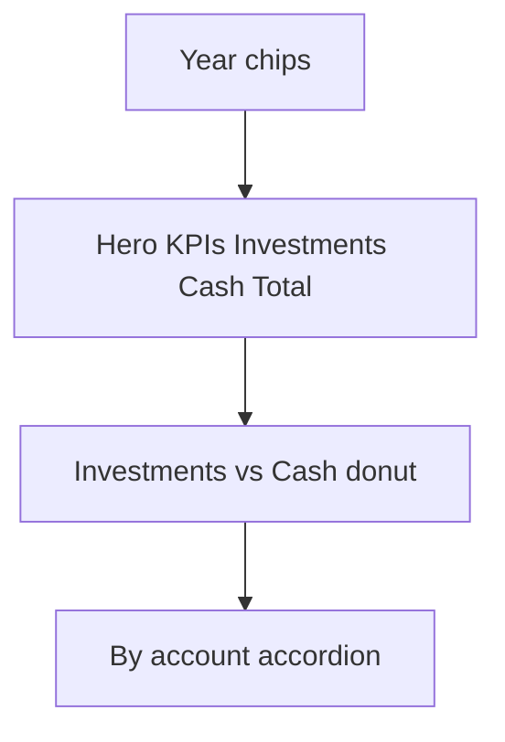

# Money YTD Board Tab

## Naming and placement
- Keep existing **YTD** tab (`renderYtd` in [`money.tsx`](mobile/app/(tabs)/money.tsx)) unchanged
- Add **YTD board** (id `ytd-board`) immediately **before** YTD
- New component: [`mobile/components/money/YtdDashboard.tsx`](mobile/components/money/YtdDashboard.tsx)

Tab order: **YTD board** · YTD · Income · Accounts · Target

Deep links (`forecast` / `returns`) continue to land on existing `ytd` (not the board) until you later switch default.

## Purpose
Read-only year performance: Investments vs Cash vs Total (amount delta, return %, year start → latest), plus per-account breakdown. Same rules as today from [`moneyReturns.ts`](mobile/utils/moneyReturns.ts) / demo overlay.

## Return formulas (unchanged)
Do **not** change return math for this board. Reuse `ytdPortfolioTotals` / `buildYearReturnRows` as-is so YTD board and old YTD show the same numbers side-by-side. That means:

- Year start = earliest snapshot in the selected calendar year
- Latest = latest snapshot on or before Dec 31 of that year
- Return % from real (unboosted) balances; demo only scales dollar display to match
- Cash included in YTD totals (Target growth scenarios stay separate)

Formula changes would be a separate product decision after the board UX is validated.

## Layout (match Overview / Budgets / Expenses / Bills boards)

1. **Year chrome** — year chips (current year + years from snapshots), same selection rules as current YTD
2. **Hero card** — eyebrow “Year to date”; three KPI cells: Investments · Cash · Total (signed $ delta + return % meta)
3. **Donut** — Investments vs Cash using **latest** balances for the selected year (reuse [`DonutChart`](mobile/components/expenses/charts/DonutChart.tsx)); tight legend like Bills board
4. **Balance path strip** (optional small section under hero or in donut card) — Year start → Latest for Total
5. **By account** — collapsed-by-default accordion (parity with current YTD); rows show type, date range, start→latest, %, $ delta
6. Empty: “Add accounts and balance snapshots to see YTD returns.”

No edit actions on this tab (Update balances stays on Accounts).

## Data
- `YtdDashboard` self-loads `getAccounts` + `getSnapshots` with family clear/generation guards (same pattern as `ExpenseDashboard` / `BillsDashboard`)
- Derive via existing `ytdPortfolioTotals` / `buildYearReturnRows` + `demoPortfolio` from money prefs (read the same demo flag money.tsx uses; do not invent new math)
- Optional `refreshKey` from money parent if Accounts updates should refresh the board while mounted

## Hub wiring
- Extend `MoneyTab` with `ytd-board`
- Render `<YtdDashboard />` for that case; leave `renderYtd` for `ytd`
- Do not remove or change Target / Income / Accounts

## Out of scope
- Removing old YTD
- Redesigning Income / Accounts / Target
- Changing return formulas

## Deliverable
- Implement `YtdDashboard`, wire tab before YTD, rebuild web `dist`
