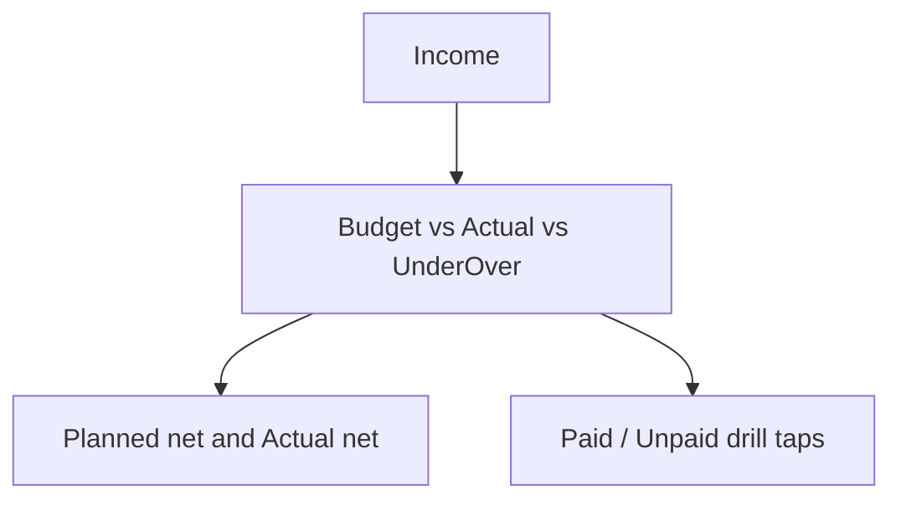

# Month card: Budget vs Actual + under/over

Yes — that reads clearly: first “am I under/over budget this month?”, then “what’s left of income?”.

## Change (UI only)

In [`CashflowDashboard.tsx`](mobile/components/expenses/CashflowDashboard.tsx) month detail KPIs, restructure to:

1. **Income** (unchanged)
2. **Budget** | **Actual** | **Under/Over**
   - Actual = `spentTotal + unpaidTotal`
   - Meta on Actual: `N paid · M unpaid` (same idea as year hero)
   - Under/Over = `budgetTotal − actual`
     - `> 0` → “Under” (success tone)
     - `< 0` → “Over” (error tone, show absolute)
     - `0` → “On budget”
3. **Planned net** | **Actual net** (unchanged formulas: Income−Budget, Income−Paid−Unpaid)
4. Keep **Paid** / **Unpaid** as tappable KPIs (or compact chips under Actual) so line-item drill still works

No backend / cashflow math changes — values already exist on `selectedMonth`. Only layout, labels, and one derived `budgetVariance = budgetTotal - (spentTotal + unpaidTotal)`.

## Verify

- `npm run build` in `mobile/` after the UI change.