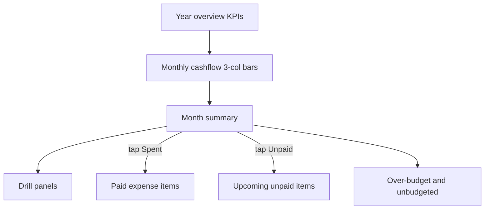

# Overview: budget-aware cashflow redesign

## Decisions (locked)

- **Evolve Overview in place** — no second hub tab; git history is the rollback.
- **Net savings = C** — show both **Planned** (`Income − Budget`) and **Actual** (`Income − Paid − Unpaid`).
- **Monthly chart** — three columns per month: **Income | Budget | Actual** (Actual = Paid + Unpaid stacked, same colors as today).

## Current state

- Overview = [`CashflowDashboard.tsx`](mobile/components/expenses/CashflowDashboard.tsx) via [`expenses-hub.tsx`](mobile/app/(tabs)/expenses-hub.tsx).
- Aggregates income + expenses in [`cashflow.ts`](mobile/utils/cashflow.ts); **never loads budgets**.
- Budgets already available as one call: `expenseService.getBudgetsYearBoard` / `GET /budgets/year_board/` (same source as Budgets tab). Monthly totals via [`budgetSeries.ts`](mobile/utils/budgetSeries.ts) (`budgeted` = sum of effective `amount`).

## Target UX

### Year overview

Update hero to: **Income**, **Budget** (sum of monthly budgets in tracking window), **Actual** (Paid + Unpaid with counts), **Planned net**, **Actual net**. Keep existing “first income month → Dec” tracking window; budget months outside that window stay excluded from year rollup the same way.

### Monthly cashflow bars

Extend [`MonthCashflowBars.tsx`](mobile/components/expenses/charts/MonthCashflowBars.tsx):

- Points gain `budget`.
- Per month: Income bar | Budget bar | stacked Paid/Unpaid bar.
- Tooltip: Income, Budget, Paid, Unpaid, Planned net, Actual net.
- Scale max includes budget. Slightly narrower bar widths so three columns fit the 12-month slots.

### Month summary (selected month)

Replace In/Spent/Unpaid/Net KPIs with:

| KPI | Value |
|-----|--------|
| Income | as today |
| Budget | sum of category budgets for that month |
| Actual | Paid + Unpaid (two tones / sub-meta) |
| Planned net | Income − Budget |
| Actual net | Income − Paid − Unpaid |

**Remove** always-visible “Spent by category” / “Unpaid by category” horizontal bars.

**Click-to-drill** (tap Spent / Unpaid KPI or legend):

- **Spent** → list of **paid** expenses for that month (description, category, amount, date).
- **Unpaid** → list of **unpaid** expenses (what’s left to pay).
- Always (or when relevant) a **Variance** section:
  - **Over budget**: categories where paid (and optionally paid+unpaid for “projected over”) exceeds that category’s budget amount.
  - **Unbudgeted**: expenses whose category has no active budget row for that month.

Keep the donut if it still helps (Income / Paid / Unpaid / Budget slice or retire Budget from donut if crowded — default: keep Income/Paid/Unpaid; budget stays in KPIs + bars).

## Data / code changes

1. **Load budgets in Overview** — in `CashflowDashboard` soft/hard load, add `getBudgetsYearBoard(familyId, year)` alongside streams/occurrences/expenses. Extend `cashflowYearCache` with `budgetsByMonth`. Invalidate path already covered by hub `invalidateCashflowYearCache` on mutations; also ensure budget edits that already invalidate budget cache continue to invalidate cashflow (hub already bumps both on `bumpExpenseBoards`).

2. **Extend [`cashflow.ts`](mobile/utils/cashflow.ts)** (or a thin join helper):
   - Per month: `budgetTotal`, `plannedNet`, lists for paid/unpaid items, `overBudgetRows`, `unbudgetedRows`.
   - Reuse `monthKey` / budget amount summing from `budgetSeries` (sum `Budget.amount` from year_board rows).
   - Unbudgeted = expense category not in that month’s budget category set.
   - Over = for each budgeted category, `paidSpent > budget.amount` (match Budgets tab paid-only for “over”; optionally note projected over including unpaid in the variance copy).

3. **UI updates** in `CashflowDashboard` + `MonthCashflowBars` as above.

4. **Perf rules** — follow [`Docs/MONEY_EXPENSES_PERF.md`](Docs/MONEY_EXPENSES_PERF.md): module cache, soft load, `lastRefreshKeyRef`, no cold spinner on warm Overview return.

5. **Backend** — no model/API/migration expected; client join only. If anything API-side is needed later, use `backend/venv` + `manage.py` — not anticipated here.

6. **Verify** — after UI changes, run `npm run build` in `mobile/` (Expo web export per daily startup).

## Out of scope

- New hub tab / Classic Overview clone.
- Changing Budgets tab behavior.
- New Django endpoints for cashflow.