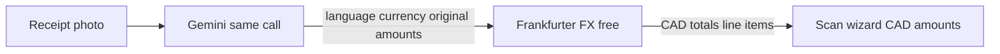

# Receipt language + CAD conversion

## Gemini cost

**No extra Gemini request.** Language and currency are two more JSON fields on the same vision call you already make. Cost impact is negligible (a few more output tokens). FX conversion is a separate free HTTP call — **not Gemini**.

## Flow

## Backend

### 1. Gemini prompt + normalize — [`backend/expenses/receipt_gemini.py`](backend/expenses/receipt_gemini.py)

Extend JSON shape:

- `source_language`: short English name or BCP-47 (e.g. `"French"`, `"th"`) or null
- `currency`: ISO 4217 (e.g. `"EUR"`, `"CAD"`) or null — infer from symbols/labels/country; if `$` is ambiguous, prefer context (Canada → CAD, US → USD)

Pass through in `_normalize_gemini_payload`. Keep translating merchant/line names to English as today. **Do not** ask Gemini for exchange rates.

### 2. Free FX helper — new [`backend/expenses/receipt_fx.py`](backend/expenses/receipt_fx.py)

- Use [Frankfurter](https://www.frankfurter.app/) (ECB rates, no API key):
  `GET https://api.frankfurter.app/{YYYY-MM-DD}?from=EUR&to=CAD`
  Fallback to `latest` if the receipt date has no rate.
- Cache in-process by `(date, from, to)` for the process lifetime.
- If `currency` missing or `CAD`, skip conversion.
- Convert `total` and each line item `unit_price` / `line_total` to CAD (2 dp).
- Return metadata: `currency`, `original_total`, `fx_rate`, `fx_as_of`, `converted_to: "CAD"`.

Wire conversion in [`backend/expenses/receipt_ocr.py`](backend/expenses/receipt_ocr.py) `parse_receipt_image` after a successful Gemini result (and optionally no-op for Tesseract). Primary amounts in the response become **CAD** so the existing wizard `setAmount` / line items stay correct.

### 3. API response fields

Parse result gains (all optional):

- `source_language`
- `currency` (original)
- `original_total`
- `fx_rate`
- `fx_as_of`
- `converted_to` (`"CAD"` when converted)

## Mobile

- Extend [`ReceiptParseResult`](mobile/types/expenses.ts).
- In [`ReceiptScanWizard.tsx`](mobile/components/expenses/ReceiptScanWizard.tsx) (and the receipt parse note in [`ExpenseForm.tsx`](mobile/components/expenses/ExpenseForm.tsx) if present): append OCR note when useful, e.g.
  `Language: Thai · Converted EUR 42.00 → CAD 62.10 (rate 1.4786 as of 2026-03-01)`.
- Form still fills from converted CAD `total` / line items (no UX change to save).

## Edge cases

- FX API down → keep original amounts, note that conversion failed (do not block scan).
- Already CAD → no FX call; still return `source_language` if present.
- Ambiguous `$` → Gemini’s best guess; user can edit amounts in review.

## Out of scope

- Persisting original currency on the Expense model
- Multi-currency reporting in budgets
- Second Gemini call for rates
