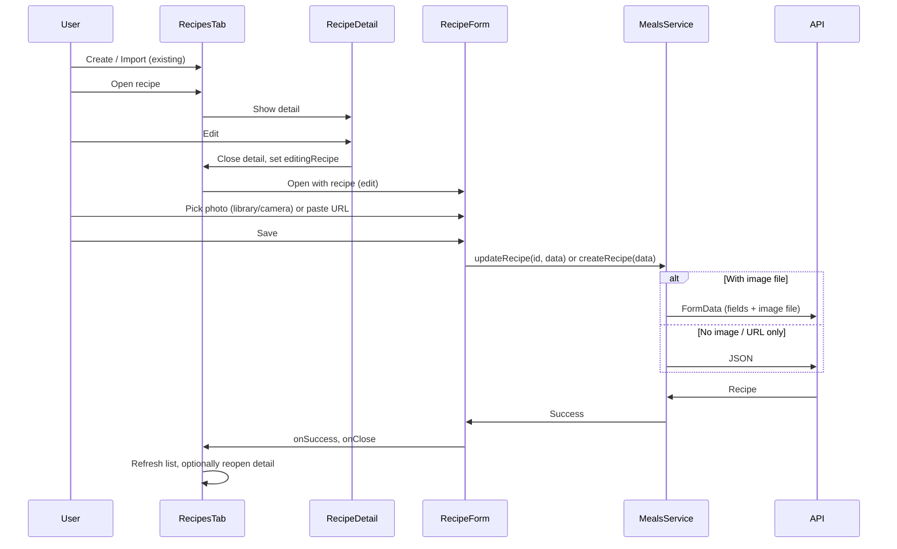

# Recipe Edit and Custom Picture Support

## Current state

- **Create / Import:** [RecipesTab.tsx](mobile/components/meals/RecipesTab.tsx) has "Create" (opens [RecipeForm.tsx](mobile/components/meals/RecipeForm.tsx)) and "Import" (opens [ImportRecipeForm.tsx](mobile/components/meals/ImportRecipeForm.tsx)). Import uses URL and the backend downloads the image; create sends JSON only.
- **Edit:** Not implemented. [RecipeForm.tsx](mobile/components/meals/RecipeForm.tsx) accepts an optional `recipe` prop but only uses it for initial values and always calls `MealsService.createRecipe()`; [RecipeDetail.tsx](mobile/components/meals/RecipeDetail.tsx) has no Edit action.
- **Image on create:** RecipeForm only has an "Image URL" text field; no camera or gallery picker. Backend [Recipe](backend/meals/models.py) has `image` (ImageField) and serializer exposes it; [RecipeSerializer](backend/api/serializers.py) already includes `image` and `get_image_url` returns the stored file URL. DRF defaults include `MultiPartParser`, so the API can accept multipart/form-data for create/update once the client sends it.

Existing patterns in the app to reuse:

- **Image picker:** [profile.tsx](mobile/app/(tabs)/profile.tsx) and [ExpenseForm.tsx](mobile/components/expenses/ExpenseForm.tsx) use `expo-image-picker` (already in [package.json](mobile/package.json)) with library and camera.
- **File upload:** [profileService.ts](mobile/services/profileService.ts) builds `FormData`, appends the image (with platform-specific handling for web vs native and XHR on native for ngrok), and uses the api client. Recipe create/update with image can follow the same pattern (FormData + optional image file).

---

## 1. Backend: Ensure recipe create/update accept image file

- **Parsers:** Rely on DRF default parsers (already include `MultiPartParser`). No settings change required unless you want to restrict parsers elsewhere.
- **Serializer:** [RecipeSerializer](backend/api/serializers.py) already has `image` in `fields` and does not set it read-only. In `create()` and `update()`, `validated_data` will contain `image` when sent via multipart; passing it through to `Recipe.objects.create(**validated_data)` and `setattr(instance, attr, value)` is correct. Optional: make `image` explicitly accept empty/null for "clear photo" on update (e.g. send `image` as empty string or add a `clear_image` flag). If not needed for v1, skip.
- **ViewSet:** [RecipeViewSet.perform_create](backend/api/views.py) uses `request.data.get('family')`; with multipart, `request.data` still contains form fields, so no change needed. No explicit parser_classes required on the viewset.

**Conclusion:** Backend is already capable. Only change is if you want a formal "clear image" on PATCH (optional).

---

## 2. Mobile: MealsService – create/update with optional image file

- **Interfaces:** Extend [CreateRecipeData](mobile/services/mealsService.ts) and [UpdateRecipeData](mobile/services/mealsService.ts) with an optional `image` (e.g. `{ uri: string; type?: string; fileName?: string } | null`) for the picked image asset.
- **createRecipe:** If `data.image` is present, build `FormData`: append `family`, `title`, `notes`, `ingredients` (JSON.stringify), `instructions` (JSON.stringify), `servings`, `prep_time_minutes`, `cook_time_minutes`, `source_url` where provided, and append the image file (same pattern as [profileService](mobile/services/profileService.ts): on web convert URI to `File`/blob, on native append `{ uri, type, name }`). POST with `formData` (no `Content-Type` so axios sets boundary). If `data.image` is absent, keep existing JSON POST.
- **updateRecipe:** Similarly: if `data.image` is present, use FormData for PATCH with all updated fields plus image file; otherwise JSON PATCH. Optionally support clearing the image (e.g. `image: null` or a dedicated flag) and send that in the request.
- **Native + ngrok:** If the app uses XHR for profile photo on native (see profileService), consider the same for recipe create/update with FormData on native to avoid axios/FormData/ngrok issues; otherwise start with axios and only switch if uploads fail.

Files: [mobile/services/mealsService.ts](mobile/services/mealsService.ts).

---

## 3. Mobile: RecipeForm – edit mode and image picker

- **Edit vs create:** When `recipe` is provided, treat as edit: set header title to "Edit Recipe", prefill all fields from `recipe`, and on submit call `MealsService.updateRecipe(recipe.id, ...)` instead of `createRecipe`. After success, call `onSuccess()` and `onClose()` so the list/detail refresh.
- **Image field UX:** Add an optional "Recipe photo" section:
  - Show current image when editing (or when a new image is picked): thumbnail from `recipe.image_url` or from `pickedImage.uri`.
  - Buttons: "Choose from library" and "Take photo" (reuse expo-image-picker and permission flow from profile or ExpenseForm). Store the picker result in state (e.g. `pickedImage: { uri, type, fileName } | null`).
  - Optional: "Remove photo" when there is a current or picked image.
  - Keep "Image URL" as a fallback for pasting a URL (create only or both; if URL is set and user picks a file, prefer file and clear URL, or vice versa—define simple rule).
- **Submit:** For create: pass `image: pickedImage` (or image URL if no pick) into `CreateRecipeData`. For edit: pass updated fields and `image: pickedImage` only when the user selected a new/changed image (or send clear image if "Remove photo" is supported).
- **Permissions:** Request media library (and camera if "Take photo" is used) when the user taps the picker, same as profile.

Files: [mobile/components/meals/RecipeForm.tsx](mobile/components/meals/RecipeForm.tsx).

---

## 4. Mobile: RecipeDetail – Edit entry point

- Add an "Edit" button in the header (e.g. next to Delete). On press: close the detail modal and open RecipeForm in edit mode with `recipe={selectedRecipe}` and the same `selectedFamily`, `onSuccess` (refresh list and optionally reopen detail with fresh data), and `onClose`.
- **State in RecipesTab:** Add `editingRecipe: Recipe | null`. When "Edit" is pressed from detail: set `editingRecipe = recipe`, set `selectedRecipe = null` (close detail), and set `showRecipeForm = true`. Render `RecipeForm` with `recipe={editingRecipe}` and `onClose` that also clears `editingRecipe`. When form submits successfully, refresh and optionally set `selectedRecipe` to the updated recipe so the user can land back on detail.

Files: [mobile/components/meals/RecipeDetail.tsx](mobile/components/meals/RecipeDetail.tsx), [mobile/components/meals/RecipesTab.tsx](mobile/components/meals/RecipesTab.tsx).

---

## 5. Optional: Clear recipe image on edit

- If you want "Remove photo" in the form: backend must accept a way to clear `recipe.image` on PATCH (e.g. exclude `image` from payload and send `clear_image: true`, or send `image` as null/empty). Django ImageField can be set to `None` to clear. Then in RecipeForm, when user taps "Remove photo", set `pickedImage = null` and send the clear flag or omit image; in serializer/update, handle clearing the file and save.

---

## Summary diagram

---

## Implementation order

1. **Backend (optional):** Add explicit handling for "clear image" on recipe PATCH if desired; otherwise no backend code change.
2. **MealsService:** Add FormData-based create/update with optional `image` and keep JSON path when no image.
3. **RecipeForm:** Add image picker (library + camera), thumbnail/current image display, and edit mode (submit to updateRecipe when `recipe` is set).
4. **RecipeDetail + RecipesTab:** Add Edit button and wire `editingRecipe` so opening edit from detail shows RecipeForm with the selected recipe.

No new dependencies; use existing `expo-image-picker` and existing FormData/XHR patterns from profile and documents.