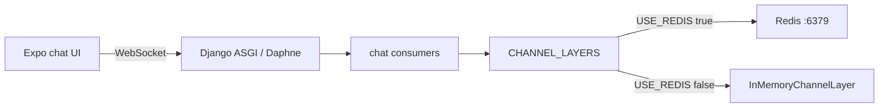

# Redis-optional chat (same UX, no Redis required)

## Reality check

You do **not** need a smaller or alternate chat feature. Chat already works via Django Channels WebSockets ([`backend/chat/consumers.py`](backend/chat/consumers.py)). Redis is only the **channel layer + cache** transport.

Today Redis is hard-required for Channels:

```284:290:backend/config/settings.py
CHANNEL_LAYERS = {
    'default': {
        'BACKEND': 'channels_redis.core.RedisChannelLayer',
        ...
    },
}
```

Cache already supports a non-Redis path via `USE_REDIS` ([`backend/config/settings.py`](backend/config/settings.py) ~326–342). Channels does not yet follow that flag (the InMemory block is only commented).



## Approach

**Default `USE_REDIS=False` for personal/single-user use.** One setting drives both Channels and cache. Flip to `True` later when you want multi-process / multi-user Redis.

### 1. Wire `CHANNEL_LAYERS` to `USE_REDIS`

In [`backend/config/settings.py`](backend/config/settings.py):

- Change default: `USE_REDIS = os.getenv('USE_REDIS', 'False').lower() == 'true'`
- If `USE_REDIS`: keep current `RedisChannelLayer` + Redis `CACHES`
- Else: `InMemoryChannelLayer` + existing `LocMemCache`
- Remove the old commented “fallback” block (logic becomes live)

### 2. Document env for later scale-up

Update [`backend/.env.example`](backend/.env.example):

```env
# Chat / OAuth cache. False = no Redis (fine for single-user / one Django process).
# True = Redis required at REDIS_HOST:REDIS_PORT (multi-user / production).
USE_REDIS=False
# REDIS_HOST=localhost
# REDIS_PORT=6379
# REDIS_URL=redis://localhost:6379/1
```

Add `USE_REDIS=False` to your local [`backend/.env`](backend/.env) (not committed).

Keep `channels-redis` / `redis` in requirements — no uninstall; ready when you flip the flag.

### 3. Docs: Redis optional now

Update briefly:

- [`Docs/WEBSOCKET_SETUP.md`](Docs/WEBSOCKET_SETUP.md) — Redis not required when `USE_REDIS=False`; note single-process limit
- [`Docs/DAILY_STARTUP.md`](Docs/DAILY_STARTUP.md) / [`Docs/STARTUP_PROCEDURE.md`](Docs/STARTUP_PROCEDURE.md) — drop Redis as a required startup step; mark as optional for later

### 4. What you can stop using

After this + restart Django:

- Stop the Docker `kewlkidsorganizer` Redis container
- Turn off Docker Desktop at Windows login if nothing else needs it
- Chat should still work on one Daphne/`runserver` process

## Limits (acceptable for now)

| With InMemory | Implication |
|---------------|-------------|
| Single server process | Don’t run multiple Daphne workers for chat |
| Not shared across machines | Fine for personal testing on one PC |
| Cache (OAuth state) is in-process | OAuth still works; lost if process restarts mid-flow |

Same chat rooms, messages, WebSocket API, and mobile UI — no frontend changes.

## Verify

1. Set `USE_REDIS=False`, restart backend
2. Stop Docker Redis; confirm chat send/receive still works
3. Optional: `USE_REDIS=True` with Redis up still works (regression check)
