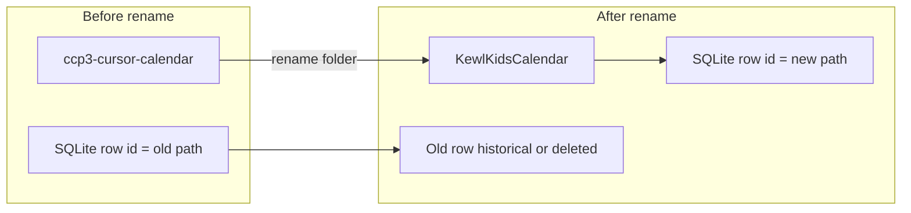

# Rename ccp3-cursor-calendar to KewlKidsCalendar

**Source:** `C:\dev\django\ccp3-cursor-calendar`  
**Target:** `C:\dev\django\KewlKidsCalendar`

App Admin keys each app by **absolute path** (`projects.id` = folder path). There is no “relocate” API—[`updateProject`](backend/src/db.ts) updates name/commands but not `id`/`path`. A folder rename always means a **new DB row** (or manual SQL), plus retiring the old row.



---

## 1. Before you rename (5 min)

1. **Stop** the calendar app in App Admin (or close its terminal). Stale `lastPid` on the old row is harmless after stop but confusing if left running.
2. Note current settings from the UI (or [Docs/PROJECTS_TABLE_DUMP.md](Docs/PROJECTS_TABLE_DUMP.md)):
   - Port **8100**
   - Start: `"C:\dev\django\ccp3-cursor-calendar\venv\Scripts\python.exe" manage.py runserver`
   - `workDir`: project root (not `src`)
   - **No Cloudflare subdomain** on this app—tunnel/DNS unchanged by rename
3. Close Cursor/VS Code windows rooted at the old path (optional; avoids broken workspace links).

---

## 2. Rename on disk

1. In Explorer or PowerShell, rename:
   - `C:\dev\django\ccp3-cursor-calendar` → `C:\dev\django\KewlKidsCalendar`
2. **Smoke-test Django** from the new folder:
   ```powershell
   cd C:\dev\django\KewlKidsCalendar
   .\venv\Scripts\python.exe manage.py check
   .\venv\Scripts\python.exe manage.py runserver 8100
   ```
3. **If venv fails** (common on Windows after moves): paths inside `venv\pyvenv.cfg` and `venv\Scripts\*.exe` still point at the old directory. Fix by either:
   - Recreate venv: `python -m venv venv` then reinstall `requirements.txt`, or
   - Use a fresh venv folder name and update start commands accordingly.

Django itself rarely cares about the parent folder name unless you have **hardcoded absolute paths** in `.env`, settings, or scripts—grep the project for `ccp3-cursor-calendar` after rename if anything breaks.

---

## 3. App Admin — replace the DB row (recommended)

**Do not** only edit display name; the old row’s `id` will still be the old path and Start will `cd` to a missing folder.

### Option A — UI (simplest)

1. Open App Admin → **Remove** the old app (`C:\dev\django\ccp3-cursor-calendar`) via Remove (uses [`POST /api/apps/remove`](backend/src/server.ts) with `id` in body).
2. **Add app** with path `C:\dev\django\KewlKidsCalendar`.
3. Set display name (e.g. `KewlKids Calendar`), tech stack `django`, port **8100**.
4. Start command (after venv works):
   ```
   "C:\dev\django\KewlKidsCalendar\venv\Scripts\python.exe" manage.py runserver
   ```
   `workDir`: `C:\dev\django\KewlKidsCalendar`
5. If you had `backendPath` / `frontendPath` before, set:
   - backend: `C:\dev\django\KewlKidsCalendar`
   - frontend: `C:\dev\django\KewlKidsCalendar\frontend` (if that folder exists)
6. **Start** from UI and confirm status + local URL on 8100.

### Option B — Re-import from batch (after updating script)

1. Edit [`CurrentStartScript.txt`](CurrentStartScript.txt) line 19 (and related `cd` / `if exist` lines) to use `C:\dev\django\KewlKidsCalendar`.
2. Run **Import from batch** in App Admin.
3. Import creates/updates a row keyed to the **new** path; it will **not** auto-delete the old path row (different `id`). Remove or mark the old entry historical manually.

You already have a **historical** duplicate at `c:\dev\django\ccp3-cursor-calendar` (lowercase id)—after migration, ensure only one **active** row exists for this app.

---

## 4. Update App Admin ancillary files

| File | Change |
|------|--------|
| [backend/data/port-mapping.json](backend/data/port-mapping.json) | `"8100": "c:\\dev\\django\\KewlKidsCalendar"` (used when process command line has no path—see [scripts/README.md](scripts/README.md)) |
| [CurrentStartScript.txt](CurrentStartScript.txt) | All `ccp3-cursor-calendar` / `ccp3_cursor_calendar` references → new path and window title if desired |
| Desktop `start_projects.bat` | Same `cd /d` updates if you still use it outside App Admin |

Docs ([Docs/PROJECTS_*.md](Docs/), [backend/scripts/migrate-phase0.ts](backend/scripts/migrate-phase0.ts)) are reference only—update only if you rely on them for audits.

---

## 5. What does *not* need changes

- **Cloudflare tunnel / Access** — unchanged (admin on 4000, wildcard proxy on 5000).
- **Subdomain for this app** — none configured today.
- **Git** inside the Django repo — remote unchanged; only local path changes.
- **Running “Running” status** — tied to `lastPid` on whichever row you started; stop old process before relying on new row.

---

## 6. Verification checklist

- [ ] `manage.py runserver 8100` works from `KewlKidsCalendar` with venv Python
- [ ] App Admin shows **one** active app at new path; old path removed or historical
- [ ] Start from App Admin opens server on 8100; Stop kills the tree
- [ ] `port-mapping.json` entry 8100 points at new folder (if you use Ports panel / path-based detection)
- [ ] Batch script / desktop launcher updated if still in use
- [ ] No stray `ccp3-cursor-calendar` strings in Django `.env` or settings (only if smoke test fails)

---

## Optional follow-up (not required for rename)

- Add a **relocate path** API in app-admin (copy row to new `id`, migrate subdomain/DNS ids, mark old historical)—would avoid manual remove/add next time.
- Implement **start-all** only after this app’s path is correct so bulk start does not target the old folder.
