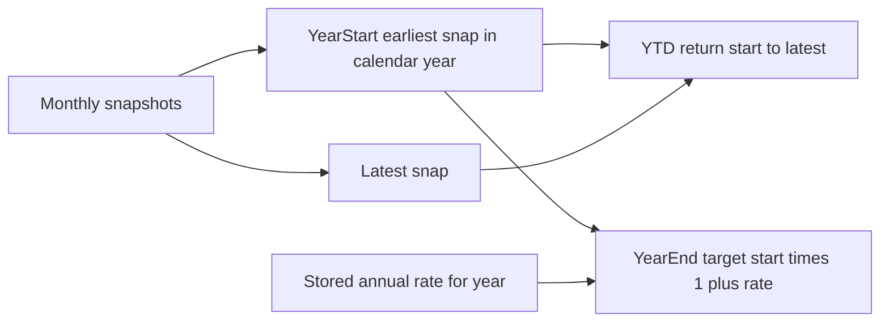

# Returns (YTD) + Year-end target

## Naming (what this is)

| Piece | Better name | Not really… |
|-------|-------------|-------------|
| Feb/Jan → today $ and % change | **Year-to-date return** / performance | Forecast |
| Pick 2.5% → “should be X by year-end” | **Year-end target** (annual projection) | Rolling multi-year forecast |

No new top-level screen. **Rename Money tab `Forecast` → `Returns`** and rebuild that tab into two sections. Keeps Income / Accounts / Returns.

## How the numbers work

- **Year-start baseline (per account):** earliest snapshot with `as_of_date` in the selected calendar year (e.g. Feb 2026 works as 2026 start without re-dating). If none, show “Add a balance for this year.”
- **YTD (missed months OK):** only two points matter — **year-start** and **latest**. Skipping March/April/etc. does not change the math; whenever you next update, YTD recalculates from start → that new latest. Gaps are fine.
- **YTD display:** latest vs year-start → `$` change and `%` (simple return). Include cash in totals (wealth). Default all accounts including cash for YTD wealth.
- **Year-end target (what-if rates):** `yearStart × (1 + annualRate)` for the full calendar year. Target date **Dec 31** of that year. This is where 2.5% / 5% / 7% live — same chip control as today’s forecast rates; changing the chip instantly recomputes year-end targets for every account. Default **2.5%**; last choice persisted per family + year (`money_year_target_rate:{familyId}:{year}`) so your preferred planning rate sticks, but you can always tap 5% or 7% to explore.
- **Going forward:** monthly 1st updates only refresh **latest** (and thus YTD). Year-end targets stay tied to year-start × selected rate until you change the rate or add a new year’s baseline.

Demo overlay stays display-only on both start and latest the same way as today.

## UI (Returns tab)

Rebuild [`mobile/app/(tabs)/money.tsx`](mobile/app/(tabs)/money.tsx) forecast panel:

1. **Year picker** (default current year) — small control, not a new route.
2. **Year to date** card/list
   - Per account: start date + amount → latest date + amount → Δ$ / Δ%
   - Compact rows (reuse recent compact card patterns)
   - Total wealth row
   - Copy note: “Based on year-start vs latest balance; missing months ignored.”
3. **Year-end target**
   - Keep interactive annual return chips (2.5, 3, 4, 5, 6, 7, … same set as now); default 2.5%; persist last selection for that year
   - Per invested account: start → target at selected rate; cash flat in total wealth
   - One summary card: portfolio start → year-end target; updates live when you change the rate chip

Remove the old rolling multi-horizon portfolio forecast (1y/5y/10y from “now”). Rate what-if moves into **year-end target** instead of a rolling term from today.

## Data / code leverage

- Snapshots already loaded via `moneyService.getSnapshots` and used in [`AccountDetailModal`](mobile/components/money/AccountDetailModal.tsx).
- Add a small helper module e.g. [`mobile/utils/moneyReturns.ts`](mobile/utils/moneyReturns.ts): `yearStartSnap`, `simpleReturn`, `yearEndTarget`.
- No backend/migration required (snapshots + `as_of_date` already exist).

## Out of scope

- Contributions/withdrawals adjustment (time-weighted return) — treat balance delta as simple return.
- Multi-year rolling forecast UI (can return later if needed).