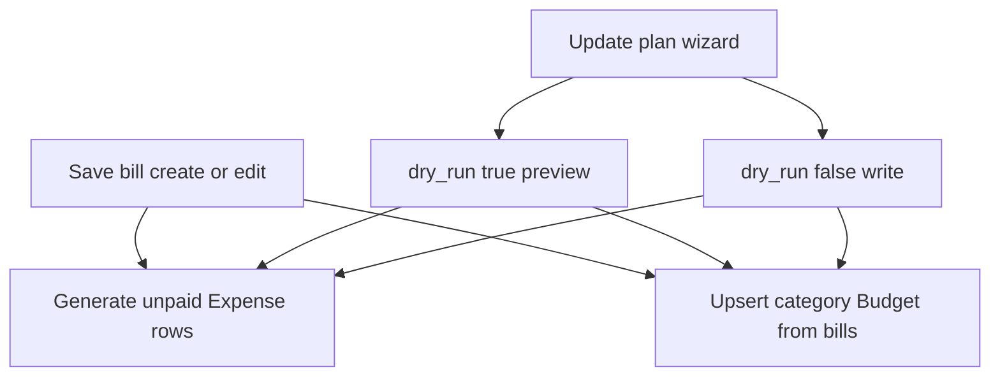

# Seasonal bills + past-start behavior

## How bills → expenses → budgets work today (Bills tab + Update plan)

One [`RecurringExpense`](backend/expenses/models.py) is a **template** (the bill). It is not itself an expense row. Saving it triggers two side effects.

### 1. When you create/edit a bill (automatic)

1. **Expense rows** — [`perform_create`](backend/expenses/views.py) / reconcile on update calls `_generate_expenses_for_recurring`.
   - Creates one **unpaid** `Expense` per due date from `start_date` through the **horizon**.
   - **Horizon today (open-ended):** Dec 31 of `max(today.year, start_date.year)` — **current calendar year only**. Example in Oct 2026 → rows **Jan–Dec 2026**, **not 2027**. That is why Budgets 2027 shows limits but empty category expense lists.
   - If the bill has a series `end_date`, generation stops there instead.
   - Skips dates that already have a row; **never overwrites paid** expenses.
2. **Budget** — [`sync_category_budget_from_bills`](backend/expenses/budget_sync.py) upserts **one** monthly `Budget` per category (standing amount from active bills, start = earliest bill start). It does **not** create 12 separate budget records per year.

### 2. What the Budgets tab shows

- You pick a **year**; the board loads 12 months via `getBudgetsYearBoard` and loads **expense rows** in the selected month via `getExpenses(start, end)`.
- For categories **with active bills**, each month’s **limit** comes from bill dues in that window (`recurring_due_in_window`) — template math, even with **zero** expense rows.
- Category **detail lines** only appear when `Expense` rows exist for that month — hence 2026 looks full and 2027 looks empty under categories.

### 3. Future years — change we will make (your feedback)

Same gap on **Expenses** and **Budgets**: advancing to 2027 shows empty (or stale) detail because rows weren’t generated / aren’t aligned to bills.

**Chosen UX — silent reconcile + info message (not a yes/no modal):** when the user advances the year on **Expenses** or **Budgets** to year **Y**:

1. Call ensure/reconcile for family through `Y-12-31` (reuse existing generate + schedule reconcile logic).
2. **Correctness, not mere existence:** for each active bill, expected due dates in Y must match generated unpaid rows:
   - **Create** missing unpaid rows on the schedule (incl. seasonal months only when seasonal).
   - **Remove** unpaid rows that are off-schedule (wrong date / out of season / after series end).
   - **Sync** unpaid row fields from the template (amount, category, description, etc.).
   - **Never** delete or overwrite **paid** expenses.
3. **Message only when something changed.** If `created + updated + removed > 0`, show a short summary (e.g. *“2027: created 24, updated 3 bill expenses.”* / include removed if any). If already correct → **no message**.
4. Same path on [`ExpenseDashboard`](mobile/components/expenses/ExpenseDashboard.tsx) and [`BudgetDashboard`](mobile/components/expenses/BudgetDashboard.tsx); then reload month/year data.

**Create/edit bill** still generates through **Dec of current year** by default. Navigating to a future year is what materializes/fixes that year’s rows. Update plan remains the explicit bulk preview/apply tool.

**Would this break things?** Same safety as today’s reconcile: paid left alone; spent = paid only; boards stay date-filtered. Cap to the **viewed year** (not unbounded future).

Seasonal filtering is part of “correct” expected dates inside Y.

### 4. Update plan (Bills tab wizard)

Already exists: [`UpdatePlanWizard`](mobile/components/expenses/UpdatePlanWizard.tsx) → `syncPlan` → [`sync_plan`](backend/expenses/views.py).

| Step | What it does |
|------|----------------|
| Preview | `dry_run: true` — lists expenses that **would** be created/updated and budgets that **would** be created/updated; **writes nothing** |
| Apply | Same pipeline with `dry_run: false` — actually creates missing unpaid expenses (through year-end horizon) and syncs budgets |

So yes: dry-run already shows what will happen. Seasonal must plug into the **same** `generate_expenses` + `create_from_recurring` paths so Preview/Apply stay accurate.

### 5. Seasonal gap today

| Scenario | Today |
|----------|--------|
| Monthly, no end | Dues every month from start through year-end horizon |
| Monthly Apr–Sep **this year only** | Works if `end_date=2026-09-30` — then **stops forever** |
| Monthly Apr–Sep **every year** | **Not supported** — `end_date` is not a repeating season |

### Past start (e.g. Jan 2026, today Oct 2026)

**Keep:** create/update generate unpaid expenses from `start_date` through **Dec of current year** (including past months in that year). Budget limits include dues in those months. Advancing to a later year **silently reconciles** that year (summary only if something changed).

Form copy: *“Start in the past: unpaid expenses will be created for each due date from start through this year-end.”*

## Seasonal design (chosen approach)

**UI:** On Monthly bills, a **Seasonal** checkbox bound to `is_seasonal`. Off by default (year-round). When checked, **Season start month** and **Season end month** appear and are **required** (block save until both set). Turning Seasonal off clears the month fields and hides them. Checkbox only shown for Monthly (or force `is_seasonal=false` and clear months if frequency changes away from Monthly).

**Data:** Explicit flag plus months on `RecurringExpense`:

- `is_seasonal` (bool, default `False`) — matches the checkbox; source of truth for “is this seasonal?”
- `season_start_month` (1–12, nullable)
- `season_end_month` (1–12, nullable)

**Rules:**
- When `is_seasonal=True`: `frequency` must be `monthly`, and both months are required (1–12). Serializer rejects invalid combos.
- When `is_seasonal=False`: both month fields must be null (serializer clears/rejects stray months).
- Each calendar year, dues fall on the bill’s day-of-month for months in `[season_start_month, season_end_month]` (inclusive). Support wrap (e.g. Nov–Feb).
- `start_date` = series begins (first year / first eligible date on or after this date).
- `end_date` = optional **permanent** series stop (not the season end) — labeled **“Stop after (optional)”**.

Example: `is_seasonal=True`, Apr–Sep, day from `start_date`, `start_date=2026-04-01`, no stop → Apr–Sep every year from 2026; Jan–Mar / Oct–Dec have no expense and $0 from this bill in budgets.

## Implementation

### Backend
1. Migration + model fields (`is_seasonal`, `season_start_month`, `season_end_month`) on [`RecurringExpense`](backend/expenses/models.py); expose + validate on [`RecurringExpenseSerializer`](backend/expenses/serializers.py).
2. Centralize schedule in [`recurring_sync.py`](backend/expenses/recurring_sync.py): when `is_seasonal`, skip months outside the season window; use from generation, `_expected_occurrence_dates`, and `recurring_due_in_window`.
3. Update [`_generate_expenses_for_recurring`](backend/expenses/views.py) / reconcile / bulk generate month roll-forward so seasonal bills land on the first in-season month of the year, not January when season starts in April.
4. Add **ensure-through-year** API (extend `generate_expenses` / reconcile with `through_year=Y`): for each active bill, reconcile **expected occurrence set** for Y (create missing, delete unpaid orphans, sync unpaid fields); return counts `{ created, updated, removed }` for the optional summary.
5. Keep recent Active/end_date fix: generation must not flip `is_active`; reactivation clears past series `end_date`.

### Mobile
1. Types in [`mobile/types/expenses.ts`](mobile/types/expenses.ts) (`is_seasonal`, season months).
2. [`RecurringExpenseForm.tsx`](mobile/components/expenses/RecurringExpenseForm.tsx): when Monthly, **Seasonal** checkbox ↔ `is_seasonal`; if on, show mandatory Season start / Season end month pickers and validate before submit; if off, send `is_seasonal: false` and null months. Relabel End Date to **“Stop after (optional)”**. Short note on past start backfill.
3. [`RecurringExpenseRow.tsx`](mobile/components/expenses/RecurringExpenseRow.tsx): show e.g. `Monthly · Apr–Sep`.
4. [`ExpenseDashboard`](mobile/components/expenses/ExpenseDashboard.tsx) + [`BudgetDashboard`](mobile/components/expenses/BudgetDashboard.tsx): on year change to Y, call ensure-through-year; show summary **only if** counts changed; reload board data.
5. Run `npm run build` for web dist after UI changes.

### Existing bills — do you have to update them?

| What you have today | After this ships | Action needed? |
|---------------------|------------------|----------------|
| Monthly, no end (year-round) | `is_seasonal=False` by migration default | **No** — keeps every-month behavior |
| Monthly with a real series stop (bill ends forever) | Same `end_date`, not seasonal | **No** |
| Meant to be Apr–Sep **every year**, but you used `end_date=…-09-30` | Still stops forever after that date | **Yes** — edit once: turn Seasonal on, set Apr–Sep, clear **Stop after** (or set a true final year) |

No automatic conversion of old `end_date` “seasons” — a Sept end date might mean “ends forever” or “season end,” and we won’t guess. Only re-save the templates that should repeat yearly.