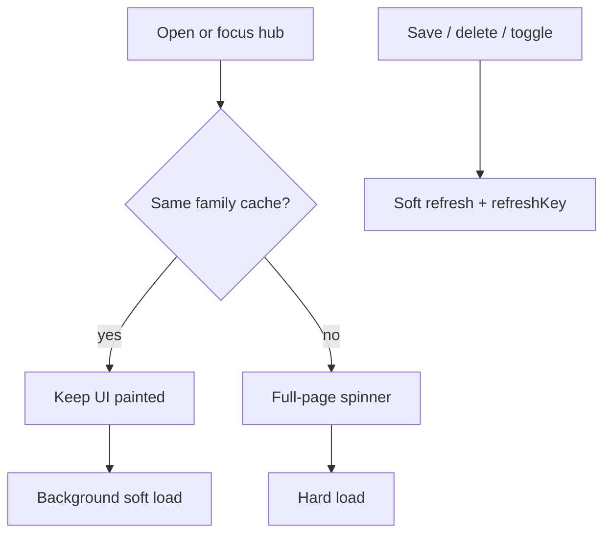

# Soft-load Expense Tracker and Money (no stale edits)

## Goal

Stop blanking the screen for 2–5s when opening or returning to Expense Tracker / Money. Keep showing last good data for the **same family**, refresh quietly in the background. First visit (no cache) and family switches still show a spinner.

## Will this break things / show outdated edits?

**No, if we keep these rules (this plan does):**

| Rule | Behavior |
|---|---|
| Family switch | Hard clear + spinner (existing `clearExpenseState` / `clearMoneyState` + `dataFamilyId`) — never paint Family A under Family B |
| Soft only when cache matches | Soft refresh only if `dataFamilyId === selectedFamily.id` |
| After create/edit/delete/toggle/plan | Soft-refresh immediately (bump `refreshKey` / `load({ soft: true })`) so the UI updates to the saved result without a full-page blank |
| Race safety | Keep existing `fetchGenerationRef` + `selectedFamilyIdRef` guards so an older fetch cannot overwrite a newer one |

What users *will* see briefly: previous correct numbers for the same family while a background refresh runs (usually &lt;1–2s). That is intentional “stale-while-revalidate,” not wrong-family or skipped-edit data. After a save, the soft refresh runs so the form close path still ends on fresh data.

Out of scope for this pass (no API redesign): Budgets’ 12× `getBudgets` and Overview’s sequential `generateOccurrences`. Soft-load alone removes most of the *felt* delay on revisit/tab return; first open of a heavy tab may still take network time, but without blanking if we already have cache.

## Concrete changes

### 1. Money hub — biggest win

File: [`mobile/app/(tabs)/money.tsx`](mobile/app/(tabs)/money.tsx)

- Add `load(opts?: { soft?: boolean })` like expenses-hub (`if (!soft) setLoading(true)`).
- Focus: `load({ soft: dataFamilyId === selectedFamily.id && (streams.length > 0 || accounts.length > 0) })`.
- Render gate: full spinner only when there is no same-family cache (`dataFamilyId !== selectedFamily.id`), **not** on every soft refresh.
- Mutation handlers that today `await load()`: switch to `await load({ soft: true })` so saves don’t blank the hub.
- Keep hard clear on `selectedFamily?.id` change.

### 2. Expense Tracker hub — small tighten

File: [`mobile/app/(tabs)/expenses-hub.tsx`](mobile/app/(tabs)/expenses-hub.tsx)

- Soften `familyDataReady` so same-family cache is enough to render boards even if a soft load is in flight (do not require `!loading` when `dataFamilyId` matches).
- Soft focus when `dataFamilyId === selectedFamily.id` even if categories are empty (empty family shouldn’t hard-spin every revisit).
- Pass `refreshKey={budgetsRefreshKey}` into `CashflowDashboard` so Overview updates after expense/budget/plan mutations (it currently does not receive the key).

### 3. CashflowDashboard — soft + refreshKey

File: [`mobile/components/expenses/CashflowDashboard.tsx`](mobile/components/expenses/CashflowDashboard.tsx)

- Track `dataFamilyId`; add soft `load` (spinner only when `loading && dataFamilyId !== selectedFamily.id`).
- Soft focus when same-family cache exists.
- Accept `refreshKey` → `load({ soft: true })` after hub mutations.

### 4. BudgetDashboard — soft year reload

File: [`mobile/components/expenses/BudgetDashboard.tsx`](mobile/components/expenses/BudgetDashboard.tsx)

- Soft `loadYear`: when same year/family cache exists, do not set `yearLoading` / wipe the board.
- On `refreshKey`, soft-reload year (and current month expenses) without clearing `expensesByMonth` first.
- Month detail spinner stays only when that month’s expenses are not ready yet.

### 5. Leave alone (already soft)

`ExpenseDashboard`, `BillsDashboard`, `IncomeDashboard`, `AccountsDashboard`, `YtdDashboard`, `TargetDashboard` already soft-load; fixing the Money parent gate unblocks them on revisit.

## What stays the same functionally

- Forms, deletes, paid toggles, receipt scan, Update plan — same handlers; only loading UX changes to soft where cache is valid.
- Family switch — still hard reset.
- No backend/API changes in this pass.

## Verify after implement

- Open Money / Expense Tracker first time → spinner OK, then content.
- Leave and return → content stays, no full-page spinner.
- Switch Expense tabs → no hub blank (boards may still fetch; Overview/Budgets soft if cached).
- Edit/save an expense, budget, stream, account → UI updates without full-page spinner; numbers match save.
- Switch family → spinner + no flash of previous family.
- Rebuild web `dist` after changes (static serve needs it).
