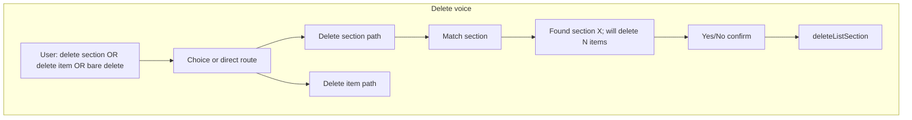

# Checklist voice delete/update parity + section confirm + accordion counts

## Goals (merged)

1. **Delete** should work like **Add**: user is guided with **delete section** vs **delete item** (same idea as add section vs add item), not a single ambiguous “delete then section or item name.”
2. **Delete section**: resolve section (number or name); when matched, **say** you are deleting the **section and all items in it** (include **N** when N > 0), then **voice confirm** before calling the API.
3. **Update** should work the same way: **update section** vs **update item**, then follow the appropriate rename flow (section title via existing `[ListService.updateListSection](c:\dev\kewlkids\mobile\services\listService.ts)`; item flow as today).
4. Keep prior fixes: **empty section** must not error with “no items”; use confirm delete section. **Accordion** shows **item count** beside section title (`[SectionRow](c:\dev\kewlkids\mobile\components\lists\SectionRow.tsx)` already accepts `itemCount` but does not render it).

---

## A. Parsers (`[voiceCommands.ts](c:\dev\kewlkids\mobile\utils\voiceCommands.ts)`)

- Add intents parallel to add:
  - **Bare**: `delete section` / `delete a section` → start **section delete** subflow (then listen for section id/name).
  - **Bare**: `delete item` / `delete items` (and optionally keep plain `**delete`** → **choice** prompt: “Say delete section or delete item,” new phase).
  - **Inline** (optional, like `add section [title]`): `delete section [title fragment]` → narrow or confirm.
- Same pattern for **update**:
  - `update section` (bare) → section subflow; `update item` (bare) → item subflow; optional `**update`** alone → “Say update section or update item.”
  - Existing `update [old] to [new]` remains a shortcut for **item** rename but must be parsed **after** `update section` so it does not steal “update section …” if ever extended.
- **Ordering** in `[[id].tsx](c:\dev\kewlkids\mobile\app\(tabs)`\listsid].tsx): run new **delete section** / **update section** checks **before** generic `parseDeleteItem` / `parseUpdateItem` so `delete section` is never treated as deleting an item named “section.”

---

## B. Delete: section path (`[[id].tsx](c:\dev\kewlkids\mobile\app\(tabs)`\listsid].tsx))

- After user is in **delete section** mode, listen for **section number** or **section name** (reuse `parseVoiceSelectionNumber`, `findMatchingSections`, multi-match disambiguation like today).
- **Single section match**:
  - Compute **N** = item count in that section.
  - TTS: e.g. *“Found section [title]. This will delete the section and all N items. Say yes to delete, or no to cancel.”* (if N = 0, wording can be *“…and all items in it”* or *“empty section”* — still one confirm).
  - Set phase `**delete_confirm_section`** + `checklistDeleteConfirmSectionId` (see section C).
- **Do not** require non-empty section to enter item-pick mode for **section delete**; section delete always confirms deletion of the whole section.

## C. Delete: item path

- `**delete item`** (after choice or direct): mirror `**add_section_or_item**` — e.g. “Say section number or name, or the item name first,” then existing branches (`delete_pick_item`, `findMatchingItems`, strict `findChecklistVoiceDeleteMatches` for `delete [name]` shortcut, modal for ambiguous item deletes, etc.).
- Retire or narrow the old combined phase `**delete_section_or_item**` so it is not the only entry point; keep behavior under the new **item** branch.

## D. `delete_confirm_section` (shared with UI)

- State: `checklistDeleteConfirmSectionId`, phase `delete_confirm_section`.
- Handler: **yes** → same behavior as `[confirmDeleteSection](c:\dev\kewlkids\mobile\app\(tabs)`\listsid].tsx) (optimistic UI + `ListService.deleteListSection` + refresh); **no** / cancel → clear; success TTS + **mic off**.
- Extract a small **shared helper** for “perform section delete” used by **AlertModal** and **voice yes** to avoid drift.
- Clear new state in `clearChecklistVoice`, `handleVoiceClick`, and `useEffect` deps.

## E. Update: section vs item

- `**update section`**: prompt for which section (number/name) → then **new title** (reuse patterns from `section_title` / edit section if needed) → `ListService.updateListSection` with new title (preserve `section_date` unless you also want voice to change date — **out of scope** unless specified).
- `**update item`**: enter existing `**update_section_or_item**` flow (or equivalent) so naming matches add/delete item UX.
- Optional bare `**update**` → speak *“Say update section or update item.”* with a short **choice** phase.

## F. Opening prompt + help

- `[handleVoiceClick](c:\dev\kewlkids\mobile\app\(tabs)`\listsid].tsx) checklist line: change from generic “delete, or update” to e.g. **add an item, add a section, delete section, delete item, update section, update item** (keep concise for TTS).
- **Voice commands** `AlertModal` **details**: add rows for **Delete section**, **Delete item**, **Update section**, **Update item** with example phrases consistent with parsers.

## G. UI: accordion count (`[SectionRow.tsx](c:\dev\kewlkids\mobile\components\lists\SectionRow.tsx)`)

- Destructure `**itemCount*`*, render beside `**section.title**` (e.g.  `(N)` or  `· N`) with secondary styling; title + count in a row with sensible `flex`/`numberOfLines` so long titles ellipsize.

---

## Files to touch

| File                                                                                               | Changes                                                                                           |
| -------------------------------------------------------------------------------------------------- | ------------------------------------------------------------------------------------------------- |
| `[mobile/utils/voiceCommands.ts](c:\dev\kewlkids\mobile\utils\voiceCommands.ts)`                   | New/changed parsers; document phrase patterns in comments                                         |
| `[mobile/app/(tabs)/lists/[id].tsx](c:\dev\kewlkids\mobile\app\(tabs)`\listsid].tsx)               | Delete/update branching, phases, `delete_confirm_section`, shared section delete, mic + help copy |
| `[mobile/components/lists/SectionRow.tsx](c:\dev\kewlkids\mobile\components\lists\SectionRow.tsx)` | Render `itemCount` next to title                                                                  |

---

## Testing (manual)

- **Delete section** on empty section: confirm wording + yes deletes section.
- **Delete section** with N > 0: warning mentions **all N items**, yes deletes section + items gone.
- **Delete item** path: same as before for item-only flows; no accidental “section” item name from `delete section`.
- **Update section**: rename via voice; **Update item**: unchanged behavior aside from entry phrase.
- **Bare delete / bare update** (if implemented): choice prompt then correct branch.
- Accordion shows **(0)** / **(N)**.

