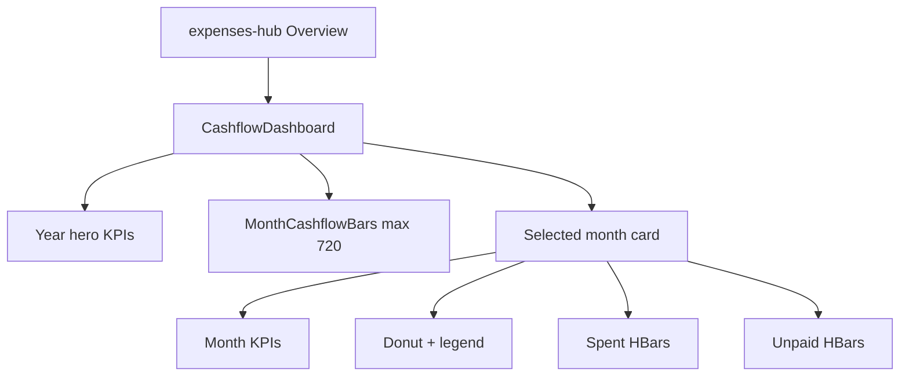

# Wide-screen Expense Tracker Overview

## Problem

Overview is [`CashflowDashboard`](mobile/components/expenses/CashflowDashboard.tsx) (not `ExpenseDashboard`). On wide viewports it is a full-bleed single column: hero KPIs, cards, and category bars stretch edge-to-edge, while [`MonthCashflowBars`](mobile/components/expenses/charts/MonthCashflowBars.tsx) already caps at **720px** and sits left-aligned inside a wider card.

## Approach

Focus on Overview. Use `useWindowDimensions()` with **`width >= 768`** for wide layout (do **not** use [`useIsMobileLayout`](mobile/hooks/useIsMobileLayout.ts) — it always returns mobile on native). Mobile (&lt;768) keeps the current vertical stack.

### 1. Centered content column in `CashflowDashboard`

- Wrap ScrollView content (and align year nav the same way) with:
  - `width: '100%'`
  - `maxWidth: 960`
  - `alignSelf: 'center'`
  - keep existing horizontal padding (~16)
- Result: phone unchanged; tablet/desktop gets a readable centered column instead of stretched cards.

### 2. Wide month-detail layout

When `width >= 768`, split the selected-month card:

| Left column | Right column |
|---|---|
| Month KPIs | Spent by category |
| Donut + legend | Unpaid by category |

Below 768: keep today’s stacked order (KPIs → donut → spent → unpaid).

Implement with a conditional `flexDirection: 'row'` wrapper and `flex: 1` / `minWidth` so columns share space without breaking wrap on mid widths.

### 3. Center the monthly chart in its card

- In the “Monthly cashflow” section card, `alignItems: 'center'` (or center the chart wrapper).
- Bump [`MonthCashflowBars`](mobile/components/expenses/charts/MonthCashflowBars.tsx) cap from `720` → `900` so the chart uses the wider content column instead of looking small inside a 960 shell.

### 4. Light consistency on sibling hub tabs

Apply the same `maxWidth: 960` + `alignSelf: 'center'` content style to [`BudgetDashboard`](mobile/components/expenses/BudgetDashboard.tsx), [`ExpenseDashboard`](mobile/components/expenses/ExpenseDashboard.tsx), and [`BillsDashboard`](mobile/components/expenses/BillsDashboard.tsx) so switching tabs doesn’t jump from constrained Overview to full-bleed stretch. No two-column restructure on those tabs in this pass.

## Files to change

- [`mobile/components/expenses/CashflowDashboard.tsx`](mobile/components/expenses/CashflowDashboard.tsx) — content max-width, year-nav alignment, wide month two-column layout
- [`mobile/components/expenses/charts/MonthCashflowBars.tsx`](mobile/components/expenses/charts/MonthCashflowBars.tsx) — chart max width 900 + ensure parent can center it
- [`mobile/components/expenses/BudgetDashboard.tsx`](mobile/components/expenses/BudgetDashboard.tsx), [`ExpenseDashboard.tsx`](mobile/components/expenses/ExpenseDashboard.tsx), [`BillsDashboard.tsx`](mobile/components/expenses/BillsDashboard.tsx) — same content max-width only

## Out of scope

- Money hub dashboards
- Redesigning Expenses/Budgets/Bills internal layouts beyond the shared content shell
- Changing `useIsMobileLayout` behavior for native tablets
