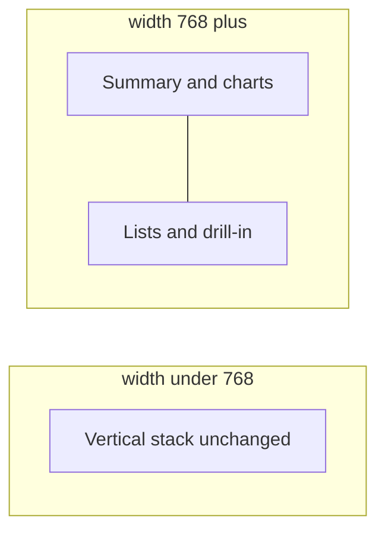

# Wide layouts for Money and Expense Tracker

## What you undid vs what’s still there

- **Still present:** Overview ([`CashflowDashboard.tsx`](mobile/components/expenses/CashflowDashboard.tsx)) — centered 960 shell + selected-month 2-col (KPIs/donut | category bars); cashflow chart max 900.
- **You undid:** Budgets shell + month 2-col (Budget chart still at 900 from that pass).
- **Never done:** Expenses, Bills, Categories, YTD, Income, Accounts, Forecast.

This pass covers **only** Expense Tracker + Money. Mobile (`width < 768`) stays the current vertical stack.

## Approach (not “just center”)

Use `useWindowDimensions()` with **`width >= 768`** (not [`useIsMobileLayout`](mobile/hooks/useIsMobileLayout.ts), which always treats native as mobile and would skip tablets).

Shared helper in [`mobile/hooks/useIsWideLayout.ts`](mobile/hooks/useIsWideLayout.ts):

```ts
export const WIDE_BREAKPOINT = 768;
export function useIsWideLayout(breakpoint = WIDE_BREAKPOINT) {
  const { width } = useWindowDimensions();
  return width >= breakpoint;
}
```

Shared row styles (inline or small style helper): `flexDirection: 'row'`, equal `flex: 1` columns, `gap: 16`, `minWidth: 0`. Content uses full available width with normal horizontal padding (no 960 centering). Overview’s existing `contentShell` maxWidth will be **removed/relaxed** so the new Overview split can use the width.



## Per-screen wide layouts (≥768)

### Expense Tracker — [`expenses-hub.tsx`](mobile/app/(tabs)/expenses-hub.tsx)

| Tab | File | Left | Right |
|-----|------|------|-------|
| Overview | [`CashflowDashboard.tsx`](mobile/components/expenses/CashflowDashboard.tsx) | Year hero + monthly bars | Selected month (KPIs, donut, category bars). Drop 960 shell. |
| Budgets | [`BudgetDashboard.tsx`](mobile/components/expenses/BudgetDashboard.tsx) | Year hero + monthly bars + help | Selected month KPIs/donut + category list |
| Expenses | [`ExpenseDashboard.tsx`](mobile/components/expenses/ExpenseDashboard.tsx) | Period controls + hero + paid/unpaid donut + Add/Scan | Search/filters + expense/category list |
| Bills | [`BillsDashboard.tsx`](mobile/components/expenses/BillsDashboard.tsx) | Hero + active/inactive donut + actions + help | Active + Inactive bill lists |
| Categories | hub `renderCategoriesTab` | Categories list + Add | Tags list + Add |

### Money — [`money.tsx`](mobile/app/(tabs)/money.tsx)

| Tab | File | Left | Right |
|-----|------|------|-------|
| YTD | [`YtdDashboard.tsx`](mobile/components/money/YtdDashboard.tsx) | Year chips + growth hero + invest/cash donut | By-account accordion |
| Income Overview | [`IncomeDashboard.tsx`](mobile/components/money/IncomeDashboard.tsx) | Year nav + hero + stream donut + month bars | Selected-month payments |
| Income Streams | same | Stream list header + streams | Expanded stream’s payments (when open); otherwise list uses full width |
| Accounts Overview | [`AccountsDashboard.tsx`](mobile/components/money/AccountsDashboard.tsx) | Portfolio hero + by-institution donut | Investments vs cash donut |
| Accounts manage | same | Update-balances CTA + portfolio header | Institution-grouped account list |
| Forecast | [`TargetDashboard.tsx`](mobile/components/money/TargetDashboard.tsx) | Intro + rate chips + selected-year hero | By-year cards |

## Implementation rules

- Only wrap/reorder with conditional `isWide ? styles.wideRow : undefined` (and column wrappers). No new card chrome or visual redesign.
- Chart width caps can rise to ~ use parent column width (keep `useWindowDimensions` inside chart components, or pass width) so bars fill the left column instead of looking tiny.
- Hub chrome (title bar, tab chips, show-amounts) unchanged.
- After code changes, rebuild web `dist` so the static server picks it up.

## Out of scope

- Lists, meals, documents, chat, calendar, home
- Soft-load / spinner performance work
- Changing mobile (`<768`) stacking or spacing
